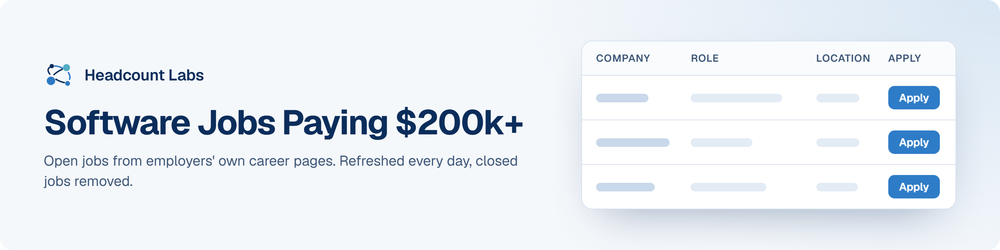

# Software Jobs Paying $200k+

Software and data jobs at US employers that publish a pay range reaching $200,000 a year or more.

**28 open jobs** · 6 new since the last update · 31 removed because they closed or left the employer's board · updated November 25, 2026 at 5:03 AM EST

This list is built and refreshed every day by [Headcount Labs](https://headcountlabs.com/?utm_source=github&utm_medium=job-list&utm_campaign=high-paying-software-jobs), which reads jobs straight from employers' own career pages and job boards. Every job here was still listed on its source board when we last read that board, within the past 3 days, and was posted in the past 30 days. Copies of the same job are merged into one row, and jobs that close are removed at the next update.

Want this data in your own app or agent? Use the [Headcount Labs jobs API](https://headcountlabs.com/docs/?utm_source=github&utm_medium=job-list&utm_campaign=high-paying-software-jobs) (free tier), the [MCP server](https://headcountlabs.com/mcp/?utm_source=github&utm_medium=job-list&utm_campaign=high-paying-software-jobs) for Claude, ChatGPT and other AI assistants, or the [public dataset subsets](https://huggingface.co/HeadcountLabs) on Hugging Face (the full dataset is coming soon).

**Full dataset.** A bigger, one-off snapshot dated 2026-10-19 (all matching jobs, not only the open jobs below) is on Hugging Face: [Tech and software jobs](https://huggingface.co/datasets/HeadcountLabs/tech-jobs) · [Jobs with posted pay](https://huggingface.co/datasets/HeadcountLabs/pay-transparency-jobs). It loads with `datasets.load_dataset` and is under the Open Database License (ODbL) 1.0.

**Jump to:** [Software engineering (19)](#software-engineering) · [Data, AI and machine learning (9)](#data-ai-and-machine-learning)

**Columns.** *Apply* opens the original posting on the employer's site. *Details* opens the job on Headcount Labs, with every posting we found for it. *Remote* shows what the employer states; a dash means the posting doesn't say. *Pay* is the range the employer published.

## Software engineering

| Company | Role | Location | Remote | Pay | Posted | Apply | Details |
| --- | --- | --- | --- | --- | --- | :---: | :---: |
| **Oracle** | Principal Product Manager - Principal Product Manager, Data Services and Developer Frameworks | United States | On-site | $84k–$210k/yr | Nov 20 |  | <a href="https://headcountlabs.com/catalog/jobs/74aa0b7d-38e8-4e96-9ff2-12b560913818?utm_source=github&utm_medium=job-list&utm_campaign=high-paying-software-jobs">via Headcount Labs</a> |
| **Honeywell Aerospace** | Principal Software Engineer | San Jose, CA | On-site | $203k–$254k/yr | Nov 20 |  | <a href="https://headcountlabs.com/catalog/jobs/7a398d01-91fb-43d1-9dee-c4d83bfcbcd9?utm_source=github&utm_medium=job-list&utm_campaign=high-paying-software-jobs">via Headcount Labs</a> |
| **The Java Platform Group** | Principal Platform Software Engineer | Nashville, TN | On-site | $104k–$235k/yr | Nov 19 |  | <a href="https://headcountlabs.com/catalog/jobs/7d717478-a3d2-4d6a-a4a3-ea25da82cb53?utm_source=github&utm_medium=job-list&utm_campaign=high-paying-software-jobs">via Headcount Labs</a> |
| **The Java Platform Group** | Senior Platform Software Engineer | Nashville, TN | On-site | $92k–$210k/yr | Nov 19 |  | <a href="https://headcountlabs.com/catalog/jobs/0e00151b-4fb0-4eef-b5ea-862ca93561f1?utm_source=github&utm_medium=job-list&utm_campaign=high-paying-software-jobs">via Headcount Labs</a> |
| **SAIC** | Senior Principal Software Engineer | 

2 locations
San Diego, CA Colorado Springs, CO
 | Remote | $160k–$200k/yr | Nov 19 |  | <a href="https://headcountlabs.com/catalog/jobs/b369bccd-443e-43b2-b798-be70631ac46c?utm_source=github&utm_medium=job-list&utm_campaign=high-paying-software-jobs">via Headcount Labs</a> |
| **Oracle** | Senior Manager, Application Software Engineering | United States | On-site | $105k–$264k/yr | Nov 19 |  | <a href="https://headcountlabs.com/catalog/jobs/687d6aef-3a55-4354-8270-38af99f4de71?utm_source=github&utm_medium=job-list&utm_campaign=high-paying-software-jobs">via Headcount Labs</a> |
| **TAD PGS, Inc.** | MuleSoft Integration Developer | Washington, DC | — | $50–$100/hr | Nov 18 |  | <a href="https://headcountlabs.com/catalog/jobs/c7ab413d-a749-4dcc-95bf-f95e4c90b4d5?utm_source=github&utm_medium=job-list&utm_campaign=high-paying-software-jobs">via Headcount Labs</a> |
| **Oracle** | Senior Principal Application Software Engineer | United States | On-site | $114k–$235k/yr | Nov 18 |  | <a href="https://headcountlabs.com/catalog/jobs/a3bf953e-cf36-4e06-8768-fd1806d83a3d?utm_source=github&utm_medium=job-list&utm_campaign=high-paying-software-jobs">via Headcount Labs</a> |
| **Oracle** | Senior Manager, Platform Software Engineering | 

2 locations
United States Nashville, TN
 | On-site | $132k–$306k/yr | Nov 18 |  | <a href="https://headcountlabs.com/catalog/jobs/5c7d7db3-2abe-49cb-91d1-6754427111e7?utm_source=github&utm_medium=job-list&utm_campaign=high-paying-software-jobs">via Headcount Labs</a> |
| **Oracle** | Senior Platform Software Engineer | 

2 locations
United States Nashville, TN
 | On-site | $88k–$210k/yr | Nov 18 |  | <a href="https://headcountlabs.com/catalog/jobs/4b70cbbc-8f20-413f-a3ff-4aa2b00dd36c?utm_source=github&utm_medium=job-list&utm_campaign=high-paying-software-jobs">via Headcount Labs</a> |
| **Akima** | Senior Applications Developer (Active Top Secret with SCI Eligibility) | Alexandria, VA | On-site | $200k–$205k/yr | Nov 16 |  | <a href="https://headcountlabs.com/catalog/jobs/dce3bf3b-ab57-4987-86db-9e3ed6221411?utm_source=github&utm_medium=job-list&utm_campaign=high-paying-software-jobs">via Headcount Labs</a> |
| **Oracle** | Principal Network Developer - Network Reliability | 

5 locations
Seattle, WA Nashville, TN Redwood City, CA Santa Clara, CA Reston, VA
 | On-site | $102k–$210k/yr | Nov 10 |  | <a href="https://headcountlabs.com/catalog/jobs/573d8432-710a-4ea5-bb9d-6cdec9642385?utm_source=github&utm_medium=job-list&utm_campaign=high-paying-software-jobs">via Headcount Labs</a> |
| **SAIC** | Ground Systems Software Integration Engineer | Redondo Beach, CA | — | $160k–$200k/yr | Nov 6 |  | <a href="https://headcountlabs.com/catalog/jobs/bfbd1282-8d5b-48ed-998f-cdec122f2898?utm_source=github&utm_medium=job-list&utm_campaign=high-paying-software-jobs">via Headcount Labs</a> |
| **SAIC** | Digital Engineer Software | San Diego, CA | — | $160k–$200k/yr | Nov 4 |  | <a href="https://headcountlabs.com/catalog/jobs/b52e9b79-3b10-469c-8d6e-97c59df1b04f?utm_source=github&utm_medium=job-list&utm_campaign=high-paying-software-jobs">via Headcount Labs</a> |
| **Varen** | Software Engineer | Suitland, MD | — | $160k–$200k/yr | Nov 3 |  | <a href="https://headcountlabs.com/catalog/jobs/8c30a106-e615-4c15-b0a4-ca76c413e048?utm_source=github&utm_medium=job-list&utm_campaign=high-paying-software-jobs">via Headcount Labs</a> |
| **loanDepot** | Principal Software Engineer (C#/SQL/Azure) | 

2 locations
Irvine, CA Plano, TX
 | — | $141k–$233k/yr | Nov 3 |  | <a href="https://headcountlabs.com/catalog/jobs/d79d5e02-1be2-4d41-ad86-661aefd7347f?utm_source=github&utm_medium=job-list&utm_campaign=high-paying-software-jobs">via Headcount Labs</a> |
| **SAIC** | Space Protection Software Test Engineer | Chantilly, VA | — | $160k–$200k/yr | Oct 29 |  | <a href="https://headcountlabs.com/catalog/jobs/8b5c8d1a-ce7d-43e2-96f4-7d9b112cc526?utm_source=github&utm_medium=job-list&utm_campaign=high-paying-software-jobs">via Headcount Labs</a> |
| **loanDepot** | Principal Software Architect (C#/SQL/Azure Services) | 

2 locations
Irvine, CA Plano, TX
 | — | $182k–$251k/yr | Oct 28 |  | <a href="https://headcountlabs.com/catalog/jobs/e818d885-0e9a-47b2-a457-ddbd7b23207e?utm_source=github&utm_medium=job-list&utm_campaign=high-paying-software-jobs">via Headcount Labs</a> |
| **Chase** | Golang / IaC Senior Lead Software Engineer | Jersey City, NJ | On-site | $176k–$260k/yr | Oct 28 |  | <a href="https://headcountlabs.com/catalog/jobs/ab8963d8-03a8-4245-b4de-76dc6719a0cf?utm_source=github&utm_medium=job-list&utm_campaign=high-paying-software-jobs">via Headcount Labs</a> |

## Data, AI and machine learning

| Company | Role | Location | Remote | Pay | Posted | Apply | Details |
| --- | --- | --- | --- | --- | --- | :---: | :---: |
| **Oracle** | Principal Condition Monitoring Engineer – Power Generation - Data Center Infrastructure (on-site Nashville, TN) | Nashville, TN | On-site | $85k–$210k/yr | Nov 20 |  | <a href="https://headcountlabs.com/catalog/jobs/870e38e5-a8d8-4920-a6dc-ea4816b2af45?utm_source=github&utm_medium=job-list&utm_campaign=high-paying-software-jobs">via Headcount Labs</a> |
| **Oracle** | Senior Data Scientist - Demand Planning and Forecasting | Seattle, WA | On-site | $102k–$210k/yr | Nov 20 |  | <a href="https://headcountlabs.com/catalog/jobs/5cad5861-95de-4f62-8c38-6f08c82cea5f?utm_source=github&utm_medium=job-list&utm_campaign=high-paying-software-jobs">via Headcount Labs</a> |
| **Charles River Laboratories** | Director CSV and Data Integrity | Wayne, PA | — | $180k–$220k/yr | Nov 19 |  | <a href="https://headcountlabs.com/catalog/jobs/706fe34f-34c8-4415-bb41-667d9c35e3fe?utm_source=github&utm_medium=job-list&utm_campaign=high-paying-software-jobs">via Headcount Labs</a> |
| **loanDepot** | Manager, Data Engineering | Irvine, CA | — | $149k–$204k/yr | Nov 17 |  | <a href="https://headcountlabs.com/catalog/jobs/9b57fd8e-7598-4d54-9325-df52d8e29323?utm_source=github&utm_medium=job-list&utm_campaign=high-paying-software-jobs">via Headcount Labs</a> |
| **S&amp;P Global** | Head of AI &amp; Data Sales | 

3 locations
New York, NY London Houston, TX
 | — | $150k–$276k/yr | Nov 16 |  | <a href="https://headcountlabs.com/catalog/jobs/28f6d7c5-b506-4bc2-8617-3104d8de1cff?utm_source=github&utm_medium=job-list&utm_campaign=high-paying-software-jobs">via Headcount Labs</a> |
| **BMO Financial Group** | MD, Data and AI - Longview | Irving, TX | — | $160k–$300k/yr | Nov 14 |  | <a href="https://headcountlabs.com/catalog/jobs/aab048d9-826b-402a-86e8-6bbbb594b60d?utm_source=github&utm_medium=job-list&utm_campaign=high-paying-software-jobs">via Headcount Labs</a> |
| **CGI Technologies and Solutions, Inc.** | Senior Databricks Data Engineer | Miami, FL | Hybrid | $92k–$204k/yr | Nov 3 |  | <a href="https://headcountlabs.com/catalog/jobs/82698a25-3627-4e57-ae5a-e46413bc6211?utm_source=github&utm_medium=job-list&utm_campaign=high-paying-software-jobs">via Headcount Labs</a> |
| **Celestica** | Director, Data Center Solutions Architect | Employee US, CA | Remote | $165k–$228k/yr | Oct 31 |  | <a href="https://headcountlabs.com/catalog/jobs/1c5f4249-9b69-4032-9158-e39a90c2ef32?utm_source=github&utm_medium=job-list&utm_campaign=high-paying-software-jobs">via Headcount Labs</a> |
| **S&amp;P Global** | Head of Multi-Asset &amp; Wealth Data | New York, NY | — | $150k–$226k/yr | Oct 27 |  | <a href="https://headcountlabs.com/catalog/jobs/db6226b1-f20f-43e7-8567-5aca8bc26cad?utm_source=github&utm_medium=job-list&utm_campaign=high-paying-software-jobs">via Headcount Labs</a> |

## Related data on Headcount Labs

- [Software engineer salary data from posted pay](https://headcountlabs.com/salary-data/software-engineer/)
- [Posted pay across US jobs](https://headcountlabs.com/reports/us-job-market/#pay)
- [US job market report: open jobs by state, top employers, pay and remote share](https://headcountlabs.com/reports/us-job-market/)

## More lists from Headcount Labs

[Software Engineering Internships](https://github.com/HeadcountLabs/software-engineering-internships) · [Data Science, AI and Machine Learning Internships](https://github.com/HeadcountLabs/data-science-ai-internships) · [Engineering Internships](https://github.com/HeadcountLabs/engineering-internships) · [Business, Finance and Marketing Internships](https://github.com/HeadcountLabs/business-finance-internships) · [Internships in the US](https://github.com/HeadcountLabs/internships) · [New Grad Software Engineer Jobs](https://github.com/HeadcountLabs/new-grad-software-engineer-jobs) · [Entry-Level and New Grad Jobs](https://github.com/HeadcountLabs/entry-level-jobs) · [Entry-Level Data Analyst Jobs](https://github.com/HeadcountLabs/entry-level-data-analyst-jobs) · [Remote Software Engineer Jobs](https://github.com/HeadcountLabs/remote-software-engineer-jobs) · [Remote Data, AI and Machine Learning Jobs](https://github.com/HeadcountLabs/remote-data-jobs) · [Remote Product Manager Jobs](https://github.com/HeadcountLabs/remote-product-manager-jobs) · [Remote Marketing Jobs](https://github.com/HeadcountLabs/remote-marketing-jobs) · [Remote Sales Jobs](https://github.com/HeadcountLabs/remote-sales-jobs) · [Remote Customer Support and Success Jobs](https://github.com/HeadcountLabs/remote-customer-support-jobs) · [Remote Healthcare Jobs](https://github.com/HeadcountLabs/remote-healthcare-jobs) · [Remote Finance and Accounting Jobs](https://github.com/HeadcountLabs/remote-finance-accounting-jobs) · [Remote Jobs in the US](https://github.com/HeadcountLabs/remote-jobs) · [AI and Machine Learning Engineer Jobs](https://github.com/HeadcountLabs/ai-ml-engineer-jobs) · [Data Engineer Jobs](https://github.com/HeadcountLabs/data-engineer-jobs) · [Cybersecurity Jobs](https://github.com/HeadcountLabs/cybersecurity-jobs) · [Product Manager Jobs](https://github.com/HeadcountLabs/product-manager-jobs) · [Registered Nurse Jobs](https://github.com/HeadcountLabs/registered-nurse-jobs) · [Tech and Software Jobs in the US](https://github.com/HeadcountLabs/tech-jobs) · [Jobs with Salary Listed in the US](https://github.com/HeadcountLabs/pay-transparency-jobs) · [San Francisco Bay Area Tech Jobs](https://github.com/HeadcountLabs/bay-area-tech-jobs) · [New York City Tech Jobs](https://github.com/HeadcountLabs/new-york-tech-jobs) · [Seattle Tech Jobs](https://github.com/HeadcountLabs/seattle-tech-jobs) · [Austin Tech Jobs](https://github.com/HeadcountLabs/austin-tech-jobs) · [Boston Tech Jobs](https://github.com/HeadcountLabs/boston-tech-jobs) · [Los Angeles Tech Jobs](https://github.com/HeadcountLabs/los-angeles-tech-jobs) · [Washington, DC Tech Jobs](https://github.com/HeadcountLabs/washington-dc-tech-jobs)

## Contributing

This README is generated, so edits to it are overwritten at the next update. If a job is closed, a link is broken or a detail is wrong, [open an issue](../../issues/new) with the link and we'll fix it in the data, which fixes it everywhere. Requests for new lists are welcome too.

## License

The list data is under the [Open Database License (ODbL) 1.0](LICENSE). Our own values in it are under the [Database Contents License (DbCL) 1.0](https://opendatacommons.org/licenses/dbcl/1-0/). Credit "Headcount Labs (https://headcountlabs.com)" when you reuse it. Job description text is the employer's own text and is not licensed by us. Takedown requests: [https://headcountlabs.com/remove/](https://headcountlabs.com/remove/). Location data includes data from OpenStreetMap contributors (ODbL) and Overture Maps. The same rows are in [`data/jobs.csv`](data/jobs.csv).

Generated by Headcount Labs from the jobs API on November 25, 2026 at 5:03 AM EST. At most 8 jobs per employer are shown in each list.
