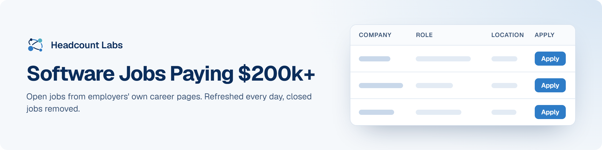

# Software Jobs Paying $200k+

Software and data jobs at US employers that publish a pay range reaching $200,000 a year or more.

**210 open jobs** · 203 new since the last update · 156 removed because they closed or left the employer's board · updated October 20, 2026 at 5:58 AM EDT

This list is built and refreshed every day by [Headcount Labs](https://headcountlabs.com/?utm_source=github&utm_medium=job-list&utm_campaign=high-paying-software-jobs), which reads jobs straight from employers' own career pages and job boards. Every job here was still listed on its source board when we last read that board, within the past 3 days, and was posted in the past 30 days. Copies of the same job are merged into one row, and jobs that close are removed at the next update.

Want this data in your own app or agent? Use the [Headcount Labs jobs API](https://headcountlabs.com/docs/?utm_source=github&utm_medium=job-list&utm_campaign=high-paying-software-jobs) (free tier), the [MCP server](https://headcountlabs.com/mcp/?utm_source=github&utm_medium=job-list&utm_campaign=high-paying-software-jobs) for Claude, ChatGPT and other AI assistants, or the [open dataset](https://huggingface.co/datasets/HeadcountLabs/job-postings) on Hugging Face ([example queries](https://github.com/HeadcountLabs/job-postings)).

**Full dataset.** A bigger, one-off snapshot dated 2026-10-19 (all matching jobs, not only the open jobs below) is on Hugging Face: [Tech and software jobs](https://huggingface.co/datasets/HeadcountLabs/tech-jobs) · [Jobs with posted pay](https://huggingface.co/datasets/HeadcountLabs/pay-transparency-jobs). It loads with `datasets.load_dataset` and is licensed CC BY 4.0.

**Jump to:** [Software engineering (126)](#software-engineering) · [Data, AI and machine learning (84)](#data-ai-and-machine-learning)

**Columns.** *Apply* opens the original posting on the employer's site. *Details* opens the job on Headcount Labs, with every posting we found for it. *Remote* shows what the employer states; a dash means the posting doesn't say. *Pay* is the range the employer published.

## Software engineering

| Company | Role | Location | Remote | Pay | Posted | Apply | Details |
| --- | --- | --- | --- | --- | --- | :---: | :---: |
| **Palo Alto Networks** | Sr. Staff Software Engineer | Santa Clara, CA | — | $154k–$249k/yr | Oct 20 |  | <a href="https://headcountlabs.com/catalog/jobs/1fa5e413-fd19-40cd-89d6-866b35abe6f8?utm_source=github&utm_medium=job-list&utm_campaign=high-paying-software-jobs">via Headcount Labs</a> |
| **Viasat, Inc.** | Senior Embedded Software Engineer (Space) | Tempe, AZ | On-site | $165k–$260k/yr | Oct 19 |  | <a href="https://headcountlabs.com/catalog/jobs/f3ec2693-576c-4552-a239-565b147bca9e?utm_source=github&utm_medium=job-list&utm_campaign=high-paying-software-jobs">via Headcount Labs</a> |
| **Applied Intuition** | Full-Stack Software Engineer, People Intelligence | Sunnyvale, CA | On-site | $138k–$208k/yr | Oct 17 |  | <a href="https://headcountlabs.com/catalog/jobs/a04f4815-1a9a-4884-ac21-5453283243e9?utm_source=github&utm_medium=job-list&utm_campaign=high-paying-software-jobs">via Headcount Labs</a> |
| **Panasonic** | MTS V, Software - Security | Beaverton, OR | — | $142k–$238k/yr | Oct 16 |  | <a href="https://headcountlabs.com/catalog/jobs/2ed9b527-ab4d-4676-a5c0-a5f92269547d?utm_source=github&utm_medium=job-list&utm_campaign=high-paying-software-jobs">via Headcount Labs</a> |
| **LlamaIndex** | Developer Evangelist, Technical Content | San Francisco, CA | Hybrid | $130k–$250k/yr | Oct 16 |  | <a href="https://headcountlabs.com/catalog/jobs/d2f1b9e6-30f1-4529-82e3-4f0381bdde94?utm_source=github&utm_medium=job-list&utm_campaign=high-paying-software-jobs">via Headcount Labs</a> |
| **H&amp;R Block** | Principal Software Engineer-Native Mobile Development | Missouri | Remote | $132k–$225k/yr | Oct 16 |  | <a href="https://headcountlabs.com/catalog/jobs/54f31160-c5ac-459d-bd1e-e57ca20598da?utm_source=github&utm_medium=job-list&utm_campaign=high-paying-software-jobs">via Headcount Labs</a> |
| **Docusign** | Lead Software Engineer - Data Protection | Seattle, WA | — | $179k–$263k/yr | Oct 16 |  | <a href="https://headcountlabs.com/catalog/jobs/739a7438-8fd9-4412-80ab-c801ee491467?utm_source=github&utm_medium=job-list&utm_campaign=high-paying-software-jobs">via Headcount Labs</a> |
| **Decagon** | Senior Software Engineer, Product | San Francisco, CA | — | $200k–$400k/yr | Oct 16 |  | <a href="https://headcountlabs.com/catalog/jobs/d40a8560-df66-4805-a810-1c18c2315116?utm_source=github&utm_medium=job-list&utm_campaign=high-paying-software-jobs">via Headcount Labs</a> |
| **Decagon** | Staff Software Engineer, Product | San Francisco, CA | — | $200k–$400k/yr | Oct 16 |  | <a href="https://headcountlabs.com/catalog/jobs/4d4418b2-3957-4927-8534-cc0381e04fb2?utm_source=github&utm_medium=job-list&utm_campaign=high-paying-software-jobs">via Headcount Labs</a> |
| **Capital One** | Staff Software Engineer - Card Technology | 

2 locations
McLean, VA Chicago, IL
 | — | $245k–$279k/yr | Oct 16 |  | <a href="https://headcountlabs.com/catalog/jobs/64f84a9f-5d3b-42e8-8d95-c2e7992d0791?utm_source=github&utm_medium=job-list&utm_campaign=high-paying-software-jobs">via Headcount Labs</a> |
| **Capital One** | Senior Director, Product Management - Developer Telemetry | 

6 locations
McLean, VA Chicago, IL New York, NY Plano, TX Richmond, VA San Francisco, CA
 | — | $245k–$280k/yr | Oct 16 |  | <a href="https://headcountlabs.com/catalog/jobs/5e36f8c4-4b54-473f-aea9-15fa9d9b4a13?utm_source=github&utm_medium=job-list&utm_campaign=high-paying-software-jobs">via Headcount Labs</a> |
| **Anthropic** | Staff+ Software Engineer, Enterprise (Full Stack) | San Francisco, CA &#124; New York City, NY | — | $405k–$485k/yr | Oct 16 |  | <a href="https://headcountlabs.com/catalog/jobs/31b85347-eea4-471f-9295-ab90e02515b4?utm_source=github&utm_medium=job-list&utm_campaign=high-paying-software-jobs">via Headcount Labs</a> |
| **Yoh** | Software Engineer - ADAS Platform, Sensor Pipeline &amp; AI Inference Optimization | Newark, CA | — | $110–$140/hr | Oct 15 |  | <a href="https://headcountlabs.com/catalog/jobs/7599e0ae-d87e-49e0-9f91-0a261af12836?utm_source=github&utm_medium=job-list&utm_campaign=high-paying-software-jobs">via Headcount Labs</a> |
| **SpaceX** | Lead Software Engineer, Components Test (Starshield) | Hawthorne, CA | — | $165k–$265k/yr | Oct 15 |  | <a href="https://headcountlabs.com/catalog/jobs/dbda3bf0-a505-4571-ad48-90792050acc6?utm_source=github&utm_medium=job-list&utm_campaign=high-paying-software-jobs">via Headcount Labs</a> |
| **SpaceX** | Global Supply Manager, Software | Hawthorne, CA | — | $135k–$200k/yr | Oct 15 |  | <a href="https://headcountlabs.com/catalog/jobs/5f7cfecb-b51a-4ec0-a9d8-0dac9a234512?utm_source=github&utm_medium=job-list&utm_campaign=high-paying-software-jobs">via Headcount Labs</a> |
| **Palo Alto Networks** | Principal Software Engineer (SaaS Agent Security) | 

2 locations
Santa Clara, CA United States
 | On-site | $156k–$253k/yr | Oct 15 |  | <a href="https://headcountlabs.com/catalog/jobs/c01bd982-a4d7-4b67-8634-c17913be5037?utm_source=github&utm_medium=job-list&utm_campaign=high-paying-software-jobs">via Headcount Labs</a> |
| **Palo Alto Networks** | Principal Software Engineer (Cloud Platform and AI Engineering) | 

2 locations
Santa Clara Santa Clara, CA
 | On-site | $156k–$253k/yr | Oct 15 |  | <a href="https://headcountlabs.com/catalog/jobs/859a0632-c408-4721-982b-68f4ba186fdf?utm_source=github&utm_medium=job-list&utm_campaign=high-paying-software-jobs">via Headcount Labs</a> |
| **Palo Alto Networks** | Distinguished Engineer Software (Cortex Platform) | 

2 locations
United States Santa Clara, CA
 | On-site | $249k–$341k/yr | Oct 15 |  | <a href="https://headcountlabs.com/catalog/jobs/03baf405-754b-4487-b1c3-2ed90505170b?utm_source=github&utm_medium=job-list&utm_campaign=high-paying-software-jobs">via Headcount Labs</a> |
| **Mayo Clinic** | Senior Data Engineer - API Platform Engineer - CDH | Rochester, MN | Remote | $141k–$205k/yr | Oct 15 |  | <a href="https://headcountlabs.com/catalog/jobs/afd56201-4f17-4400-b865-8caa6fb0d6f2?utm_source=github&utm_medium=job-list&utm_campaign=high-paying-software-jobs">via Headcount Labs</a> |
| **Capital One** | Director, Data Science - Consumer and Developer Experience (Remote-Eligible) | 

6 locations
McLean, VA Chicago, IL New York, NY Richmond, VA Riverwoods, IL San Francisco, CA
 | Remote | $245k–$279k/yr | Oct 15 |  | <a href="https://headcountlabs.com/catalog/jobs/644affc1-d80b-434a-85ce-ec6f3571f631?utm_source=github&utm_medium=job-list&utm_campaign=high-paying-software-jobs">via Headcount Labs</a> |
| **Viasat, Inc.** | Senior Software Engineer - Embedded Network | 

5 locations
Carlsbad, CA Linthicum Heights, MD Tampa, FL Marlborough, MA Tempe, AZ
 | — | $165k–$260k/yr | Oct 14 |  | <a href="https://headcountlabs.com/catalog/jobs/1d58680c-a91c-445c-b84d-1fdc57ff5b7c?utm_source=github&utm_medium=job-list&utm_campaign=high-paying-software-jobs">via Headcount Labs</a> |
| **UnitedHealth Group** | Senior Director Software Engineering | Eden Prairie, MN | Remote | $159k–$273k/yr | Oct 14 |  | <a href="https://headcountlabs.com/catalog/jobs/346c69cc-0d3d-4e45-913b-9e3c54736670?utm_source=github&utm_medium=job-list&utm_campaign=high-paying-software-jobs">via Headcount Labs</a> |
| **SpaceX** | Sr. Software Engineer, Network Observability (Starlink) | Hawthorne, CA | — | $165k–$265k/yr | Oct 14 |  | <a href="https://headcountlabs.com/catalog/jobs/7c44069f-2ec7-44c7-8935-5bd7d6d10cdb?utm_source=github&utm_medium=job-list&utm_campaign=high-paying-software-jobs">via Headcount Labs</a> |
| **Palo Alto Networks** | Principal Engineer Software - Front End (Prisma AIRS) | Santa Clara, CA | On-site | $156k–$253k/yr | Oct 14 |  | <a href="https://headcountlabs.com/catalog/jobs/efb560f5-75a4-4b11-922f-1748cb4abf46?utm_source=github&utm_medium=job-list&utm_campaign=high-paying-software-jobs">via Headcount Labs</a> |
| **Anthropic** | Staff+ Software Engineer, Platform Acceleration | San Francisco, CA &#124; New York City, NY &#124; Seattle, WA | — | $405k–$485k/yr | Oct 14 |  | <a href="https://headcountlabs.com/catalog/jobs/4fc71015-08c6-43fd-92a3-7b0b9ddbc590?utm_source=github&utm_medium=job-list&utm_campaign=high-paying-software-jobs">via Headcount Labs</a> |
| **Anthropic** | Developer Relations Manager, Claude Platform | San Francisco, CA &#124; New York City, NY | — | $290k–$435k/yr | Oct 14 |  | <a href="https://headcountlabs.com/catalog/jobs/9188ac0c-352b-4304-b89b-79f406c6601e?utm_source=github&utm_medium=job-list&utm_campaign=high-paying-software-jobs">via Headcount Labs</a> |
| **Teradyne** | Software Engineer (Integrated System Test, North Reading) | North Reading, MA | — | $133k–$213k/yr | Oct 13 |  | <a href="https://headcountlabs.com/catalog/jobs/72400820-2c10-4888-a33f-a686335c0cfb?utm_source=github&utm_medium=job-list&utm_campaign=high-paying-software-jobs">via Headcount Labs</a> |
| **Teradyne** | Senior Software Engineer (Integrated System Test, North Reading) | North Reading, MA | — | $162k–$259k/yr | Oct 13 |  | <a href="https://headcountlabs.com/catalog/jobs/2b986aad-4446-4c55-b08a-082fe154b54f?utm_source=github&utm_medium=job-list&utm_campaign=high-paying-software-jobs">via Headcount Labs</a> |
| **SpaceX** | Principal Operations Engineer (Application Software) | Hawthorne, CA | — | $180k–$275k/yr | Oct 13 |  | <a href="https://headcountlabs.com/catalog/jobs/b8ca6eaf-55ee-403f-b998-984657705551?utm_source=github&utm_medium=job-list&utm_campaign=high-paying-software-jobs">via Headcount Labs</a> |
| **SpaceX** | Manager, Software Engineering, Finance (Application Software) | Hawthorne, CA | — | $195k–$290k/yr | Oct 13 |  | <a href="https://headcountlabs.com/catalog/jobs/ea9d102b-54e4-46b4-954f-5916126cd7ed?utm_source=github&utm_medium=job-list&utm_campaign=high-paying-software-jobs">via Headcount Labs</a> |
| **SpaceX** | Manager, Software Engineering, People (Application Software) | Hawthorne, CA | — | $195k–$290k/yr | Oct 13 |  | <a href="https://headcountlabs.com/catalog/jobs/d2e15fa3-cd23-4e5d-800f-9b4936e38acd?utm_source=github&utm_medium=job-list&utm_campaign=high-paying-software-jobs">via Headcount Labs</a> |
| **Providence** | Executive Director Software Engineering | Renton, WA | On-site | $85.56–$152.95/hr | Oct 13 |  | <a href="https://headcountlabs.com/catalog/jobs/09488b93-93fb-4df9-9cb3-e568e76aa987?utm_source=github&utm_medium=job-list&utm_campaign=high-paying-software-jobs">via Headcount Labs</a> |
| **Palo Alto Networks** | Senior Staff Software Engineer (L7 Security) | Santa Clara, CA | — | $150k–$250k/yr | Oct 13 |  | <a href="https://headcountlabs.com/catalog/jobs/9f63d933-a808-4a98-8060-501fef522d04?utm_source=github&utm_medium=job-list&utm_campaign=high-paying-software-jobs">via Headcount Labs</a> |
| **Palo Alto Networks** | Sr Manager, IT Software Engineering | 

2 locations
United States Santa Clara, CA
 | On-site | $192k–$310k/yr | Oct 13 |  | <a href="https://headcountlabs.com/catalog/jobs/700cfbdf-cf12-40f9-915a-be67491cead7?utm_source=github&utm_medium=job-list&utm_campaign=high-paying-software-jobs">via Headcount Labs</a> |
| **Databricks** | Sr. Staff Security Software Engineer - Agentic Security Engineering | California | Remote | $229k–$314k/yr | Oct 13 |  | <a href="https://headcountlabs.com/catalog/jobs/8d83d18e-f7ee-45d6-bfde-4ccc44d461c4?utm_source=github&utm_medium=job-list&utm_campaign=high-paying-software-jobs">via Headcount Labs</a> |
| **Booz Allen Hamilton_United States** | Full Stack Developer, Senior | Fort Meade, MD | — | $113k–$257k/yr | Oct 13 |  | <a href="https://headcountlabs.com/catalog/jobs/86d616e8-a9ef-4404-9550-c66e411437c6?utm_source=github&utm_medium=job-list&utm_campaign=high-paying-software-jobs">via Headcount Labs</a> |
| **Supermicro** | Sr. Software Engineer | San Jose, CA | — | $160k–$200k/yr | Oct 12 |  | <a href="https://headcountlabs.com/catalog/jobs/06ea3300-4810-4c0d-a2c9-de31fb85137a?utm_source=github&utm_medium=job-list&utm_campaign=high-paying-software-jobs">via Headcount Labs</a> |
| **Viasat, Inc.** | Embedded Software Engineer, Viasat Government | 

4 locations
Carlsbad, CA Tampa, FL Linthicum Heights, MD Tempe, AZ
 | On-site | $140k–$222k/yr | Oct 9 |  | <a href="https://headcountlabs.com/catalog/jobs/84a5d285-b25a-4c02-95e4-c01796b155bc?utm_source=github&utm_medium=job-list&utm_campaign=high-paying-software-jobs">via Headcount Labs</a> |
| **SpaceX** | Sr. Software Engineer (AI Data Engineering) | Hawthorne, CA | — | $165k–$265k/yr | Oct 9 |  | <a href="https://headcountlabs.com/catalog/jobs/84df84b7-542c-4302-a642-bdbde2ffdab7?utm_source=github&utm_medium=job-list&utm_campaign=high-paying-software-jobs">via Headcount Labs</a> |
| **Peraton** | Cloud Software Engineer Top Secret/SCI w/Poly | Annapolis Junction, MD | — | $135k–$216k/yr | Oct 8 |  | <a href="https://headcountlabs.com/catalog/jobs/27630dcd-e1c0-4e05-94ca-f7175f7a79f7?utm_source=github&utm_medium=job-list&utm_campaign=high-paying-software-jobs">via Headcount Labs</a> |
| **Booz Allen Hamilton_United States** | Multi-Cloud Developer, Senior | 

2 locations
Charlottesville, VA Alexandria, VA
 | — | $113k–$257k/yr | Oct 8 |  | <a href="https://headcountlabs.com/catalog/jobs/4cc8333a-067b-422a-8487-324e7b9404c4?utm_source=github&utm_medium=job-list&utm_campaign=high-paying-software-jobs">via Headcount Labs</a> |
| **AnaVation** | Senior Cloud Developer | Washington, DC | On-site | $93k–$218k/yr | Oct 8 |  | <a href="https://headcountlabs.com/catalog/jobs/6c429177-f057-488c-b820-2efa353a0930?utm_source=github&utm_medium=job-list&utm_campaign=high-paying-software-jobs">via Headcount Labs</a> |
| **Starbucks Corporation** | Application Developer Sr | Tennessee | — | $155k–$203k/yr | Oct 7 |  | <a href="https://headcountlabs.com/catalog/jobs/ac0bc8d8-487f-40c2-9b7f-3304661c4179?utm_source=github&utm_medium=job-list&utm_campaign=high-paying-software-jobs">via Headcount Labs</a> |
| **Peraton** | Software Engineering, Senior Advisor | United States | Remote | $135k–$216k/yr | Oct 7 |  | <a href="https://headcountlabs.com/catalog/jobs/9a487119-6517-4eeb-930b-867fea1996e4?utm_source=github&utm_medium=job-list&utm_campaign=high-paying-software-jobs">via Headcount Labs</a> |
| **Hermeus** | Flight Software Engineer – Command &amp; Control | Atlanta, GA | On-site | $130k–$205k/yr | Oct 7 |  | <a href="https://headcountlabs.com/catalog/jobs/3ca02df9-edcd-459b-b049-a7c51bc7bc7d?utm_source=github&utm_medium=job-list&utm_campaign=high-paying-software-jobs">via Headcount Labs</a> |
| **Commonware** | Lead Software Engineer | United States | Remote | $250k/yr | Oct 7 |  | <a href="https://headcountlabs.com/catalog/jobs/07a20646-0359-40fd-b9e1-26b0a480dc73?utm_source=github&utm_medium=job-list&utm_campaign=high-paying-software-jobs">via Headcount Labs</a> |
| **Array Labs** | Senior Software Engineer - Cloud Infrastructure | Redwood City, CA | On-site | $150k–$250k/yr | Oct 7 |  | <a href="https://headcountlabs.com/catalog/jobs/cadb0355-548b-4725-9056-fe55b1d0c3d7?utm_source=github&utm_medium=job-list&utm_campaign=high-paying-software-jobs">via Headcount Labs</a> |
| **Applied Intuition** | Software Integration Engineer, Vehicle OS | Sunnyvale, CA | On-site | $180k–$250k/yr | Oct 7 |  | <a href="https://headcountlabs.com/catalog/jobs/936e819e-a76f-4ceb-bec0-feb1a69042e8?utm_source=github&utm_medium=job-list&utm_campaign=high-paying-software-jobs">via Headcount Labs</a> |
| **vCluster Labs** | Staff Software Engineer | United States | Remote | $180k–$220k/yr | Oct 6 |  | <a href="https://headcountlabs.com/catalog/jobs/65050bd8-bb86-4d54-8521-de96228c7c50?utm_source=github&utm_medium=job-list&utm_campaign=high-paying-software-jobs">via Headcount Labs</a> |
| **Peraton** | Software Engineering Manager - SATCOM | Seal Beach, CA | — | $146k–$234k/yr | Oct 6 |  | <a href="https://headcountlabs.com/catalog/jobs/7fe0f0b5-d212-43d5-8343-009144d89799?utm_source=github&utm_medium=job-list&utm_campaign=high-paying-software-jobs">via Headcount Labs</a> |
| **AstraZeneca** | Software Engineering Director - eCOA - Evinova | Gaithersburg, MD | Hybrid | $166k–$225k/yr | Oct 6 |  | <a href="https://headcountlabs.com/catalog/jobs/3c0b76f0-96e9-436a-a077-ac6b09dba7c6?utm_source=github&utm_medium=job-list&utm_campaign=high-paying-software-jobs">via Headcount Labs</a> |
| **Applied Intuition** | Senior Software Engineer - Neural Simulation | Sunnyvale, CA | On-site | $185k–$250k/yr | Oct 6 |  | <a href="https://headcountlabs.com/catalog/jobs/8f04abfc-07c4-42d1-9b3d-a75ea819cfb4?utm_source=github&utm_medium=job-list&utm_campaign=high-paying-software-jobs">via Headcount Labs</a> |
| **Teradyne** | Training Developer (Teradyne, N. Reading MA) | North Reading, MA | — | $127k–$203k/yr | Oct 5 |  | <a href="https://headcountlabs.com/catalog/jobs/8e2db63e-bfbc-482c-bffe-0b350b555d04?utm_source=github&utm_medium=job-list&utm_campaign=high-paying-software-jobs">via Headcount Labs</a> |
| **Peraton** | DevEx (Developer Experience) Lead | Chantilly, VA | On-site | $135k–$216k/yr | Oct 5 |  | <a href="https://headcountlabs.com/catalog/jobs/cdef7c9d-f515-46ff-b2f2-096b4976cf1e?utm_source=github&utm_medium=job-list&utm_campaign=high-paying-software-jobs">via Headcount Labs</a> |
| **First Citizens Bank** | Software Engineer Consultant | 

2 locations
Raleigh, NC North Carolina
 | Remote | $148k–$226k/yr | Oct 5 |  | <a href="https://headcountlabs.com/catalog/jobs/ffb95c13-4bd8-4a5c-a226-fd6cb83d36e3?utm_source=github&utm_medium=job-list&utm_campaign=high-paying-software-jobs">via Headcount Labs</a> |
| **Constellation Technologies, Inc** | Software Engineer - Level 03 - FULLY CLEARED with POLYGRAPH REQUIRED | Columbia, MD | On-site | $230k–$272k/yr | Oct 5 |  | <a href="https://headcountlabs.com/catalog/jobs/5424e91f-0b2a-4881-b127-67233fd1da9e?utm_source=github&utm_medium=job-list&utm_campaign=high-paying-software-jobs">via Headcount Labs</a> |
| **Teradyne** | Software Engineering Manager (Compute Test, North Reading, MA) | North Reading, MA | — | $166k–$265k/yr | Oct 2 |  | <a href="https://headcountlabs.com/catalog/jobs/45408d70-b751-4b58-b2b3-3d523aceaf21?utm_source=github&utm_medium=job-list&utm_campaign=high-paying-software-jobs">via Headcount Labs</a> |
| **Teradyne** | Software Engineer (Teradyne, Oregon) | Tualatin, OR | — | $130k–$207k/yr | Oct 2 |  | <a href="https://headcountlabs.com/catalog/jobs/916e811d-4024-4ccb-bdcb-f3056eb28518?utm_source=github&utm_medium=job-list&utm_campaign=high-paying-software-jobs">via Headcount Labs</a> |
| **Teradyne** | Software Engineer (Compute Test, Agoura Hills, CA) | Agoura Hills, CA | — | $130k–$207k/yr | Oct 2 |  | <a href="https://headcountlabs.com/catalog/jobs/0df63da9-6dc3-4a4f-8e88-8444941651e0?utm_source=github&utm_medium=job-list&utm_campaign=high-paying-software-jobs">via Headcount Labs</a> |
| **Teradyne** | Software Engineer (Compute Test, North Reading, MA) | North Reading, MA | — | $130k–$207k/yr | Oct 2 |  | <a href="https://headcountlabs.com/catalog/jobs/08b72659-1ec6-4dcc-8115-5dd7f453b7d0?utm_source=github&utm_medium=job-list&utm_campaign=high-paying-software-jobs">via Headcount Labs</a> |
| **Docusign** | Software Engineer | San Francisco, CA | — | $167k–$235k/yr | Oct 2 |  | <a href="https://headcountlabs.com/catalog/jobs/205bd98b-4f9b-4b37-a98f-4d401012c070?utm_source=github&utm_medium=job-list&utm_campaign=high-paying-software-jobs">via Headcount Labs</a> |
| **Databricks** | Senior Software Engineer — Backend (Files Team) | San Francisco, CA | — | $166k–$225k/yr | Oct 2 |  | <a href="https://headcountlabs.com/catalog/jobs/f0fc5ed3-113d-4c69-a184-1d22267c3e27?utm_source=github&utm_medium=job-list&utm_campaign=high-paying-software-jobs">via Headcount Labs</a> |
| **Atomic** | Senior Device Software Engineer | San Francisco, CA | — | $220k–$250k/yr | Oct 2 |  | <a href="https://headcountlabs.com/catalog/jobs/1b196256-0f43-44d0-9bd1-e68403bb1acf?utm_source=github&utm_medium=job-list&utm_campaign=high-paying-software-jobs">via Headcount Labs</a> |
| **Applied Intuition** | Software Engineer - Low Speed Motion Planning &amp; Control | Sunnyvale, CA | On-site | $125k–$232k/yr | Oct 2 |  | <a href="https://headcountlabs.com/catalog/jobs/55b5eafc-44d1-4690-948c-af8fa81b0368?utm_source=github&utm_medium=job-list&utm_campaign=high-paying-software-jobs">via Headcount Labs</a> |
| **Viant Technology** | Staff Software Engineer - Ad Serving | 

2 locations
Irvine, CA Los Angeles, CA
 | — | $160k–$200k/yr | Oct 1 |  | <a href="https://headcountlabs.com/catalog/jobs/13cd7f2a-11ee-4a64-b57d-a643d472738b?utm_source=github&utm_medium=job-list&utm_campaign=high-paying-software-jobs">via Headcount Labs</a> |
| **SpaceX** | Sr. RF Silicon Software Engineer (RFIC Engineering) | Redmond, WA | — | $165k–$270k/yr | Oct 1 |  | <a href="https://headcountlabs.com/catalog/jobs/e16c8e79-3911-447d-ad90-7feecdfe6286?utm_source=github&utm_medium=job-list&utm_campaign=high-paying-software-jobs">via Headcount Labs</a> |
| **Cvent** | Principal Software Engineer | New York, NY | — | $194k–$210k/yr | Oct 1 |  | <a href="https://headcountlabs.com/catalog/jobs/35486bff-b79f-4c70-82e4-03979faac64e?utm_source=github&utm_medium=job-list&utm_campaign=high-paying-software-jobs">via Headcount Labs</a> |
| **CodeRabbit** | Software Engineer - Enterprise Engineering | San Francisco, CA | Hybrid | $200k–$250k/yr | Oct 1 |  | <a href="https://headcountlabs.com/catalog/jobs/2d93724b-59b9-4e7b-8ac3-e6c5f29e61fc?utm_source=github&utm_medium=job-list&utm_campaign=high-paying-software-jobs">via Headcount Labs</a> |
| **Cayuse Holdings** | Full Stack Developer | Chantilly, VA | On-site | $194k–$205k/yr | Oct 1 |  | <a href="https://headcountlabs.com/catalog/jobs/07a1a7d8-0c0e-4f2f-a44b-e205be55ca61?utm_source=github&utm_medium=job-list&utm_campaign=high-paying-software-jobs">via Headcount Labs</a> |
| **Bio-Rad Laboratories** | Staff Agentic Software Engineer | 

2 locations
Irvine, CA Hercules, CA
 | — | $157k–$200k/yr | Oct 1 |  | <a href="https://headcountlabs.com/catalog/jobs/e9f5c175-e575-4adf-a8ba-5cb954924585?utm_source=github&utm_medium=job-list&utm_campaign=high-paying-software-jobs">via Headcount Labs</a> |
| **Rocket Lab Corporation** | Principal Flight Software Engineer | Long Beach, CA | — | $210k–$324k/yr | Sep 30 |  | <a href="https://headcountlabs.com/catalog/jobs/754095cf-86d5-42cb-8406-a020e65e0d7a?utm_source=github&utm_medium=job-list&utm_campaign=high-paying-software-jobs">via Headcount Labs</a> |
| **Providence** | Senior Principal Software Engineer IS - Cloud Engineering, Hybrid | Redmond, WA | Hybrid | $76.20–$129.74/hr | Sep 30 |  | <a href="https://headcountlabs.com/catalog/jobs/0b33086d-6eae-4948-b0f1-a7222e8bfd1b?utm_source=github&utm_medium=job-list&utm_campaign=high-paying-software-jobs">via Headcount Labs</a> |
| **CX2** | Software Engineer - Software Infrastructure (Cybersecurity) | El Segundo, CA | On-site | $175k–$205k/yr | Sep 30 |  | <a href="https://headcountlabs.com/catalog/jobs/68f708e6-e1a4-49eb-9c37-3ce5cea9503b?utm_source=github&utm_medium=job-list&utm_campaign=high-paying-software-jobs">via Headcount Labs</a> |
| **Curai** | Senior Software Engineer, Full-Stack | United States | Remote | $175k–$210k/yr | Sep 30 |  | <a href="https://headcountlabs.com/catalog/jobs/4064c35b-06f6-48e8-953b-6f81d88ea37a?utm_source=github&utm_medium=job-list&utm_campaign=high-paying-software-jobs">via Headcount Labs</a> |
| **Curai** | Senior Software Engineer, Agentic AI | United States | Remote | $175k–$210k/yr | Sep 30 |  | <a href="https://headcountlabs.com/catalog/jobs/df2e259f-b33d-4235-a1db-edb23b7f459a?utm_source=github&utm_medium=job-list&utm_campaign=high-paying-software-jobs">via Headcount Labs</a> |
| **Viasat, Inc.** | Senior Software Engineer - Product Test Frameworks (.NET/TestStand) | 

8 locations
Georgia California Arizona Carlsbad, CA Tempe, AZ Duluth, GA India, GA Hyderabad
 | Remote | $140k–$222k/yr | Sep 29 |  | <a href="https://headcountlabs.com/catalog/jobs/bf808de2-f62a-482b-a003-1ffd58b3a45e?utm_source=github&utm_medium=job-list&utm_campaign=high-paying-software-jobs">via Headcount Labs</a> |
| **UnitedHealth Group** | Vice President of Software Engineering - Payment Integrity | 

2 locations
Eden Prairie, MN Washington D.C., DC
 | Remote | $200k–$344k/yr | Sep 29 |  | <a href="https://headcountlabs.com/catalog/jobs/dd321a21-629c-4107-a661-3dfc588978f4?utm_source=github&utm_medium=job-list&utm_campaign=high-paying-software-jobs">via Headcount Labs</a> |
| **T. Rowe Price** | Sr .Net Software Engineer – Hybrid Owings Mills, MD | Owings Mills, MD | On-site | $121k–$206k/yr | Sep 29 |  | <a href="https://headcountlabs.com/catalog/jobs/9cb93c4b-3d0e-4e7a-a19e-7efd4a876a76?utm_source=github&utm_medium=job-list&utm_campaign=high-paying-software-jobs">via Headcount Labs</a> |
| **Pebl** | Senior Frontend Software Engineer - Invoicing &amp; Payments | Palo Alto, CA | Hybrid | $146k–$201k/yr | Sep 29 |  | <a href="https://headcountlabs.com/catalog/jobs/82b19dfd-5631-40bb-a24a-40401eb5a393?utm_source=github&utm_medium=job-list&utm_campaign=high-paying-software-jobs">via Headcount Labs</a> |
| **Panasonic** | MTS IV, Software Engineer - Platform &amp; Cloud-Native Systems | Beaverton, OR | — | $122k–$220k/yr | Sep 29 |  | <a href="https://headcountlabs.com/catalog/jobs/d8265e07-4628-4a91-81dd-2ee0499c1d8f?utm_source=github&utm_medium=job-list&utm_campaign=high-paying-software-jobs">via Headcount Labs</a> |
| **Govcio LLC** | Senior Software Engineer (Remote) | United States | Remote | $195k–$225k/yr | Sep 29 |  | <a href="https://headcountlabs.com/catalog/jobs/a337cacb-f229-4929-ad6a-7193c333efb0?utm_source=github&utm_medium=job-list&utm_campaign=high-paying-software-jobs">via Headcount Labs</a> |
| **Docusign** | Senior Software Engineer | 

3 locations
San Francisco, CA Seattle, WA Chicago, IL
 | — | $158k–$233k/yr | Sep 29 |  | <a href="https://headcountlabs.com/catalog/jobs/4676b02b-8e09-4df0-a460-338f2d15ab49?utm_source=github&utm_medium=job-list&utm_campaign=high-paying-software-jobs">via Headcount Labs</a> |
| **DEDALUS LABS, INC.** | Software Engineer, Infrastructure &amp; Performance | San Francisco, CA | On-site | $120k–$250k/yr | Sep 29 |  | <a href="https://headcountlabs.com/catalog/jobs/fb473daf-db7f-4a7d-a503-9726feedd336?utm_source=github&utm_medium=job-list&utm_campaign=high-paying-software-jobs">via Headcount Labs</a> |
| **Decagon** | Staff Software Engineer, Platform Security | 

2 locations
San Francisco, CA New York City
 | Hybrid | $200k–$400k/yr | Sep 29 |  | <a href="https://headcountlabs.com/catalog/jobs/b3c1527c-135d-4cb0-897b-68644de8c4bc?utm_source=github&utm_medium=job-list&utm_campaign=high-paying-software-jobs">via Headcount Labs</a> |
| **Becton Dickinson &amp; Company** | Staff Software Engineer | 

2 locations
California Irvine, CA
 | On-site | $130k–$207k/yr | Sep 29 |  | <a href="https://headcountlabs.com/catalog/jobs/501709af-7082-47c8-a54e-b8cadcc22f76?utm_source=github&utm_medium=job-list&utm_campaign=high-paying-software-jobs">via Headcount Labs</a> |
| **Akima, LLC** | Senior ServiceNow Developer | Alexandria, VA | — | $160k–$200k/yr | Sep 29 |  | <a href="https://headcountlabs.com/catalog/jobs/663036b8-e5b8-4769-a2b1-ea4c3c53dc96?utm_source=github&utm_medium=job-list&utm_campaign=high-paying-software-jobs">via Headcount Labs</a> |
| **Viasat, Inc.** | Service Automation Software Engineer | 

2 locations
California Carlsbad, CA
 | Remote | $165k–$260k/yr | Sep 28 |  | <a href="https://headcountlabs.com/catalog/jobs/97ecbba6-3f82-4239-9fbb-03753466b612?utm_source=github&utm_medium=job-list&utm_campaign=high-paying-software-jobs">via Headcount Labs</a> |
| **Pebl** | Senior Staff Software Engineer - UI Architect | Palo Alto, CA | Hybrid | $235k–$323k/yr | Sep 28 |  | <a href="https://headcountlabs.com/catalog/jobs/9eb56308-4600-4e99-b501-f8568f60aa59?utm_source=github&utm_medium=job-list&utm_campaign=high-paying-software-jobs">via Headcount Labs</a> |
| **Applied Intuition** | Software Engineering Manager - Firmware | Sunnyvale, CA | On-site | $280k–$355k/yr | Sep 28 |  | <a href="https://headcountlabs.com/catalog/jobs/8737a306-b30c-4e19-9a6d-ecff2fe0352c?utm_source=github&utm_medium=job-list&utm_campaign=high-paying-software-jobs">via Headcount Labs</a> |
| **HUD** | Software Engineer, UI/UX | 

3 locations
San Francisco, CA Asia North America
 | On-site | $100k–$225k/yr | Sep 26 |  | <a href="https://headcountlabs.com/catalog/jobs/23b4d643-a986-4046-a090-708bac44ac4a?utm_source=github&utm_medium=job-list&utm_campaign=high-paying-software-jobs">via Headcount Labs</a> |
| **Applied Materials, Inc** | Software Engineer IV - (E4) | 

2 locations
Billerica, MA Santa Clara, CA
 | — | $156k–$214k/yr | Sep 26 |  | <a href="https://headcountlabs.com/catalog/jobs/c6721379-0a8e-446f-a7e8-d17d9af3c825?utm_source=github&utm_medium=job-list&utm_campaign=high-paying-software-jobs">via Headcount Labs</a> |
| **Applied Materials, Inc** | Sr. Software Engineer V - (E5) | Billerica, MA | — | $180k–$248k/yr | Sep 26 |  | <a href="https://headcountlabs.com/catalog/jobs/ae29416b-350d-4b16-a3f0-ac8b332685ca?utm_source=github&utm_medium=job-list&utm_campaign=high-paying-software-jobs">via Headcount Labs</a> |
| **Lumafield** | Head of Software | San Francisco, CA | On-site | $230k–$250k/yr | Sep 25 |  | <a href="https://headcountlabs.com/catalog/jobs/52917fe1-4812-4b57-aaaa-fd218991548e?utm_source=github&utm_medium=job-list&utm_campaign=high-paying-software-jobs">via Headcount Labs</a> |
| **Intercontinental Exchange Holdings, Inc.** | Senior Developer | New York, NY | — | $150k–$210k/yr | Sep 25 |  | <a href="https://headcountlabs.com/catalog/jobs/c6961e27-5b11-498e-94fa-63787b4114b1?utm_source=github&utm_medium=job-list&utm_campaign=high-paying-software-jobs">via Headcount Labs</a> |
| **Applied Intuition** | Software Engineer - Onboard Maps | Sunnyvale, CA | On-site | $170k–$265k/yr | Sep 25 |  | <a href="https://headcountlabs.com/catalog/jobs/771cb5ff-0398-4990-a9e5-4424f742be48?utm_source=github&utm_medium=job-list&utm_campaign=high-paying-software-jobs">via Headcount Labs</a> |
| **Applied Intuition** | Software Engineer - Onboard Maps and State Estimation | Sunnyvale, CA | On-site | $190k–$265k/yr | Sep 25 |  | <a href="https://headcountlabs.com/catalog/jobs/17470f21-8bb8-4b94-8746-10cfd31c791f?utm_source=github&utm_medium=job-list&utm_campaign=high-paying-software-jobs">via Headcount Labs</a> |
| **AnaVation** | ETL Software Engineer | Chantilly, VA | Hybrid | $90k–$202k/yr | Sep 25 |  | <a href="https://headcountlabs.com/catalog/jobs/7ad8b697-40cc-47b2-8eb5-7814257ed2a6?utm_source=github&utm_medium=job-list&utm_campaign=high-paying-software-jobs">via Headcount Labs</a> |
| **Total Expert** | Senior Manager, Software Engineering | St. Louis Park, MN | Hybrid | $180k–$200k/yr | Sep 24 |  | <a href="https://headcountlabs.com/catalog/jobs/0e054c97-969a-4ee0-b902-31f15fa2f7bb?utm_source=github&utm_medium=job-list&utm_campaign=high-paying-software-jobs">via Headcount Labs</a> |
| **The Cigna Group** | Senior Full Stack Developer- Senior Advisor | Newton, MA | — | $130k–$217k/yr | Sep 24 |  | <a href="https://headcountlabs.com/catalog/jobs/8a082d26-f75d-458c-81ec-00b15ff93313?utm_source=github&utm_medium=job-list&utm_campaign=high-paying-software-jobs">via Headcount Labs</a> |
| **Lambda** | Senior Software Enginering - Mk8S/Control Plane | 

3 locations
San Francisco Office (Fremont St) San Jose Office (First St) Bellevue, WA
 | Hybrid | $255k–$346k/yr | Sep 24 |  | <a href="https://headcountlabs.com/catalog/jobs/e9838068-0ec1-4113-89b1-fa8edf3e3df7?utm_source=github&utm_medium=job-list&utm_campaign=high-paying-software-jobs">via Headcount Labs</a> |
| **Lambda** | Senior Software Engineer - Core Cloud Platform | 

3 locations
San Francisco Office (Fremont St) San Jose Office (First St) Bellevue, WA
 | Hybrid | $255k–$346k/yr | Sep 24 |  | <a href="https://headcountlabs.com/catalog/jobs/af8a234c-77f1-4c39-8b9e-3020cfc24b97?utm_source=github&utm_medium=job-list&utm_campaign=high-paying-software-jobs">via Headcount Labs</a> |
| **Lambda** | Senior Software Engineer - Managed Kubernetes | 

3 locations
San Francisco Office (Fremont St) San Jose Office (First St) Bellevue, WA
 | Hybrid | $255k–$346k/yr | Sep 24 |  | <a href="https://headcountlabs.com/catalog/jobs/419cdd61-9bbc-4d60-b2ec-87b966192d64?utm_source=github&utm_medium=job-list&utm_campaign=high-paying-software-jobs">via Headcount Labs</a> |
| **Lambda** | Staff Software Engineer - Managed Kubernetes | 

3 locations
San Francisco Office (Fremont St) San Jose Office (First St) Bellevue, WA
 | Hybrid | $349k–$465k/yr | Sep 24 |  | <a href="https://headcountlabs.com/catalog/jobs/3d669917-ed57-427e-aae7-d678486ec30a?utm_source=github&utm_medium=job-list&utm_campaign=high-paying-software-jobs">via Headcount Labs</a> |
| **Databricks** | Staff Software Engineer, Agent Quality | New York City, NY | — | $200k–$265k/yr | Sep 24 |  | <a href="https://headcountlabs.com/catalog/jobs/e386e253-426a-41c0-8f92-6222f69b4414?utm_source=github&utm_medium=job-list&utm_campaign=high-paying-software-jobs">via Headcount Labs</a> |
| **Clay Labs** | Software Engineer, GTM Ops | New York, NY | Hybrid | $160k–$230k/yr | Sep 24 |  | <a href="https://headcountlabs.com/catalog/jobs/dc9fdaad-ceee-48a1-952c-dff617839178?utm_source=github&utm_medium=job-list&utm_campaign=high-paying-software-jobs">via Headcount Labs</a> |
| **Check** | Software Engineer, Senior | 

2 locations
New York City, NY San Francisco, CA
 | Remote | $205k–$225k/yr | Sep 24 |  | <a href="https://headcountlabs.com/catalog/jobs/741629fc-7e2e-4c9b-9398-78d95e6f097a?utm_source=github&utm_medium=job-list&utm_campaign=high-paying-software-jobs">via Headcount Labs</a> |
| **Check** | Software Engineer, Staff | 

2 locations
New York City, NY San Francisco, CA
 | Remote | $240k–$264k/yr | Sep 24 |  | <a href="https://headcountlabs.com/catalog/jobs/081f46fc-789a-44a1-b950-fd735f5ba3d6?utm_source=github&utm_medium=job-list&utm_campaign=high-paying-software-jobs">via Headcount Labs</a> |
| **Palo Alto Networks, Inc.** | Sr Staff Software Engineer (AI SW Integration - Prisma AIRS) | 

2 locations
United States Santa Clara, CA
 | Hybrid | $135k–$218k/yr | Sep 23 |  | <a href="https://headcountlabs.com/catalog/jobs/1a55adfa-da5a-4c0e-99f3-ea7e475a7176?utm_source=github&utm_medium=job-list&utm_campaign=high-paying-software-jobs">via Headcount Labs</a> |
| **IntraFi** | Senior Software Architect – Java Enterprise Applications | Arlington, VA | Hybrid | $170k–$215k/yr | Sep 23 |  | <a href="https://headcountlabs.com/catalog/jobs/74719fa5-4021-4264-a277-0a15ef58de21?utm_source=github&utm_medium=job-list&utm_campaign=high-paying-software-jobs">via Headcount Labs</a> |
| **Applied Materials, Inc** | Software Engineer | Santa Clara, CA | — | $180k–$246k/yr | Sep 23 |  | <a href="https://headcountlabs.com/catalog/jobs/9f690beb-7cc8-4570-a7c7-1699fac714a3?utm_source=github&utm_medium=job-list&utm_campaign=high-paying-software-jobs">via Headcount Labs</a> |
| **Applied Materials, Inc** | Software Product Manager IV | Santa Clara, CA | — | $161k–$221k/yr | Sep 23 |  | <a href="https://headcountlabs.com/catalog/jobs/080213d3-be78-4b25-bf5b-2ef23248c0b5?utm_source=github&utm_medium=job-list&utm_campaign=high-paying-software-jobs">via Headcount Labs</a> |
| **Applied Materials, Inc** | Algorithm Developer | Santa Clara, CA | — | $202k–$278k/yr | Sep 23 |  | <a href="https://headcountlabs.com/catalog/jobs/5fd80a47-ff64-4f25-8bad-e95dcbeecf43?utm_source=github&utm_medium=job-list&utm_campaign=high-paying-software-jobs">via Headcount Labs</a> |
| **WRITER** | Software engineer, agents | 

3 locations
New York City, NY Seattle, WA San Francisco, CA
 | Hybrid | $146k–$240k/yr | Sep 22 |  | <a href="https://headcountlabs.com/catalog/jobs/f31f6016-7b30-46e7-ac0f-e88348219f56?utm_source=github&utm_medium=job-list&utm_campaign=high-paying-software-jobs">via Headcount Labs</a> |
| **WRITER** | Software engineer, connectors &amp; MCP | 

3 locations
San Francisco, CA Seattle, WA New York City, NY
 | Hybrid | $146k–$240k/yr | Sep 22 |  | <a href="https://headcountlabs.com/catalog/jobs/737825e7-be3e-45bb-a9ce-4c8ba42acfb2?utm_source=github&utm_medium=job-list&utm_campaign=high-paying-software-jobs">via Headcount Labs</a> |
| **WRITER** | Software engineer, generative AI | 

3 locations
San Francisco, CA Seattle, WA New York City, NY
 | Hybrid | $146k–$240k/yr | Sep 22 |  | <a href="https://headcountlabs.com/catalog/jobs/404947fe-c607-4e1e-9b2c-7c4c6290d07e?utm_source=github&utm_medium=job-list&utm_campaign=high-paying-software-jobs">via Headcount Labs</a> |
| **Schneider Electric** | Senior Software Engineer | Foxboro, MA | — | $186k–$200k/yr | Sep 22 |  | <a href="https://headcountlabs.com/catalog/jobs/1f5b6510-288e-4da1-9cb1-ad5f75eed68b?utm_source=github&utm_medium=job-list&utm_campaign=high-paying-software-jobs">via Headcount Labs</a> |
| **LHH** | Technical Software Professional Services Consultant | Seattle, WA | Remote | $150k–$200k/yr | Sep 22 |  | <a href="https://headcountlabs.com/catalog/jobs/a9fe818d-82a9-4c71-b2d3-5fd6ad86af00?utm_source=github&utm_medium=job-list&utm_campaign=high-paying-software-jobs">via Headcount Labs</a> |
| **LHH** | Sr Software Engineer, PlanPoint | Sunnyvale, CA | On-site | $189k–$271k/yr | Sep 22 |  | <a href="https://headcountlabs.com/catalog/jobs/f8e07e71-e1f0-4565-af77-10cd571e4a01?utm_source=github&utm_medium=job-list&utm_campaign=high-paying-software-jobs">via Headcount Labs</a> |
| **Gridware** | Senior Software Engineer, Field Software | San Francisco, CA | Hybrid | $190k–$220k/yr | Sep 22 |  | <a href="https://headcountlabs.com/catalog/jobs/7d3c234f-2224-4df6-931f-b5ec037dcb92?utm_source=github&utm_medium=job-list&utm_campaign=high-paying-software-jobs">via Headcount Labs</a> |
| **The Northern Trust Company** | Sr Principal Software Engineer, AI Security Platform | Chicago, IL | — | $165k–$288k/yr | Sep 21 |  | <a href="https://headcountlabs.com/catalog/jobs/2635f80c-022a-41b1-8468-936d1d4282d9?utm_source=github&utm_medium=job-list&utm_campaign=high-paying-software-jobs">via Headcount Labs</a> |
| **Hermeus** | Software Engineer - Internal Applications | Los Angeles, CA | On-site | $160k–$226k/yr | Sep 21 |  | <a href="https://headcountlabs.com/catalog/jobs/b6d789b8-a863-4759-886d-98e1a04dc7fb?utm_source=github&utm_medium=job-list&utm_campaign=high-paying-software-jobs">via Headcount Labs</a> |
| **Foodsmart** | Staff Software Engineer | United States | Remote | $180k–$200k/yr | Sep 21 |  | <a href="https://headcountlabs.com/catalog/jobs/fd28d48c-dfdb-4233-9a4f-d97091540628?utm_source=github&utm_medium=job-list&utm_campaign=high-paying-software-jobs">via Headcount Labs</a> |
| **First Citizens Bank** | Senior Software Engineer | 

2 locations
Raleigh, NC North Carolina
 | Remote | $160k–$204k/yr | Sep 21 |  | <a href="https://headcountlabs.com/catalog/jobs/f654edb7-569e-48ad-9aee-99342d0fdec0?utm_source=github&utm_medium=job-list&utm_campaign=high-paying-software-jobs">via Headcount Labs</a> |
| **Dynatrace** | Principal Mainframe Developer - HLASM | United States | Remote | $161k–$241k/yr | Sep 21 |  | <a href="https://headcountlabs.com/catalog/jobs/d9d18a53-5b06-421f-9ec0-ef0c403c9725?utm_source=github&utm_medium=job-list&utm_campaign=high-paying-software-jobs">via Headcount Labs</a> |
| **Decagon** | Senior Software Engineer, Application Security | 

2 locations
San Francisco, CA New York City
 | — | $200k–$400k/yr | Sep 21 |  | <a href="https://headcountlabs.com/catalog/jobs/f1aea320-f6d2-47ca-aec4-e7f34d805fe4?utm_source=github&utm_medium=job-list&utm_campaign=high-paying-software-jobs">via Headcount Labs</a> |
| **Decagon** | Senior Software Engineer, Platform Security | 

2 locations
San Francisco, CA New York City
 | — | $200k–$400k/yr | Sep 21 |  | <a href="https://headcountlabs.com/catalog/jobs/da3037c0-166f-4d3a-bb76-7463281b4b98?utm_source=github&utm_medium=job-list&utm_campaign=high-paying-software-jobs">via Headcount Labs</a> |

## Data, AI and machine learning

| Company | Role | Location | Remote | Pay | Posted | Apply | Details |
| --- | --- | --- | --- | --- | --- | :---: | :---: |
| **Black &amp; Veatch Family of Companies** | Data Center Project Manager | 

4 locations
Overland Park, KS Greenwood Village, CO Austin, TX Dallas, TX
 | — | $126k–$215k/yr | Oct 20 |  | <a href="https://headcountlabs.com/catalog/jobs/751f9b3a-4c72-4ae1-9137-220b8e37af7a?utm_source=github&utm_medium=job-list&utm_campaign=high-paying-software-jobs">via Headcount Labs</a> |
| **PepsiCo** | Data Science (MLOPS) Tech Lead | Plano, TX | — | $128k–$222k/yr | Oct 19 |  | <a href="https://headcountlabs.com/catalog/jobs/9d849c26-e8f2-4a96-9b7a-93f42079d6cb?utm_source=github&utm_medium=job-list&utm_campaign=high-paying-software-jobs">via Headcount Labs</a> |
| **Palo Alto Networks** | Principal Machine Learning Engineer (AI-ML Data Scientist - ADEM) | 

2 locations
Santa Clara Santa Clara, CA
 | On-site | $163k–$264k/yr | Oct 19 |  | <a href="https://headcountlabs.com/catalog/jobs/37397ca0-2d6a-44cf-9129-49b7239a174e?utm_source=github&utm_medium=job-list&utm_campaign=high-paying-software-jobs">via Headcount Labs</a> |
| **Peraton** | Senior Data Architect | 

2 locations
Herndon, VA Annapolis Junction, MD
 | — | $135k–$216k/yr | Oct 16 |  | <a href="https://headcountlabs.com/catalog/jobs/84771df2-1dc5-43ca-8466-fc6b6323e179?utm_source=github&utm_medium=job-list&utm_campaign=high-paying-software-jobs">via Headcount Labs</a> |
| **Headway** | Senior Data Scientist | 

3 locations
New York, NY San Francisco, CA Seattle, WA
 | Hybrid | $180k–$225k/yr | Oct 16 |  | <a href="https://headcountlabs.com/catalog/jobs/81c66743-29c8-4e9b-a9e9-277776b57603?utm_source=github&utm_medium=job-list&utm_campaign=high-paying-software-jobs">via Headcount Labs</a> |
| **DuckDuckGo** | Director, Data Science | United States | Remote | $263k/yr | Oct 16 |  | <a href="https://headcountlabs.com/catalog/jobs/1dd82379-b2b8-41ed-8c5e-f39e18d2d9e9?utm_source=github&utm_medium=job-list&utm_campaign=high-paying-software-jobs">via Headcount Labs</a> |
| **Capital One** | Data Engineer 5, Marketing and Messaging (Enterprise Platform Technology) | 

3 locations
McLean, VA Chicago, IL Riverwoods, IL
 | — | $209k–$238k/yr | Oct 16 |  | <a href="https://headcountlabs.com/catalog/jobs/c3d16108-7f50-413e-a34f-c3942dc80fe4?utm_source=github&utm_medium=job-list&utm_campaign=high-paying-software-jobs">via Headcount Labs</a> |
| **Capital One** | Director, Project Management - Enterprise Data | 

2 locations
McLean, VA Richmond, VA
 | Hybrid | $206k–$235k/yr | Oct 16 |  | <a href="https://headcountlabs.com/catalog/jobs/823b1584-7ca2-48c0-af13-bb6dcc711296?utm_source=github&utm_medium=job-list&utm_campaign=high-paying-software-jobs">via Headcount Labs</a> |
| **Capital One** | Data Engineer 4, Real-time Data Platform | Plano, TX | — | $179k–$205k/yr | Oct 16 |  | <a href="https://headcountlabs.com/catalog/jobs/2bdbaf0b-6ed2-4965-a030-6b23b9cb048b?utm_source=github&utm_medium=job-list&utm_campaign=high-paying-software-jobs">via Headcount Labs</a> |
| **Capital One** | Data Engineer 4, Auto Data Platforms | Plano, TX | — | $179k–$205k/yr | Oct 16 |  | <a href="https://headcountlabs.com/catalog/jobs/082dea24-63e3-46ef-b1e8-7dd1319eb932?utm_source=github&utm_medium=job-list&utm_campaign=high-paying-software-jobs">via Headcount Labs</a> |
| **Booz Allen Hamilton_United States** | Data Scientist | 

2 locations
McLean, VA O'Fallon, IL
 | — | $99k–$225k/yr | Oct 16 |  | <a href="https://headcountlabs.com/catalog/jobs/33b85c5e-a25b-44e6-957a-78418f91850f?utm_source=github&utm_medium=job-list&utm_campaign=high-paying-software-jobs">via Headcount Labs</a> |
| **Anthropic** | Community Engagement Manager, Data Centers (Montana &amp; Utah) | United States | Remote | $265k–$295k/yr | Oct 16 |  | <a href="https://headcountlabs.com/catalog/jobs/ba9201bb-4875-46e7-a934-ce76fa05cfb7?utm_source=github&utm_medium=job-list&utm_campaign=high-paying-software-jobs">via Headcount Labs</a> |
| **TISTA Science and Technology Corporation** | Data Center Operations Tower Director | Rockville, MD | Remote | $151k–$226k/yr | Oct 15 |  | <a href="https://headcountlabs.com/catalog/jobs/a2b5a67b-6a96-4724-b208-54b154cbec2d?utm_source=github&utm_medium=job-list&utm_campaign=high-paying-software-jobs">via Headcount Labs</a> |
| **Sitetracker** | Senior Data Scientist (Agentic UX), Design | All Offices | Remote | $145k–$215k/yr | Oct 15 |  | <a href="https://headcountlabs.com/catalog/jobs/d3e86005-a2e5-486c-b285-fe0f5d77f0e8?utm_source=github&utm_medium=job-list&utm_campaign=high-paying-software-jobs">via Headcount Labs</a> |
| **Panasonic** | Machine Learning Engineer IV | Irvine, CA | Hybrid | $142k–$230k/yr | Oct 15 |  | <a href="https://headcountlabs.com/catalog/jobs/380894ab-e487-4881-9ba6-8f65042c2a24?utm_source=github&utm_medium=job-list&utm_campaign=high-paying-software-jobs">via Headcount Labs</a> |
| **First Citizens Bank** | PPM Director - PPM Tool, Data, Reporting | Raleigh, NC | Remote | $140k–$215k/yr | Oct 15 |  | <a href="https://headcountlabs.com/catalog/jobs/400c11c3-bd26-45a4-a495-610027d94158?utm_source=github&utm_medium=job-list&utm_campaign=high-paying-software-jobs">via Headcount Labs</a> |
| **Capital One** | Data Engineer 4 (Python, AWS) | 

4 locations
Richmond, VA Plano, TX McLean, VA Cambridge, MA
 | — | $197k–$225k/yr | Oct 15 |  | <a href="https://headcountlabs.com/catalog/jobs/cb48a43d-35c2-4b28-97d0-1f77cb52c432?utm_source=github&utm_medium=job-list&utm_campaign=high-paying-software-jobs">via Headcount Labs</a> |
| **Anthropic** | Community Engagement Manager, Data Centers (Virginia &amp; West Virginia) | United States | Remote | $265k–$295k/yr | Oct 15 |  | <a href="https://headcountlabs.com/catalog/jobs/d9becfe6-681e-417f-9edb-c122c148547b?utm_source=github&utm_medium=job-list&utm_campaign=high-paying-software-jobs">via Headcount Labs</a> |
| **Anthropic** | Community Engagement Manager, Data Centers (Louisiana) | United States | Remote | $265k–$295k/yr | Oct 15 |  | <a href="https://headcountlabs.com/catalog/jobs/d80aa7e0-a520-45f7-9ea9-1fe4905e1e2e?utm_source=github&utm_medium=job-list&utm_campaign=high-paying-software-jobs">via Headcount Labs</a> |
| **Anthropic** | Community Engagement Manager, Data Centers (New York) | United States | Remote | $265k–$295k/yr | Oct 15 |  | <a href="https://headcountlabs.com/catalog/jobs/cc0d6ff0-d9e6-4bf1-bf72-5b910fa13c63?utm_source=github&utm_medium=job-list&utm_campaign=high-paying-software-jobs">via Headcount Labs</a> |
| **The Clorox Company** | Data Architect (Azure) | 

2 locations
Durham, NC Pleasanton, CA
 | Hybrid | $131k–$258k/yr | Oct 14 |  | <a href="https://headcountlabs.com/catalog/jobs/4722a26e-2f5d-4d27-b355-ff7a1400b4ab?utm_source=github&utm_medium=job-list&utm_campaign=high-paying-software-jobs">via Headcount Labs</a> |
| **Mayo Clinic** | Principal Data Engineer | Rochester, MN | Remote | $148k–$215k/yr | Oct 14 |  | <a href="https://headcountlabs.com/catalog/jobs/09b06bf2-f2da-4072-9d60-76964452a99f?utm_source=github&utm_medium=job-list&utm_campaign=high-paying-software-jobs">via Headcount Labs</a> |
| **Booz Allen Hamilton_United States** | Data Analyst | McLean, VA | — | $99k–$225k/yr | Oct 14 |  | <a href="https://headcountlabs.com/catalog/jobs/e77eb244-7a73-409a-b09e-8dad9c7719d0?utm_source=github&utm_medium=job-list&utm_campaign=high-paying-software-jobs">via Headcount Labs</a> |
| **Black &amp; Veatch Family of Companies** | Senior Mechanical Engineer - HVAC/Plumbing - Data Centers | 

13 locations
Walnut Creek, CA Rancho Cordova, CA Ann Arbor, MI Houston, TX Orlando, FL Canonsburg, PA Greenwood Village, CO Phoenix, AZ Dallas, TX Cary, NC Overland Park, KS Bloomington, MN +1 more
 | — | $156k–$308k/yr | Oct 14 |  | <a href="https://headcountlabs.com/catalog/jobs/4ae9ddaa-2887-4136-98db-431d8cabe5df?utm_source=github&utm_medium=job-list&utm_campaign=high-paying-software-jobs">via Headcount Labs</a> |
| **Providence** | Senior Data Engineer IS - Remote | Richland, WA | Remote | $61.31–$104.39/hr | Oct 13 |  | <a href="https://headcountlabs.com/catalog/jobs/81af7f81-d140-4d74-922a-75349e1e1387?utm_source=github&utm_medium=job-list&utm_campaign=high-paying-software-jobs">via Headcount Labs</a> |
| **Lambda** | Technical Program Manager - Data Center Infrastructure Delivery | United States | Remote | $214k–$284k/yr | Oct 13 |  | <a href="https://headcountlabs.com/catalog/jobs/fa3f8d4b-b445-4d30-ade7-91808c7db160?utm_source=github&utm_medium=job-list&utm_campaign=high-paying-software-jobs">via Headcount Labs</a> |
| **Databricks** | Accounting Data &amp; Technology Manager | 

2 locations
Mountain View, CA San Francisco, CA
 | — | $146k–$200k/yr | Oct 12 |  | <a href="https://headcountlabs.com/catalog/jobs/bb51d0fe-058c-4a6b-828e-61d9b49152c3?utm_source=github&utm_medium=job-list&utm_campaign=high-paying-software-jobs">via Headcount Labs</a> |
| **CodeRabbit** | Sr. Data Analyst (San Francisco) | San Francisco, CA | Hybrid | $170k–$200k/yr | Oct 12 |  | <a href="https://headcountlabs.com/catalog/jobs/63f16eb6-7b8a-4cc1-940d-171230f5738a?utm_source=github&utm_medium=job-list&utm_campaign=high-paying-software-jobs">via Headcount Labs</a> |
| **Anthropic** | Data Engineer, Billing &amp; Payments | San Francisco, CA &#124; New York City, NY | — | $320k–$405k/yr | Oct 12 |  | <a href="https://headcountlabs.com/catalog/jobs/14078ad7-47da-4019-8246-5a22813a6825?utm_source=github&utm_medium=job-list&utm_campaign=high-paying-software-jobs">via Headcount Labs</a> |
| **Rocket Lab Corporation** | Senior Machine Learning Engineer II (EO/IR Image Analysis) | 

4 locations
Long Beach, CA Tucson, AZ Chantilly, VA Littleton, CO
 | — | $130k–$229k/yr | Oct 11 |  | <a href="https://headcountlabs.com/catalog/jobs/dc5a9b8f-742d-45f0-9316-b58a58eb0eaa?utm_source=github&utm_medium=job-list&utm_campaign=high-paying-software-jobs">via Headcount Labs</a> |
| **Washington Gas Light Company** | WGL - Senior Manager, Commercial Development – Data Centers &amp; Power Solutions | 

2 locations
Washington, DC Springfield, VA
 | — | $149k–$215k/yr | Oct 9 |  | <a href="https://headcountlabs.com/catalog/jobs/66889efd-1b5f-43c1-9734-d80dc289819e?utm_source=github&utm_medium=job-list&utm_campaign=high-paying-software-jobs">via Headcount Labs</a> |
| **Selective Insurance Company of America** | Sr. Data &amp; Analytics Architect (Hybrid) | Charlotte, NC | Hybrid | $163k–$220k/yr | Oct 9 |  | <a href="https://headcountlabs.com/catalog/jobs/e5dc45bb-9c2d-4f4f-87f0-8bc17eae9c84?utm_source=github&utm_medium=job-list&utm_campaign=high-paying-software-jobs">via Headcount Labs</a> |
| **Blend360** | Delivery Lead / PMO Director – AI, Data &amp; Customer Transformation | Stamford, CT | Hybrid | $190k–$280k/yr | Oct 9 |  | <a href="https://headcountlabs.com/catalog/jobs/c938dc48-2892-4197-94cb-f7b32dc2b862?utm_source=github&utm_medium=job-list&utm_campaign=high-paying-software-jobs">via Headcount Labs</a> |
| **stanleyreid** | Data Engineer- up to $220K - FS Poly | McLean, VA | — | $220k/yr | Oct 8 |  | <a href="https://headcountlabs.com/catalog/jobs/443064ae-ae6b-4c06-8a62-bf675b4d5cfd?utm_source=github&utm_medium=job-list&utm_campaign=high-paying-software-jobs">via Headcount Labs</a> |
| **Peraton** | Data Scientist 2 Top Secret/SCI w/Poly | Laurel, MD | — | $176k–$282k/yr | Oct 8 |  | <a href="https://headcountlabs.com/catalog/jobs/b7bc4fce-67a6-4095-ae5d-ff6c19b6d247?utm_source=github&utm_medium=job-list&utm_campaign=high-paying-software-jobs">via Headcount Labs</a> |
| **Booz Allen Hamilton_United States** | Data Scientist, Senior | 

5 locations
Washington, DC McLean, VA Alexandria, VA Fort Belvoir, VA Lexington Park, MD
 | — | $99k–$225k/yr | Oct 8 |  | <a href="https://headcountlabs.com/catalog/jobs/f443eaaa-0131-4f6c-babd-e73c4501ad5f?utm_source=github&utm_medium=job-list&utm_campaign=high-paying-software-jobs">via Headcount Labs</a> |
| **Booz Allen Hamilton_United States** | Data Scientist, Mid | 

2 locations
McLean, VA Washington, DC
 | — | $99k–$225k/yr | Oct 8 |  | <a href="https://headcountlabs.com/catalog/jobs/3b8c965a-7cc7-4f30-b214-676571bca497?utm_source=github&utm_medium=job-list&utm_campaign=high-paying-software-jobs">via Headcount Labs</a> |
| **VIPRE Security Group** | Director - Data Quality &amp; Observability Lead | Dallas, TX | — | $140k–$220k/yr | Oct 7 |  | <a href="https://headcountlabs.com/catalog/jobs/d93c1562-a730-4348-aa40-8c0023faccd7?utm_source=github&utm_medium=job-list&utm_campaign=high-paying-software-jobs">via Headcount Labs</a> |
| **VIPRE Security Group** | VP - Data Governance &amp; Strategy | Dallas, TX | — | $170k–$280k/yr | Oct 7 |  | <a href="https://headcountlabs.com/catalog/jobs/a55d021e-d7df-4e35-bb33-336581929365?utm_source=github&utm_medium=job-list&utm_campaign=high-paying-software-jobs">via Headcount Labs</a> |
| **VIPRE Security Group** | VP - Data Innovation &amp; Products | Dallas, TX | — | $160k–$260k/yr | Oct 7 |  | <a href="https://headcountlabs.com/catalog/jobs/3d8da4e0-2364-4130-86d3-cf2a55c0124c?utm_source=github&utm_medium=job-list&utm_campaign=high-paying-software-jobs">via Headcount Labs</a> |
| **VIPRE Security Group** | Director - Enterprise Data Architect | Dallas, TX | — | $140k–$220k/yr | Oct 7 |  | <a href="https://headcountlabs.com/catalog/jobs/394678d3-58f5-4f18-8b5c-e85eeb01cd52?utm_source=github&utm_medium=job-list&utm_campaign=high-paying-software-jobs">via Headcount Labs</a> |
| **Fluor** | Construction Site Manager IV - Data Center EPC | Hawesville, KY | — | $166k–$310k/yr | Oct 7 |  | <a href="https://headcountlabs.com/catalog/jobs/cdbf33e9-af64-48c4-b312-917b8b57a624?utm_source=github&utm_medium=job-list&utm_campaign=high-paying-software-jobs">via Headcount Labs</a> |
| **Docusign** | Sr. Machine Learning Engineer | Seattle, WA | — | $179k–$263k/yr | Oct 7 |  | <a href="https://headcountlabs.com/catalog/jobs/3c076cd4-fb19-4bff-b9cb-64916b2f2634?utm_source=github&utm_medium=job-list&utm_campaign=high-paying-software-jobs">via Headcount Labs</a> |
| **Cricket Wireless LLC** | Principal Data/AI Engineering | Atlanta, GA | On-site | $155k–$233k/yr | Oct 7 |  | <a href="https://headcountlabs.com/catalog/jobs/d6d9630b-bae1-43d4-80a0-90ccceb1ccba?utm_source=github&utm_medium=job-list&utm_campaign=high-paying-software-jobs">via Headcount Labs</a> |
| **Peraton** | Artificial Intelligence &amp; Machine Learning, Advisor | United States | Remote | $146k–$234k/yr | Oct 6 |  | <a href="https://headcountlabs.com/catalog/jobs/acf2039f-8883-4440-ac95-e863040ecfff?utm_source=github&utm_medium=job-list&utm_campaign=high-paying-software-jobs">via Headcount Labs</a> |
| **Booz Allen Hamilton_United States** | AI and ML Engineer and Data Scientist | Fayetteville, NC | — | $99k–$225k/yr | Oct 6 |  | <a href="https://headcountlabs.com/catalog/jobs/dc0370dc-81f2-440d-9a25-e115ee9a03bc?utm_source=github&utm_medium=job-list&utm_campaign=high-paying-software-jobs">via Headcount Labs</a> |
| **Binti** | Data Engineer | 

2 locations
Binti HQ Satellite Office - Seattle, WA
 | Hybrid | $200k–$300k/yr | Oct 6 |  | <a href="https://headcountlabs.com/catalog/jobs/02a04bae-8ccb-4a21-9276-c8e7d306a199?utm_source=github&utm_medium=job-list&utm_campaign=high-paying-software-jobs">via Headcount Labs</a> |
| **Applied Intuition** | Senior Machine Learning Engineer - Generative Models | Sunnyvale, CA | On-site | $185k–$260k/yr | Oct 6 |  | <a href="https://headcountlabs.com/catalog/jobs/721ca9ca-fdbc-459d-b93b-6f7213025856?utm_source=github&utm_medium=job-list&utm_campaign=high-paying-software-jobs">via Headcount Labs</a> |
| **Staples Inc.** | Sr Manager Data Science &amp; Engineering-Pricing &amp; Optimization | Framingham, MA | On-site | $157k–$217k/yr | Oct 5 |  | <a href="https://headcountlabs.com/catalog/jobs/0d91f0a5-4b95-4a17-b056-d84764557409?utm_source=github&utm_medium=job-list&utm_campaign=high-paying-software-jobs">via Headcount Labs</a> |
| **Peraton** | Data Scientist / Analyst | Fort Meade, MD | — | $135k–$216k/yr | Oct 5 |  | <a href="https://headcountlabs.com/catalog/jobs/43ca6dfd-f778-4fb2-ae40-672cacffcf34?utm_source=github&utm_medium=job-list&utm_campaign=high-paying-software-jobs">via Headcount Labs</a> |
| **L'Oreal** | Platform Services Lead, Data &amp; AI | New York, NY | — | $147k–$213k/yr | Oct 5 |  | <a href="https://headcountlabs.com/catalog/jobs/0177e08b-ae86-4538-b6c2-bf6a3605e80f?utm_source=github&utm_medium=job-list&utm_campaign=high-paying-software-jobs">via Headcount Labs</a> |
| **Akima, LLC** | Data Architect | Herndon, VA | Hybrid | $225k–$235k/yr | Oct 5 |  | <a href="https://headcountlabs.com/catalog/jobs/3500b5c3-ad0a-49b9-8c13-99421bc5ea5a?utm_source=github&utm_medium=job-list&utm_campaign=high-paying-software-jobs">via Headcount Labs</a> |
| **Teradyne** | Machine Learning Engineering Manager (Teradyne, North Reading, MA) | North Reading, MA | — | $200k–$319k/yr | Oct 2 |  | <a href="https://headcountlabs.com/catalog/jobs/8d1334ac-b86a-446f-9ce0-097936d8961a?utm_source=github&utm_medium=job-list&utm_campaign=high-paying-software-jobs">via Headcount Labs</a> |
| **ENGIE** | Power Data Science Senior Advisor | United States | — | $135k–$207k/yr | Oct 2 |  | <a href="https://headcountlabs.com/catalog/jobs/0f18399b-6487-4b2f-8af1-39f3a2cd55e5?utm_source=github&utm_medium=job-list&utm_campaign=high-paying-software-jobs">via Headcount Labs</a> |
| **UnitedHealth Group** | Director of Architecture and Data Strategy - Remote | Minnetonka, MN | Remote | $135k–$231k/yr | Oct 1 |  | <a href="https://headcountlabs.com/catalog/jobs/f2ec7b7b-e22d-45ca-a5c0-e26cc0ea010e?utm_source=github&utm_medium=job-list&utm_campaign=high-paying-software-jobs">via Headcount Labs</a> |
| **AstraZeneca** | Associate Director, Translational Data Science - Translational Medicine and Bioinformatics | 

2 locations
Cambridge, MA Cambridge Kendall SQ
 | On-site | $143k–$215k/yr | Oct 1 |  | <a href="https://headcountlabs.com/catalog/jobs/9212481a-6a4b-4b6f-8c05-231668ec6efb?utm_source=github&utm_medium=job-list&utm_campaign=high-paying-software-jobs">via Headcount Labs</a> |
| **Lambda** | Principal Data Center Supply Chain Lead | 

4 locations
San Jose Office (Zanker) United States San Francisco Office (Fremont St) Bellevue, WA
 | Hybrid | $248k–$331k/yr | Sep 30 |  | <a href="https://headcountlabs.com/catalog/jobs/d39c426b-d1dc-463a-ab79-05306af6c44a?utm_source=github&utm_medium=job-list&utm_campaign=high-paying-software-jobs">via Headcount Labs</a> |
| **Govcio LLC** | Data Engineer / Enterprise Telemetry &amp; Data Pipeline SME | San Antonio, TX | On-site | $170k–$200k/yr | Sep 30 |  | <a href="https://headcountlabs.com/catalog/jobs/d7cac114-a967-459a-b21b-2b9e36501d4b?utm_source=github&utm_medium=job-list&utm_campaign=high-paying-software-jobs">via Headcount Labs</a> |
| **UnitedHealth Group** | Senior Principal Data Scientist - Remote | Eden Prairie, MN | Remote | $135k–$231k/yr | Sep 29 |  | <a href="https://headcountlabs.com/catalog/jobs/cd1b5d4d-491f-4fe8-822c-90561871b2b9?utm_source=github&utm_medium=job-list&utm_campaign=high-paying-software-jobs">via Headcount Labs</a> |
| **IES Electrical** | Senior Electrical Project Manager - Data Center | 

2 locations
Pecos, TX Lithia Springs, GA
 | — | $20–$100/hr | Sep 29 |  | <a href="https://headcountlabs.com/catalog/jobs/c971aed3-b4f9-45a8-a21a-13a054829d66?utm_source=github&utm_medium=job-list&utm_campaign=high-paying-software-jobs">via Headcount Labs</a> |
| **Financial Services, Department of** | Deputy Superintendent for Insurance Data (Director Financial Services Programs 3, NS) | Albany, NY | — | $181k–$224k/yr | Sep 29 |  | <a href="https://headcountlabs.com/catalog/jobs/2c191ab5-f137-48af-91b6-ad44e8f24f8e?utm_source=github&utm_medium=job-list&utm_campaign=high-paying-software-jobs">via Headcount Labs</a> |
| **Booz Allen Hamilton_United States** | Artificial Intelligence and Machine Learning Engineer | Camp Lejeune, NC | — | $99k–$225k/yr | Sep 29 |  | <a href="https://headcountlabs.com/catalog/jobs/92168a5b-296e-4cce-9db7-4a9580a085ef?utm_source=github&utm_medium=job-list&utm_campaign=high-paying-software-jobs">via Headcount Labs</a> |
| **Becton Dickinson &amp; Company** | Staff Data Engineer | 

2 locations
Irvine, CA California
 | On-site | $161k–$258k/yr | Sep 29 |  | <a href="https://headcountlabs.com/catalog/jobs/c9b41112-63c0-4f83-bc45-a6bb044a6b93?utm_source=github&utm_medium=job-list&utm_campaign=high-paying-software-jobs">via Headcount Labs</a> |
| **Becton Dickinson &amp; Company** | Staff Machine Learning Engineer | 

2 locations
California Irvine, CA
 | On-site | $161k–$258k/yr | Sep 29 |  | <a href="https://headcountlabs.com/catalog/jobs/9eacc875-6b16-4240-bdaa-77dd49074433?utm_source=github&utm_medium=job-list&utm_campaign=high-paying-software-jobs">via Headcount Labs</a> |
| **Reinsurance Group of America** | Actuary, Data Commercialization | Chesterfield, MO | Hybrid | $139k–$208k/yr | Sep 28 |  | <a href="https://headcountlabs.com/catalog/jobs/40faad4f-63bc-45cc-b2cd-8002b4fb1514?utm_source=github&utm_medium=job-list&utm_campaign=high-paying-software-jobs">via Headcount Labs</a> |
| **Pebl** | Director of Data | Palo Alto, CA | Hybrid | $230k–$345k/yr | Sep 28 |  | <a href="https://headcountlabs.com/catalog/jobs/c7049556-37ca-4035-846e-51c569e681ad?utm_source=github&utm_medium=job-list&utm_campaign=high-paying-software-jobs">via Headcount Labs</a> |
| **LHH** | Business Data Analyst V | Mountain View, CA | — | $90–$102.32/hr | Sep 28 |  | <a href="https://headcountlabs.com/catalog/jobs/34793736-562e-45ed-93d3-ad2b0582e2cc?utm_source=github&utm_medium=job-list&utm_campaign=high-paying-software-jobs">via Headcount Labs</a> |
| **HUD** | Research Engineer, Robotics Data | 

3 locations
San Francisco, CA Asia North America
 | On-site | $100k–$230k/yr | Sep 28 |  | <a href="https://headcountlabs.com/catalog/jobs/082b7d2a-bc7f-4547-adf1-94dfa35f5bbe?utm_source=github&utm_medium=job-list&utm_campaign=high-paying-software-jobs">via Headcount Labs</a> |
| **Fluor** | Data Center Construction Site Manager IV | Houston, TX | — | $166k–$310k/yr | Sep 26 |  | <a href="https://headcountlabs.com/catalog/jobs/03a7110c-f8ae-4dbd-b81c-4f6f4ea68ee5?utm_source=github&utm_medium=job-list&utm_campaign=high-paying-software-jobs">via Headcount Labs</a> |
| **UnitedHealth Group** | Sr Director Data Science - Remote | Eden Prairie, MN | Remote | $159k–$273k/yr | Sep 24 |  | <a href="https://headcountlabs.com/catalog/jobs/c4736efb-4fb9-4621-8c47-4b8e508965a6?utm_source=github&utm_medium=job-list&utm_campaign=high-paying-software-jobs">via Headcount Labs</a> |
| **Teleport** | Senior Data Engineer - US | 

3 locations
United States San Francisco Bay Area, CA Seattle, WA
 | Remote | $222k–$342k/yr | Sep 24 |  | <a href="https://headcountlabs.com/catalog/jobs/2554e7c9-e381-4bf1-acff-9ebf42bddcc2?utm_source=github&utm_medium=job-list&utm_campaign=high-paying-software-jobs">via Headcount Labs</a> |
| **HealthLeap** | Senior Data Engineer | San Francisco, CA | — | $175k–$275k/yr | Sep 24 |  | <a href="https://headcountlabs.com/catalog/jobs/69a995f8-f03b-4785-ae31-72b2a67b9db7?utm_source=github&utm_medium=job-list&utm_campaign=high-paying-software-jobs">via Headcount Labs</a> |
| **Curri** | Director, Data &amp; AI | 

2 locations
Ventura, CA United States
 | Remote | $220k–$260k/yr | Sep 24 |  | <a href="https://headcountlabs.com/catalog/jobs/5771bec5-207b-40d7-911b-cb14720b2347?utm_source=github&utm_medium=job-list&utm_campaign=high-paying-software-jobs">via Headcount Labs</a> |
| **Collective** | AI Data Engineer, Data Platform | San Francisco, CA | Hybrid | $180k–$230k/yr | Sep 24 |  | <a href="https://headcountlabs.com/catalog/jobs/7b4ea8d4-d9ef-4019-a14f-e30c073a8229?utm_source=github&utm_medium=job-list&utm_campaign=high-paying-software-jobs">via Headcount Labs</a> |
| **Aon Corporation** | Director - Compensation Data Solutions | Norwalk, CT | — | $150k–$200k/yr | Sep 24 |  | <a href="https://headcountlabs.com/catalog/jobs/2e067dbf-9bf0-4e8a-b190-d8b809d8ba01?utm_source=github&utm_medium=job-list&utm_campaign=high-paying-software-jobs">via Headcount Labs</a> |
| **Spectrum** | Enterprise Data Sales - Auto, Financial Services &amp; Travel | 

5 locations
Los Angeles, CA Greenwood Village, CO New York, NY San Francisco, CA Chicago, IL
 | — | $185k–$210k/yr | Sep 23 |  | <a href="https://headcountlabs.com/catalog/jobs/e5a4942f-f91d-403b-9cb5-c4a958fb840c?utm_source=github&utm_medium=job-list&utm_campaign=high-paying-software-jobs">via Headcount Labs</a> |
| **Spectrum** | Enterprise Data Sales - Commerce, Retail &amp; Consumer Growth | 

5 locations
New York, NY San Francisco, CA Los Angeles, CA Greenwood Village, CO Chicago, IL
 | — | $185k–$210k/yr | Sep 23 |  | <a href="https://headcountlabs.com/catalog/jobs/c217d134-3e75-41c3-bc0c-98bcad51a61a?utm_source=github&utm_medium=job-list&utm_campaign=high-paying-software-jobs">via Headcount Labs</a> |
| **Munich Re** | Solution Architect - Data | Princeton, NJ | — | $142k–$208k/yr | Sep 23 |  | <a href="https://headcountlabs.com/catalog/jobs/c2068acb-a0f5-4cfb-8558-134b7ad59f1c?utm_source=github&utm_medium=job-list&utm_campaign=high-paying-software-jobs">via Headcount Labs</a> |
| **Mount Sinai Health Systems** | Senior HPC Administrator, Secure HPC Platform - High Performance Computational and Data Ecosystem - Technology Specialist III - Hybrid/Onsite | New York, NY | Hybrid | $113k–$202k/yr | Sep 23 |  | <a href="https://headcountlabs.com/catalog/jobs/01e9c1b2-4e0b-46bc-b760-f412aae28445?utm_source=github&utm_medium=job-list&utm_campaign=high-paying-software-jobs">via Headcount Labs</a> |
| **Lambda** | Data Center Construction Site Foreman (Reno) | Reno, NV | On-site | $188k–$250k/yr | Sep 23 |  | <a href="https://headcountlabs.com/catalog/jobs/42bf2e68-9fda-4884-9f14-fd1cc2be65b6?utm_source=github&utm_medium=job-list&utm_campaign=high-paying-software-jobs">via Headcount Labs</a> |
| **Applied Materials, Inc** | Senior Manager, Supply Chain Data Science &amp; AI Operationalization | Santa Clara, CA | — | $194k–$266k/yr | Sep 23 |  | <a href="https://headcountlabs.com/catalog/jobs/d91f9a1c-4588-4467-8551-3b839923525c?utm_source=github&utm_medium=job-list&utm_campaign=high-paying-software-jobs">via Headcount Labs</a> |
| **UnitedHealth Group** | Healthcare Director, Data Analytics (CMS/CMMI) - Remote | Reston, VA | Remote | $135k–$231k/yr | Sep 22 |  | <a href="https://headcountlabs.com/catalog/jobs/b67c87ef-a657-40b8-91c2-8f54d06f7cb0?utm_source=github&utm_medium=job-list&utm_campaign=high-paying-software-jobs">via Headcount Labs</a> |
| **The Cigna Group** | Data Science Senior Advisor | Bloomfield, CT | — | $131k–$219k/yr | Sep 22 |  | <a href="https://headcountlabs.com/catalog/jobs/b95414e3-e81b-4a64-9966-fb5f48812c08?utm_source=github&utm_medium=job-list&utm_campaign=high-paying-software-jobs">via Headcount Labs</a> |
| **Applied Materials, Inc** | Principal Data Architect | Santa Clara, CA | — | $198k–$272k/yr | Sep 22 |  | <a href="https://headcountlabs.com/catalog/jobs/b02ce14f-ff12-4a61-9cac-eacbc9a52cb6?utm_source=github&utm_medium=job-list&utm_campaign=high-paying-software-jobs">via Headcount Labs</a> |

## Related data on Headcount Labs

- [Software engineer salary data from posted pay](https://headcountlabs.com/salary-data/software-engineer/)
- [Posted pay across US jobs](https://headcountlabs.com/reports/us-job-market/#pay)
- [US job market report: open jobs by state, top employers, pay and remote share](https://headcountlabs.com/reports/us-job-market/)

## More lists from Headcount Labs

[Software Engineering Internships](https://github.com/HeadcountLabs/software-engineering-internships) · [Data Science, AI and Machine Learning Internships](https://github.com/HeadcountLabs/data-science-ai-internships) · [Engineering Internships](https://github.com/HeadcountLabs/engineering-internships) · [Business, Finance and Marketing Internships](https://github.com/HeadcountLabs/business-finance-internships) · [Internships in the US](https://github.com/HeadcountLabs/internships) · [New Grad Software Engineer Jobs](https://github.com/HeadcountLabs/new-grad-software-engineer-jobs) · [Entry-Level and New Grad Jobs](https://github.com/HeadcountLabs/entry-level-jobs) · [Entry-Level Data Analyst Jobs](https://github.com/HeadcountLabs/entry-level-data-analyst-jobs) · [Remote Software Engineer Jobs](https://github.com/HeadcountLabs/remote-software-engineer-jobs) · [Remote Data, AI and Machine Learning Jobs](https://github.com/HeadcountLabs/remote-data-jobs) · [Remote Product Manager Jobs](https://github.com/HeadcountLabs/remote-product-manager-jobs) · [Remote Marketing Jobs](https://github.com/HeadcountLabs/remote-marketing-jobs) · [Remote Sales Jobs](https://github.com/HeadcountLabs/remote-sales-jobs) · [Remote Customer Support and Success Jobs](https://github.com/HeadcountLabs/remote-customer-support-jobs) · [Remote Healthcare Jobs](https://github.com/HeadcountLabs/remote-healthcare-jobs) · [Remote Finance and Accounting Jobs](https://github.com/HeadcountLabs/remote-finance-accounting-jobs) · [Remote Jobs in the US](https://github.com/HeadcountLabs/remote-jobs) · [AI and Machine Learning Engineer Jobs](https://github.com/HeadcountLabs/ai-ml-engineer-jobs) · [Data Engineer Jobs](https://github.com/HeadcountLabs/data-engineer-jobs) · [Cybersecurity Jobs](https://github.com/HeadcountLabs/cybersecurity-jobs) · [Product Manager Jobs](https://github.com/HeadcountLabs/product-manager-jobs) · [Registered Nurse Jobs](https://github.com/HeadcountLabs/registered-nurse-jobs) · [Tech and Software Jobs in the US](https://github.com/HeadcountLabs/tech-jobs) · [Jobs with Salary Listed in the US](https://github.com/HeadcountLabs/pay-transparency-jobs) · [San Francisco Bay Area Tech Jobs](https://github.com/HeadcountLabs/bay-area-tech-jobs) · [New York City Tech Jobs](https://github.com/HeadcountLabs/new-york-tech-jobs) · [Seattle Tech Jobs](https://github.com/HeadcountLabs/seattle-tech-jobs) · [Austin Tech Jobs](https://github.com/HeadcountLabs/austin-tech-jobs) · [Boston Tech Jobs](https://github.com/HeadcountLabs/boston-tech-jobs) · [Los Angeles Tech Jobs](https://github.com/HeadcountLabs/los-angeles-tech-jobs) · [Washington, DC Tech Jobs](https://github.com/HeadcountLabs/washington-dc-tech-jobs)

## Contributing

This README is generated, so edits to it are overwritten at the next update. If a job is closed, a link is broken or a detail is wrong, [open an issue](../../issues/new) with the link and we'll fix it in the data, which fixes it everywhere. Requests for new lists are welcome too.

## License

The list data is licensed under [CC BY 4.0](LICENSE). Credit "Headcount Labs (https://headcountlabs.com)" when you reuse it. Job postings belong to the employers that published them. The same rows are in [`data/jobs.csv`](data/jobs.csv).

Generated by Headcount Labs from the jobs API on October 20, 2026 at 5:58 AM EDT. At most 8 jobs per employer are shown in each list.
