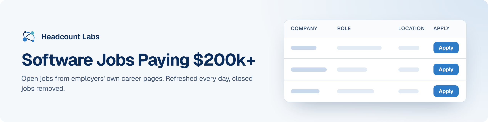

# Software Jobs Paying $200k+

Software and data jobs at US employers that publish a pay range reaching $200,000 a year or more.

**306 open jobs** · 301 new since the last update · 139 removed because they closed or left the employer's board · updated November 2, 2026 at 5:01 AM EST

This list is built and refreshed every day by [Headcount Labs](https://headcountlabs.com/?utm_source=github&utm_medium=job-list&utm_campaign=high-paying-software-jobs), which reads jobs straight from employers' own career pages and job boards. Every job here was still listed on its source board when we last read that board, within the past 3 days, and was posted in the past 30 days. Copies of the same job are merged into one row, and jobs that close are removed at the next update.

Want this data in your own app or agent? Use the [Headcount Labs jobs API](https://headcountlabs.com/docs/?utm_source=github&utm_medium=job-list&utm_campaign=high-paying-software-jobs) (free tier), the [MCP server](https://headcountlabs.com/mcp/?utm_source=github&utm_medium=job-list&utm_campaign=high-paying-software-jobs) for Claude, ChatGPT and other AI assistants, or the [public dataset subsets](https://huggingface.co/HeadcountLabs) on Hugging Face (the full dataset is coming soon).

**Full dataset.** A bigger, one-off snapshot dated 2026-10-19 (all matching jobs, not only the open jobs below) is on Hugging Face: [Tech and software jobs](https://huggingface.co/datasets/HeadcountLabs/tech-jobs) · [Jobs with posted pay](https://huggingface.co/datasets/HeadcountLabs/pay-transparency-jobs). It loads with `datasets.load_dataset` and is under the Open Database License (ODbL) 1.0.

**Jump to:** [Software engineering (206)](#software-engineering) · [Data, AI and machine learning (100)](#data-ai-and-machine-learning)

**Columns.** *Apply* opens the original posting on the employer's site. *Details* opens the job on Headcount Labs, with every posting we found for it. *Remote* shows what the employer states; a dash means the posting doesn't say. *Pay* is the range the employer published.

## Software engineering

| Company | Role | Location | Remote | Pay | Posted | Apply | Details |
| --- | --- | --- | --- | --- | --- | :---: | :---: |
| **Whoop** | Staff Software Engineer (Backend, Business Systems) | Boston, MA | On-site | $170k–$230k/yr | Nov 1 |  | <a href="https://headcountlabs.com/catalog/jobs/e285a26e-be4f-4259-a21e-b0fe66ade27b?utm_source=github&utm_medium=job-list&utm_campaign=high-paying-software-jobs">via Headcount Labs</a> |
| **QuEra Computing, Inc.** | Scientific Software Lead — Infrastructure | Boston, MA | — | $150k–$240k/yr | Nov 1 |  | <a href="https://headcountlabs.com/catalog/jobs/aed4f1be-581d-4500-949f-097558dcf82a?utm_source=github&utm_medium=job-list&utm_campaign=high-paying-software-jobs">via Headcount Labs</a> |
| **Intel Corporation** | GPU Software Development Engineer | Folsom, CA | Hybrid | $111k–$211k/yr | Oct 31 |  | <a href="https://headcountlabs.com/catalog/jobs/5714bb77-af96-4b59-a528-a86ee2c79a38?utm_source=github&utm_medium=job-list&utm_campaign=high-paying-software-jobs">via Headcount Labs</a> |
| **True Anomaly** | Principal Software Engineer, Spacecraft Simulation | 

2 locations
Denver, CO Long Beach, CA
 | On-site | $210k–$325k/yr | Oct 30 |  | <a href="https://headcountlabs.com/catalog/jobs/22259a14-bb14-4d66-83eb-f281e4e7c635?utm_source=github&utm_medium=job-list&utm_campaign=high-paying-software-jobs">via Headcount Labs</a> |
| **Toast** | Manager, Software Engineering | United States | Remote | $193k–$309k/yr | Oct 30 |  | <a href="https://headcountlabs.com/catalog/jobs/ee2404fe-1543-4526-be9c-70a2fb809b10?utm_source=github&utm_medium=job-list&utm_campaign=high-paying-software-jobs">via Headcount Labs</a> |
| **The Elevance Health Companies, Inc.** | AI-Native Software Engineer Advisor Senior | United States | — | $142k–$222k/yr | Oct 30 |  | <a href="https://headcountlabs.com/catalog/jobs/36259422-996a-48a9-b540-abc942c11850?utm_source=github&utm_medium=job-list&utm_campaign=high-paying-software-jobs">via Headcount Labs</a> |
| **The Boeing Company** | Lead Software Engineer Developer - DevSecOps | Richardson, TX | On-site | $172k–$232k/yr | Oct 30 |  | <a href="https://headcountlabs.com/catalog/jobs/a4fe81e5-33ca-49bd-975d-d64800433647?utm_source=github&utm_medium=job-list&utm_campaign=high-paying-software-jobs">via Headcount Labs</a> |
| **The Boeing Company** | Software Engineering Manager | Berkeley, MO | On-site | $161k–$217k/yr | Oct 30 |  | <a href="https://headcountlabs.com/catalog/jobs/7c1354f8-4a07-4b45-9c1f-0b9d511860f8?utm_source=github&utm_medium=job-list&utm_campaign=high-paying-software-jobs">via Headcount Labs</a> |
| **The Boeing Company** | Mission Systems Lead Software Architect | Berkeley, MO | On-site | $178k–$240k/yr | Oct 30 |  | <a href="https://headcountlabs.com/catalog/jobs/ae82d617-d4cb-4a48-b8e2-ef05191f82da?utm_source=github&utm_medium=job-list&utm_campaign=high-paying-software-jobs">via Headcount Labs</a> |
| **The Boeing Company** | Digital Software Engineering Architect | Berkeley, MO | On-site | $198k–$268k/yr | Oct 30 |  | <a href="https://headcountlabs.com/catalog/jobs/0d4a0562-d92f-4b89-a322-1f649f7f0a91?utm_source=github&utm_medium=job-list&utm_campaign=high-paying-software-jobs">via Headcount Labs</a> |
| **SMX** | Embedded C++ Software Engineer (5808) (Broomfield, CO) (Abil to obtain Secret) | Broomfield, CO | — | $160k–$210k/yr | Oct 30 |  | <a href="https://headcountlabs.com/catalog/jobs/c33954d2-3663-41e2-97b1-f95814d85d41?utm_source=github&utm_medium=job-list&utm_campaign=high-paying-software-jobs">via Headcount Labs</a> |
| **S&amp;P Global** | Software Developer | New York, NY | — | $190k–$206k/yr | Oct 30 |  | <a href="https://headcountlabs.com/catalog/jobs/6176a3da-e77a-4204-a486-c41aa536dfe8?utm_source=github&utm_medium=job-list&utm_campaign=high-paying-software-jobs">via Headcount Labs</a> |
| **REGENXBIO** | Lead Integration Developer | Rockville, MD | Hybrid | $153k–$207k/yr | Oct 30 |  | <a href="https://headcountlabs.com/catalog/jobs/8a5b5dbc-2eec-4aa7-a935-05811c086346?utm_source=github&utm_medium=job-list&utm_campaign=high-paying-software-jobs">via Headcount Labs</a> |
| **Outside Analytics** | Embedded C++ Software Engineer (5808) (Broomfield, CO) (Abil to obtain Secret) | Broomfield, CO | — | $160k–$210k/yr | Oct 30 |  | <a href="https://headcountlabs.com/catalog/jobs/a441a9e5-de0a-4c29-9e0b-725f7e00d2f6?utm_source=github&utm_medium=job-list&utm_campaign=high-paying-software-jobs">via Headcount Labs</a> |
| **Nuro** | Senior Software Engineer, Map Platform | Mountain View | — | $194k–$291k/yr | Oct 30 |  | <a href="https://headcountlabs.com/catalog/jobs/c3a380b7-6988-47c5-bb30-9e9a1ca82611?utm_source=github&utm_medium=job-list&utm_campaign=high-paying-software-jobs">via Headcount Labs</a> |
| **Millennium Space Systems** | Software Engineer Developer – Millennium Space Systems | El Segundo, CA | On-site | $172k–$252k/yr | Oct 30 |  | <a href="https://headcountlabs.com/catalog/jobs/ac1a9cb6-fc95-4619-b0a2-959692e54e8f?utm_source=github&utm_medium=job-list&utm_campaign=high-paying-software-jobs">via Headcount Labs</a> |
| **Intel Corporation** | GPU Software Architect | Folsom, CA | Hybrid | $234k–$330k/yr | Oct 30 |  | <a href="https://headcountlabs.com/catalog/jobs/bab3b86d-9667-46bd-90aa-414bcda5c2f5?utm_source=github&utm_medium=job-list&utm_campaign=high-paying-software-jobs">via Headcount Labs</a> |
| **Intel Corporation** | Database Administrator PL/SQL Developer | 

2 locations
Phoenix, AZ Hillsboro, OR
 | On-site | $118k–$227k/yr | Oct 30 |  | <a href="https://headcountlabs.com/catalog/jobs/0c17d0b2-285c-404b-b3fe-b0e4895c6afe?utm_source=github&utm_medium=job-list&utm_campaign=high-paying-software-jobs">via Headcount Labs</a> |
| **Credit Acceptance Corporation** | Software Engineering Manager II, Consumer 360 | 

3 locations
Southfield, MI California Bellevue, CA
 | — | $186k–$261k/yr | Oct 30 |  | <a href="https://headcountlabs.com/catalog/jobs/f5da9d65-a209-47cd-b9d7-96e557b5cc6f?utm_source=github&utm_medium=job-list&utm_campaign=high-paying-software-jobs">via Headcount Labs</a> |
| **Credit Acceptance Corporation** | Staff Software Engineer, Consumer 360 | 

2 locations
California Bellevue, CA
 | Hybrid | $186k–$260k/yr | Oct 30 |  | <a href="https://headcountlabs.com/catalog/jobs/2706c5d1-7538-4a9b-8115-b6f4513c5d6f?utm_source=github&utm_medium=job-list&utm_campaign=high-paying-software-jobs">via Headcount Labs</a> |
| **Salesforce, Inc.** | Senior Software Engineering Manager - Full Stack (Slack) | 

8 locations
Atlanta, GA San Francisco, CA Georgia Bellevue, WA Seattle, WA Georgia - Atlanta California - San Francisco New York - New York
 | — | $172k–$260k/yr | Oct 29 |  | <a href="https://headcountlabs.com/catalog/jobs/12fbf421-899c-486d-9953-a1c9421e2dbf?utm_source=github&utm_medium=job-list&utm_campaign=high-paying-software-jobs">via Headcount Labs</a> |
| **Robinhood** | Senior Software Engineer, AI Security | 

2 locations
Bellevue, WA Menlo Park, CA
 | — | $196k–$230k/yr | Oct 29 |  | <a href="https://headcountlabs.com/catalog/jobs/b13f30d6-8141-46c8-b94f-9bcb8874f741?utm_source=github&utm_medium=job-list&utm_campaign=high-paying-software-jobs">via Headcount Labs</a> |
| **Robinhood** | Senior Software Engineer, Observability | Menlo Park, CA | — | $196k–$230k/yr | Oct 29 |  | <a href="https://headcountlabs.com/catalog/jobs/63d6dccf-c837-49a1-8eca-e0c09a64a216?utm_source=github&utm_medium=job-list&utm_campaign=high-paying-software-jobs">via Headcount Labs</a> |
| **OneTrust** | Manager, Software Engineering | Atlanta, GA | Hybrid | $144k–$215k/yr | Oct 29 |  | <a href="https://headcountlabs.com/catalog/jobs/932a4c96-ae3a-459e-8c33-854965da403f?utm_source=github&utm_medium=job-list&utm_campaign=high-paying-software-jobs">via Headcount Labs</a> |
| **Healthie** | Staff Software Engineer, Billing &amp; Payments | New York City | Hybrid | $240k–$280k/yr | Oct 29 |  | <a href="https://headcountlabs.com/catalog/jobs/10c608e5-da57-4c4d-a835-be7f20b4fa9f?utm_source=github&utm_medium=job-list&utm_campaign=high-paying-software-jobs">via Headcount Labs</a> |
| **The Boeing Company** | Senior Software Engineer | 

3 locations
El Segundo, CA Los Angeles, CA Huntsville, AL
 | On-site | $198k–$268k/yr | Oct 28 |  | <a href="https://headcountlabs.com/catalog/jobs/ddfad015-e6ea-4fb4-8c0d-7ae54881381c?utm_source=github&utm_medium=job-list&utm_campaign=high-paying-software-jobs">via Headcount Labs</a> |
| **The Boeing Company** | Senior Software Lab Readiness and Integration Engineer | Berkeley, MO | On-site | $198k–$268k/yr | Oct 28 |  | <a href="https://headcountlabs.com/catalog/jobs/d0a409d0-2997-42c3-80f7-66fbc7074f72?utm_source=github&utm_medium=job-list&utm_campaign=high-paying-software-jobs">via Headcount Labs</a> |
| **The Boeing Company** | Lead Software Integration Engineer | Berkeley, MO | On-site | $198k–$268k/yr | Oct 28 |  | <a href="https://headcountlabs.com/catalog/jobs/a4cff5b4-97c4-4bf2-aef2-460936a6b29c?utm_source=github&utm_medium=job-list&utm_campaign=high-paying-software-jobs">via Headcount Labs</a> |
| **Teradyne** | Senior Robotics Software Engineer (Integrated System Test, Sunnyvale) | North Reading, MA | — | $167k–$268k/yr | Oct 28 |  | <a href="https://headcountlabs.com/catalog/jobs/39977fd1-4d3c-486a-a1b4-91ade23a7f74?utm_source=github&utm_medium=job-list&utm_campaign=high-paying-software-jobs">via Headcount Labs</a> |
| **Teradyne** | Senior Robotics Software Engineer (Integrated System Test, North Reading) | North Reading, MA | — | $167k–$268k/yr | Oct 28 |  | <a href="https://headcountlabs.com/catalog/jobs/a426b354-f3bc-4852-b913-e74061b29885?utm_source=github&utm_medium=job-list&utm_campaign=high-paying-software-jobs">via Headcount Labs</a> |
| **Salesforce, Inc.** | Staff Software Engineer, Data Infrastructure | 

4 locations
San Francisco, CA Atlanta, GA Bellevue, WA Seattle, WA
 | — | $197k–$314k/yr | Oct 28 |  | <a href="https://headcountlabs.com/catalog/jobs/ccff3200-4575-408a-8b2f-b9675293a509?utm_source=github&utm_medium=job-list&utm_campaign=high-paying-software-jobs">via Headcount Labs</a> |
| **Salesforce, Inc.** | Staff iOS Developer Experience Engineer - Slack | 

3 locations
San Francisco, CA Bellevue, WA Seattle, WA
 | — | $197k–$314k/yr | Oct 28 |  | <a href="https://headcountlabs.com/catalog/jobs/c3ec04a9-5df6-499e-a75e-46b9a7974e2b?utm_source=github&utm_medium=job-list&utm_campaign=high-paying-software-jobs">via Headcount Labs</a> |
| **Salesforce, Inc.** | Senior Software Engineer, Android Accessibility | 

4 locations
San Francisco, CA Atlanta, GA California Seattle, WA
 | — | $172k–$260k/yr | Oct 28 |  | <a href="https://headcountlabs.com/catalog/jobs/62decf03-977d-4652-b691-2c24d9e93e54?utm_source=github&utm_medium=job-list&utm_campaign=high-paying-software-jobs">via Headcount Labs</a> |
| **Salesforce, Inc.** | Senior Software Engineer, Identity Security | 

4 locations
San Francisco, CA Atlanta, GA Bellevue, WA Seattle, WA
 | — | $172k–$260k/yr | Oct 28 |  | <a href="https://headcountlabs.com/catalog/jobs/c02d7338-2672-4863-9756-9737b3a861b5?utm_source=github&utm_medium=job-list&utm_campaign=high-paying-software-jobs">via Headcount Labs</a> |
| **Robinhood** | Senior Software Engineer, Capacity &amp; Efficiency | Bellevue, WA | — | $196k–$230k/yr | Oct 28 |  | <a href="https://headcountlabs.com/catalog/jobs/be4a9796-1359-435e-86f7-4f5adec7f9db?utm_source=github&utm_medium=job-list&utm_campaign=high-paying-software-jobs">via Headcount Labs</a> |
| **Principal Financial Group** | Director of Engineering, Cyber GRC Data, AI &amp; Automation | United States | Remote | $160k–$210k/yr | Oct 28 |  | <a href="https://headcountlabs.com/catalog/jobs/9a71fb49-2ae2-4181-a7c2-233d533573ce?utm_source=github&utm_medium=job-list&utm_campaign=high-paying-software-jobs">via Headcount Labs</a> |
| **Intel Corporation** | AI Software Development Engineer - Neuromorphic Computing | Santa Clara, CA | Hybrid | $170k–$241k/yr | Oct 28 |  | <a href="https://headcountlabs.com/catalog/jobs/9bc52824-b76e-45a7-b9f0-f59f3e23f6c7?utm_source=github&utm_medium=job-list&utm_campaign=high-paying-software-jobs">via Headcount Labs</a> |
| **Intel Corporation** | LTD RET Software/Research Engineer | Hillsboro, OR | Hybrid | $150k–$285k/yr | Oct 28 |  | <a href="https://headcountlabs.com/catalog/jobs/f608b95f-77ec-4bae-8dd7-4248ef94687d?utm_source=github&utm_medium=job-list&utm_campaign=high-paying-software-jobs">via Headcount Labs</a> |
| **Intel Corporation** | EDA Tools Software Engineer | Hillsboro, OR | Hybrid | $129k–$245k/yr | Oct 28 |  | <a href="https://headcountlabs.com/catalog/jobs/3021e7fa-2531-4c0d-b982-f4b9832b2151?utm_source=github&utm_medium=job-list&utm_campaign=high-paying-software-jobs">via Headcount Labs</a> |
| **Western Union, LLC** | Software Engineer, AI &amp; Cloud Applications | Austin, TX | Hybrid | $195k–$220k/yr | Oct 27 |  | <a href="https://headcountlabs.com/catalog/jobs/b890f154-e9bd-455d-8834-b6ad974b115a?utm_source=github&utm_medium=job-list&utm_campaign=high-paying-software-jobs">via Headcount Labs</a> |
| **Upstart** | Senior Software Engineer, Unsecured Installments | United States | Remote | $167k–$231k/yr | Oct 27 |  | <a href="https://headcountlabs.com/catalog/jobs/350e39db-1859-4eaf-86bf-31c32539baea?utm_source=github&utm_medium=job-list&utm_campaign=high-paying-software-jobs">via Headcount Labs</a> |
| **Toast** | Staff Software Engineer, Orders | United States | Remote | $193k–$309k/yr | Oct 27 |  | <a href="https://headcountlabs.com/catalog/jobs/3c0fc99b-d3fe-45ce-81e5-cc5e62944c74?utm_source=github&utm_medium=job-list&utm_campaign=high-paying-software-jobs">via Headcount Labs</a> |
| **Tempus AI, Inc.** | Senior Manager, Software Engineering (Data Architecture) | Chicago | — | $150k–$225k/yr | Oct 27 |  | <a href="https://headcountlabs.com/catalog/jobs/eb967d0e-a1ee-43fa-a949-468bd5ff6261?utm_source=github&utm_medium=job-list&utm_campaign=high-paying-software-jobs">via Headcount Labs</a> |
| **SingleStore-LinkedIn** | Staff / Principal Software Engineer – Cloud Platform &amp; SaaS | United States | — | $140k–$215k/yr | Oct 27 |  | <a href="https://headcountlabs.com/catalog/jobs/7813ac3d-6f75-4b08-91ad-dbee1c680be4?utm_source=github&utm_medium=job-list&utm_campaign=high-paying-software-jobs">via Headcount Labs</a> |
| **HII** | Software Engineer | 

2 locations
Roanoke, VA Annapolis Junction, MD
 | — | $105k–$200k/yr | Oct 27 |  | <a href="https://headcountlabs.com/catalog/jobs/0a36c9e7-4641-4910-87dc-3d7e61768b98?utm_source=github&utm_medium=job-list&utm_campaign=high-paying-software-jobs">via Headcount Labs</a> |
| **Fluxcap** | Senior Software Engineer | 

2 locations
New York City, NY Washington, DC
 | Hybrid | $170k–$220k/yr | Oct 27 |  | <a href="https://headcountlabs.com/catalog/jobs/67f241f3-6e26-48ea-a5bb-8229d48afbcd?utm_source=github&utm_medium=job-list&utm_campaign=high-paying-software-jobs">via Headcount Labs</a> |
| **Everpure** | Director of Software Engineering, CPBU | Santa Clara, CA | On-site | $263k–$395k/yr | Oct 27 |  | <a href="https://headcountlabs.com/catalog/jobs/8bd32dd0-e258-4d04-9c2f-1c85621a15d3?utm_source=github&utm_medium=job-list&utm_campaign=high-paying-software-jobs">via Headcount Labs</a> |
| **BIO-OPTRONICS, INC.** | Staff Software Engineer | United States of America | Remote | $144k–$278k/yr | Oct 27 |  | <a href="https://headcountlabs.com/catalog/jobs/21dd0f47-6a95-471b-8925-9fe39d7ee7df?utm_source=github&utm_medium=job-list&utm_campaign=high-paying-software-jobs">via Headcount Labs</a> |
| **Baseten** | Software Engineer - Storage Systems (Agent Infra) | 

2 locations
San Francisco, CA New York, NY
 | Hybrid | $160k–$330k/yr | Oct 27 |  | <a href="https://headcountlabs.com/catalog/jobs/efc8b072-9266-4e20-a0fd-bef29027c500?utm_source=github&utm_medium=job-list&utm_campaign=high-paying-software-jobs">via Headcount Labs</a> |
| **Piq Energy** | Staff Software Engineer | United States | Remote | $200k–$250k/yr | Oct 26 |  | <a href="https://headcountlabs.com/catalog/jobs/c78b100d-0068-4dd9-94db-1393b416b87e?utm_source=github&utm_medium=job-list&utm_campaign=high-paying-software-jobs">via Headcount Labs</a> |
| **MCKESSON** | Sr. Software Engineer, Identity &amp; Access Management | Columbus, OH | — | $131k–$218k/yr | Oct 26 |  | <a href="https://headcountlabs.com/catalog/jobs/30f7ee3f-f3ff-4bf5-ab61-29e595ba928d?utm_source=github&utm_medium=job-list&utm_campaign=high-paying-software-jobs">via Headcount Labs</a> |
| **LHH (Global)** | Enterprise New Business Developer (New Logo/Global), North America, LHH CTM | United States | — | $165k–$210k/yr | Oct 26 |  | <a href="https://headcountlabs.com/catalog/jobs/85992193-b818-4b6b-8cbe-947d45ac557f?utm_source=github&utm_medium=job-list&utm_campaign=high-paying-software-jobs">via Headcount Labs</a> |
| **Intel Corporation** | Software Integration Engineer | 

2 locations
Hillsboro, OR Phoenix, AZ
 | Hybrid | $150k–$285k/yr | Oct 26 |  | <a href="https://headcountlabs.com/catalog/jobs/5e791c86-27c4-43ee-b263-7c3352135fb0?utm_source=github&utm_medium=job-list&utm_campaign=high-paying-software-jobs">via Headcount Labs</a> |
| **HII** | Software Security Engineer (Hybrid) - 30874 | Columbia, MD | Hybrid | $165k–$240k/yr | Oct 26 |  | <a href="https://headcountlabs.com/catalog/jobs/ce480156-469d-47da-bd0b-6ef5256b5416?utm_source=github&utm_medium=job-list&utm_campaign=high-paying-software-jobs">via Headcount Labs</a> |
| **HII** | Software Engineer (Hybrid) - 30870 | Columbia, MD | Hybrid | $138k–$200k/yr | Oct 26 |  | <a href="https://headcountlabs.com/catalog/jobs/919442ac-e070-42c9-b38f-1765f3d06084?utm_source=github&utm_medium=job-list&utm_campaign=high-paying-software-jobs">via Headcount Labs</a> |
| **Credit Acceptance Corporation** | Director of Software Engineering, Platform Services | 

3 locations
Southfield, MI California Bellevue, CA
 | — | $251k–$351k/yr | Oct 26 |  | <a href="https://headcountlabs.com/catalog/jobs/92a13c1d-e3f5-4169-af53-5ff10ae00b7e?utm_source=github&utm_medium=job-list&utm_campaign=high-paying-software-jobs">via Headcount Labs</a> |
| **Baseten** | Software Engineer - Networking (Agent Infra) | 

2 locations
San Francisco, CA New York, NY
 | Hybrid | $160k–$330k/yr | Oct 26 |  | <a href="https://headcountlabs.com/catalog/jobs/f26997df-ab56-43a4-a991-8ccd585b08fc?utm_source=github&utm_medium=job-list&utm_campaign=high-paying-software-jobs">via Headcount Labs</a> |
| **Baseten** | Software Engineer - Compute and Isolation | 

2 locations
San Francisco, CA New York, NY
 | Hybrid | $165k–$330k/yr | Oct 26 |  | <a href="https://headcountlabs.com/catalog/jobs/5d42cbf9-d418-4c45-8c45-e9e08346941b?utm_source=github&utm_medium=job-list&utm_campaign=high-paying-software-jobs">via Headcount Labs</a> |
| **QuEra Computing, Inc.** | Senior Scientific Software Engineer — Autoresearch | Boston, MA | — | $160k–$220k/yr | Oct 25 |  | <a href="https://headcountlabs.com/catalog/jobs/42af892f-404c-4c56-bec4-f72e433447ec?utm_source=github&utm_medium=job-list&utm_campaign=high-paying-software-jobs">via Headcount Labs</a> |
| **MAXISIQ, Inc.** | Full Stack Developer - Top Secret Required | Quantico, VA | — | $210k–$230k/yr | Oct 24 |  | <a href="https://headcountlabs.com/catalog/jobs/f88faef5-4be8-4743-a436-30965fc2b0dc?utm_source=github&utm_medium=job-list&utm_campaign=high-paying-software-jobs">via Headcount Labs</a> |
| **ZINC Zillow, Inc.** | Senior Software Engineer | United States | Remote | $164k–$263k/yr | Oct 23 |  | <a href="https://headcountlabs.com/catalog/jobs/3a9ed298-f3ac-4223-9ae9-7da48f9cdbd8?utm_source=github&utm_medium=job-list&utm_campaign=high-paying-software-jobs">via Headcount Labs</a> |
| **Toast** | Senior Software Engineer, Consumer | United States | Remote | $159k–$254k/yr | Oct 23 |  | <a href="https://headcountlabs.com/catalog/jobs/ce907e01-30b6-4fb9-a259-3278a1d9cbf8?utm_source=github&utm_medium=job-list&utm_campaign=high-paying-software-jobs">via Headcount Labs</a> |
| **Steampunk** | Software Development Architect (Drupal) | McLean, VA | — | $112k–$225k/yr | Oct 23 |  | <a href="https://headcountlabs.com/catalog/jobs/adabfbbe-8a75-4b6c-9279-8402367f6fee?utm_source=github&utm_medium=job-list&utm_campaign=high-paying-software-jobs">via Headcount Labs</a> |
| **Starburst** | Staff Software Engineer - IAM | Boston, MA | Hybrid | $215k–$250k/yr | Oct 23 |  | <a href="https://headcountlabs.com/catalog/jobs/442c8749-90e2-4e14-80b3-f50ca887fb3d?utm_source=github&utm_medium=job-list&utm_campaign=high-paying-software-jobs">via Headcount Labs</a> |
| **Overland AI** | Senior Software Engineer (C++) | Seattle, WA | On-site | $150k–$230k/yr | Oct 23 |  | <a href="https://headcountlabs.com/catalog/jobs/ca67bacb-05c5-4455-896a-6c8fb08831cc?utm_source=github&utm_medium=job-list&utm_campaign=high-paying-software-jobs">via Headcount Labs</a> |
| **Overland AI** | Software Safety Engineer (Software) | Seattle, WA | On-site | $170k–$225k/yr | Oct 23 |  | <a href="https://headcountlabs.com/catalog/jobs/3db77f75-db89-4265-8ad1-c7413fb47af6?utm_source=github&utm_medium=job-list&utm_campaign=high-paying-software-jobs">via Headcount Labs</a> |
| **Guidewire Software, Inc. (US)** | Senior Machine Learning Platform Engineer | San Mateo, CA | Hybrid | $160k–$271k/yr | Oct 23 |  | <a href="https://headcountlabs.com/catalog/jobs/deeea885-4559-407a-877f-0ce234eeca35?utm_source=github&utm_medium=job-list&utm_campaign=high-paying-software-jobs">via Headcount Labs</a> |
| **Guidewire Software, Inc. (US)** | Software Engineer (Full-Stack) III | Bedford, MA | Hybrid | $132k–$228k/yr | Oct 23 |  | <a href="https://headcountlabs.com/catalog/jobs/6491083e-b010-4a6f-8086-bf98c769b16e?utm_source=github&utm_medium=job-list&utm_campaign=high-paying-software-jobs">via Headcount Labs</a> |
| **Credit Acceptance Corporation** | Distinguished Software Engineer | 

3 locations
United States California Bellevue, CA
 | — | $279k–$391k/yr | Oct 23 |  | <a href="https://headcountlabs.com/catalog/jobs/0387c5d0-ec73-4ac0-9c87-123ee3861e7e?utm_source=github&utm_medium=job-list&utm_campaign=high-paying-software-jobs">via Headcount Labs</a> |
| **ŌURA** | Staff AI Engineer - Developer Productivity | United States | Remote | $233k–$268k/yr | Oct 22 |  | <a href="https://headcountlabs.com/catalog/jobs/2c827b85-92c1-4394-9b10-b06e99f88782?utm_source=github&utm_medium=job-list&utm_campaign=high-paying-software-jobs">via Headcount Labs</a> |
| **Verkada** | Senior Software Engineer - Computer Vision | San Mateo | On-site | $200k–$300k/yr | Oct 22 |  | <a href="https://headcountlabs.com/catalog/jobs/bbc16d3b-5d95-4b6d-9ada-712e70b7c32a?utm_source=github&utm_medium=job-list&utm_campaign=high-paying-software-jobs">via Headcount Labs</a> |
| **Striveworks** | Senior Software Engineer (Secret Clearance Eligible) | or Austin, TX | Remote | $160k–$200k/yr | Oct 22 |  | <a href="https://headcountlabs.com/catalog/jobs/90f43a09-63d8-4df8-9719-acd7b66399f9?utm_source=github&utm_medium=job-list&utm_campaign=high-paying-software-jobs">via Headcount Labs</a> |
| **Roku** | Senior Software Engineer, Observability | 

3 locations
San Jose, CA Chicago, IL New York, NY
 | — | $251k–$404k/yr | Oct 22 |  | <a href="https://headcountlabs.com/catalog/jobs/239a4412-49d9-4349-8f65-4000316e9f0e?utm_source=github&utm_medium=job-list&utm_campaign=high-paying-software-jobs">via Headcount Labs</a> |
| **Muon Space** | Principal Software Engineer, Mission Design | San Jose, CA | Hybrid | $266k–$298k/yr | Oct 22 |  | <a href="https://headcountlabs.com/catalog/jobs/6e29bb94-a1ba-48f9-a560-3c491b6a21b7?utm_source=github&utm_medium=job-list&utm_campaign=high-paying-software-jobs">via Headcount Labs</a> |
| **Legora** | Senior Software Engineer | New York City, NY | On-site | $237k–$321k/yr | Oct 22 |  | <a href="https://headcountlabs.com/catalog/jobs/b02eb3ec-5598-422e-a6c1-aee60c05504c?utm_source=github&utm_medium=job-list&utm_campaign=high-paying-software-jobs">via Headcount Labs</a> |
| **L3Harris, Inc** | Software Engineer (Senior Member) - Rust | Camden, NJ | On-site | $118k–$225k/yr | Oct 22 |  | <a href="https://headcountlabs.com/catalog/jobs/57c28c7f-0cb3-4475-b3b2-ac6aff35d233?utm_source=github&utm_medium=job-list&utm_campaign=high-paying-software-jobs">via Headcount Labs</a> |
| **eBay Inc.** | Senior Software Engineer - Golang | San Jose | Hybrid | $172k–$230k/yr | Oct 22 |  | <a href="https://headcountlabs.com/catalog/jobs/01c93fa8-703c-4299-9974-1850f41eed6e?utm_source=github&utm_medium=job-list&utm_campaign=high-paying-software-jobs">via Headcount Labs</a> |
| **Baseten** | Software Engineer - Billing &amp; Internal Tooling | 

5 locations
San Francisco, CA Toronto New York, NY Montreal Seattle, WA
 | Hybrid | $165k–$330k/yr | Oct 22 |  | <a href="https://headcountlabs.com/catalog/jobs/87be510c-9c05-4140-975b-e9bdb85d8e7b?utm_source=github&utm_medium=job-list&utm_campaign=high-paying-software-jobs">via Headcount Labs</a> |
| **Baseten** | Software Engineer - Identity &amp; Authorization | 

5 locations
San Francisco, CA Toronto New York, NY Montreal Seattle, WA
 | Hybrid | $165k–$330k/yr | Oct 22 |  | <a href="https://headcountlabs.com/catalog/jobs/e5be7543-a570-41bc-b06d-5afaaa17cc64?utm_source=github&utm_medium=job-list&utm_campaign=high-paying-software-jobs">via Headcount Labs</a> |
| **Baseten** | Software Engineer - Partner Platform | 

5 locations
San Francisco, CA Toronto New York, NY Montreal Seattle, WA
 | Hybrid | $165k–$330k/yr | Oct 22 |  | <a href="https://headcountlabs.com/catalog/jobs/df48c2a2-442c-4507-a65c-0162aec21f0a?utm_source=github&utm_medium=job-list&utm_campaign=high-paying-software-jobs">via Headcount Labs</a> |
| **BackerKit** | Staff Software Developer | San Francisco | Remote | $184k–$235k/yr | Oct 22 |  | <a href="https://headcountlabs.com/catalog/jobs/8b9e26b4-424f-47cf-9f0f-0ef0cfd2cd69?utm_source=github&utm_medium=job-list&utm_campaign=high-paying-software-jobs">via Headcount Labs</a> |
| **ZoomInfo Technologies LLC** | Senior Software Engineer, Mobile Engineer | Bethesda, MD | Hybrid | $140k–$220k/yr | Oct 21 |  | <a href="https://headcountlabs.com/catalog/jobs/764c5a43-ff27-45d9-a616-406421621502?utm_source=github&utm_medium=job-list&utm_campaign=high-paying-software-jobs">via Headcount Labs</a> |
| **West Monroe** | Manager, High tech &amp; Software Value Creation | 

3 locations
New York, NY Chicago San Francisco
 | — | $171k–$202k/yr | Oct 21 |  | <a href="https://headcountlabs.com/catalog/jobs/be742a3c-a7a8-463b-b92d-fa7ca98886de?utm_source=github&utm_medium=job-list&utm_campaign=high-paying-software-jobs">via Headcount Labs</a> |
| **WarnerMedia Services, LLC** | Senior Software Engineer (Boundary Traffic Management) | United States | Hybrid | $146k–$272k/yr | Oct 21 |  | <a href="https://headcountlabs.com/catalog/jobs/6724bd2a-71e5-4412-a4be-edf02f6b916a?utm_source=github&utm_medium=job-list&utm_campaign=high-paying-software-jobs">via Headcount Labs</a> |
| **WarnerMedia Services, LLC** | Senior Mobile Application Developer | United States | Hybrid | $110k–$205k/yr | Oct 21 |  | <a href="https://headcountlabs.com/catalog/jobs/2251ebe7-0336-4138-865a-c97efcd447dd?utm_source=github&utm_medium=job-list&utm_campaign=high-paying-software-jobs">via Headcount Labs</a> |
| **Verkada** | Senior/Staff Software Engineer, Developer AI | San Mateo | — | $180k–$280k/yr | Oct 21 |  | <a href="https://headcountlabs.com/catalog/jobs/b19fdb33-48af-42dc-ac86-f7a00fd18f68?utm_source=github&utm_medium=job-list&utm_campaign=high-paying-software-jobs">via Headcount Labs</a> |
| **Turner Services Inc.** | Senior Software Engineer (Roku) | 

2 locations
United States New York, NY
 | Hybrid | $164k–$304k/yr | Oct 21 |  | <a href="https://headcountlabs.com/catalog/jobs/dff01a0b-a1ae-462c-be93-45d1597b5778?utm_source=github&utm_medium=job-list&utm_campaign=high-paying-software-jobs">via Headcount Labs</a> |
| **Turner Services Inc.** | Senior Software Engineer | United States | Hybrid | $131k–$243k/yr | Oct 21 |  | <a href="https://headcountlabs.com/catalog/jobs/b2dd08a3-164b-45fb-952c-6f9c6f71440e?utm_source=github&utm_medium=job-list&utm_campaign=high-paying-software-jobs">via Headcount Labs</a> |
| **Turner Services Inc.** | Staff Product Manager, Developer Experience | 

2 locations
New York, NY United States
 | Hybrid | $133k–$247k/yr | Oct 21 |  | <a href="https://headcountlabs.com/catalog/jobs/ac62576f-4ff4-4328-b76d-566d4387383e?utm_source=github&utm_medium=job-list&utm_campaign=high-paying-software-jobs">via Headcount Labs</a> |
| **Seekr** | Senior Software Engineer | Reston, VA | Remote | $160k–$230k/yr | Oct 21 |  | <a href="https://headcountlabs.com/catalog/jobs/0c8ddbfd-75b7-4d3b-9739-c78b41d570e9?utm_source=github&utm_medium=job-list&utm_campaign=high-paying-software-jobs">via Headcount Labs</a> |
| **Schonfeld** | Senior Software Engineer | New York, NY | — | $200k–$250k/yr | Oct 21 |  | <a href="https://headcountlabs.com/catalog/jobs/1d9f5f64-57c0-4cc4-9a92-bf7012fbdceb?utm_source=github&utm_medium=job-list&utm_campaign=high-paying-software-jobs">via Headcount Labs</a> |
| **MCKESSON** | MMS Sr Salesforce Developer | 

2 locations
Irving, TX Richmond, VA
 | Hybrid | $120k–$200k/yr | Oct 21 |  | <a href="https://headcountlabs.com/catalog/jobs/31801639-71cd-42f9-8558-7e53b699eaf1?utm_source=github&utm_medium=job-list&utm_campaign=high-paying-software-jobs">via Headcount Labs</a> |
| **International Motors, LLC** | Lead Software Engineer - Enterprise Applications | Lisle, IL | — | $138k–$206k/yr | Oct 21 |  | <a href="https://headcountlabs.com/catalog/jobs/67fb540c-9144-4c76-a92e-2653b18043c4?utm_source=github&utm_medium=job-list&utm_campaign=high-paying-software-jobs">via Headcount Labs</a> |
| **Handshake** | Senior Software Engineer, Growth | San Francisco, CA | On-site | $225k–$250k/yr | Oct 21 |  | <a href="https://headcountlabs.com/catalog/jobs/2ac44c7c-42d7-4575-b05f-9eb1bcb26276?utm_source=github&utm_medium=job-list&utm_campaign=high-paying-software-jobs">via Headcount Labs</a> |
| **Everpure** | Software Engineering Manager, Hyperscale Line of Business | Santa Clara, CA | On-site | $193k–$317k/yr | Oct 21 |  | <a href="https://headcountlabs.com/catalog/jobs/4db64546-4eb5-48c5-997e-e5d2221cadb4?utm_source=github&utm_medium=job-list&utm_campaign=high-paying-software-jobs">via Headcount Labs</a> |
| **BlackRock** | Developer Platform &amp; AI, Technology Product Manager - Director | New York, NY | Hybrid | $215k–$275k/yr | Oct 21 |  | <a href="https://headcountlabs.com/catalog/jobs/aff931f8-2b13-4d65-9b5e-71da99239696?utm_source=github&utm_medium=job-list&utm_campaign=high-paying-software-jobs">via Headcount Labs</a> |
| **Vast** | Senior Flight Software Engineer | Long Beach, CA | — | $159k–$220k/yr | Oct 20 |  | <a href="https://headcountlabs.com/catalog/jobs/61969d42-2a80-45a7-a5fd-89ab1c5c7cee?utm_source=github&utm_medium=job-list&utm_campaign=high-paying-software-jobs">via Headcount Labs</a> |
| **Toast** | Staff Software Engineer, Enterprise | United States | Remote | $193k–$309k/yr | Oct 20 |  | <a href="https://headcountlabs.com/catalog/jobs/48e4a10f-c3e1-4dbc-be56-f9433d8eb2ea?utm_source=github&utm_medium=job-list&utm_campaign=high-paying-software-jobs">via Headcount Labs</a> |
| **Tempus AI, Inc.** | Staff Software Engineer, Security | 

2 locations
Chicago Redwood City
 | — | $200k–$260k/yr | Oct 20 |  | <a href="https://headcountlabs.com/catalog/jobs/9d50bf68-0930-40cd-9c48-7d512fad750d?utm_source=github&utm_medium=job-list&utm_campaign=high-paying-software-jobs">via Headcount Labs</a> |
| **Tempus AI, Inc.** | Senior Software Engineer II, RPM Growth &amp; Ops | New York City | — | $150k–$210k/yr | Oct 20 |  | <a href="https://headcountlabs.com/catalog/jobs/4c287dbc-196a-47b3-a2bb-ef67e15e3e76?utm_source=github&utm_medium=job-list&utm_campaign=high-paying-software-jobs">via Headcount Labs</a> |
| **Skillable** | Principal Software Engineer | United States | Remote | $150k–$200k/yr | Oct 20 |  | <a href="https://headcountlabs.com/catalog/jobs/05fdc152-8927-408b-88a6-b80f57c6c8bd?utm_source=github&utm_medium=job-list&utm_campaign=high-paying-software-jobs">via Headcount Labs</a> |
| **Ford Motor Company** | Supervisor Body Control Software | Allen Park, MI | Hybrid | $130k–$226k/yr | Oct 20 |  | <a href="https://headcountlabs.com/catalog/jobs/4e165bb3-8814-4014-86aa-0038105e896a?utm_source=github&utm_medium=job-list&utm_campaign=high-paying-software-jobs">via Headcount Labs</a> |
| **DoubleVerify Inc.** | Sr. Software Engineer, Analytics &amp; Data Platform | United States | Hybrid | $107k–$212k/yr | Oct 20 |  | <a href="https://headcountlabs.com/catalog/jobs/6e81a616-6df8-46c7-902e-734dbb89e33e?utm_source=github&utm_medium=job-list&utm_campaign=high-paying-software-jobs">via Headcount Labs</a> |
| **ZoomInfo Technologies LLC** | Principal Software Engineer | US-CA | Remote | $164k–$257k/yr | Oct 19 |  | <a href="https://headcountlabs.com/catalog/jobs/36867b65-ec9c-495c-b37b-35af6e4e61ef?utm_source=github&utm_medium=job-list&utm_campaign=high-paying-software-jobs">via Headcount Labs</a> |
| **Obviant** | Senior Fullstack Software Engineer | Tampa, FL | Hybrid | $150k–$200k/yr | Oct 19 |  | <a href="https://headcountlabs.com/catalog/jobs/42370625-ff2a-4985-92c1-3c13b206602b?utm_source=github&utm_medium=job-list&utm_campaign=high-paying-software-jobs">via Headcount Labs</a> |
| **MCKESSON** | Sr. Manager, Software Engineering | Columbus, OH | Hybrid | $126k–$210k/yr | Oct 19 |  | <a href="https://headcountlabs.com/catalog/jobs/f82b2774-15ae-4fdf-9dba-f8bb53a9cff2?utm_source=github&utm_medium=job-list&utm_campaign=high-paying-software-jobs">via Headcount Labs</a> |
| **L3Harris, Inc** | Manager, Software Engineer | Rochester, NY | On-site | $117k–$218k/yr | Oct 19 |  | <a href="https://headcountlabs.com/catalog/jobs/5b0e2bda-7176-4c5f-ab81-71a52b6d97c0?utm_source=github&utm_medium=job-list&utm_campaign=high-paying-software-jobs">via Headcount Labs</a> |
| **BridgePoint Associates** | Action Developer - Climate Action | San Francisco, CA | Hybrid | $125k–$200k/yr | Oct 19 |  | <a href="https://headcountlabs.com/catalog/jobs/c0ffd888-a54b-47be-8f25-5a80f89bf732?utm_source=github&utm_medium=job-list&utm_campaign=high-paying-software-jobs">via Headcount Labs</a> |
| **S&amp;P Global** | Director, Open-Source Software Manager | Princeton, NJ | Hybrid | $174k–$200k/yr | Oct 18 |  | <a href="https://headcountlabs.com/catalog/jobs/67e850d5-b632-4644-8ab9-5dd4ef812521?utm_source=github&utm_medium=job-list&utm_campaign=high-paying-software-jobs">via Headcount Labs</a> |
| **DiDi Labs** | Software Engineer, Motion Planning | San Jose, CA | — | $141k–$235k/yr | Oct 18 |  | <a href="https://headcountlabs.com/catalog/jobs/71065f0b-73e5-4b3f-9878-601f17b1e2e2?utm_source=github&utm_medium=job-list&utm_campaign=high-paying-software-jobs">via Headcount Labs</a> |
| **West Monroe** | Director, TechEx, Software Engineering | 

2 locations
New York, NY Chicago
 | — | $200k–$250k/yr | Oct 17 |  | <a href="https://headcountlabs.com/catalog/jobs/ec03cb44-5ce0-440e-aa2a-6b434c33472d?utm_source=github&utm_medium=job-list&utm_campaign=high-paying-software-jobs">via Headcount Labs</a> |
| **Seekr** | Senior Manager, Software Engineering | Reston, VA | — | $200k–$275k/yr | Oct 16 |  | <a href="https://headcountlabs.com/catalog/jobs/7e3fa1ed-46fa-4bea-98b7-8d7c9004542d?utm_source=github&utm_medium=job-list&utm_campaign=high-paying-software-jobs">via Headcount Labs</a> |
| **MCKESSON** | Sr. JDE Techno Functional Developer | 

2 locations
Richmond, VA Jacksonville, FL
 | Hybrid | $123k–$204k/yr | Oct 16 |  | <a href="https://headcountlabs.com/catalog/jobs/afeb8371-89dc-47aa-88be-a9d3fb9ee12c?utm_source=github&utm_medium=job-list&utm_campaign=high-paying-software-jobs">via Headcount Labs</a> |
| **H&amp;R Block** | Principal Software Engineer-Native Mobile Development | Missouri | Remote | $132k–$225k/yr | Oct 16 |  | <a href="https://headcountlabs.com/catalog/jobs/54f31160-c5ac-459d-bd1e-e57ca20598da?utm_source=github&utm_medium=job-list&utm_campaign=high-paying-software-jobs">via Headcount Labs</a> |
| **Bretton AI** | Software Engineer, Product | San Francisco, CA | On-site | $200k–$270k/yr | Oct 16 |  | <a href="https://headcountlabs.com/catalog/jobs/71c16bd5-5bb4-4a24-bc04-4cd900c6bf65?utm_source=github&utm_medium=job-list&utm_campaign=high-paying-software-jobs">via Headcount Labs</a> |
| **ZINC Zillow, Inc.** | Senior Software Development Engineer - Big Data | United States | Remote | $164k–$263k/yr | Oct 15 |  | <a href="https://headcountlabs.com/catalog/jobs/ff0f2df9-aa6a-4c90-9434-e6c1c59e4f40?utm_source=github&utm_medium=job-list&utm_campaign=high-paying-software-jobs">via Headcount Labs</a> |
| **Theori** | Senior Software Engineer, Mobile Security Analysis | Washington | Hybrid | $175k–$235k/yr | Oct 15 |  | <a href="https://headcountlabs.com/catalog/jobs/d820db0a-d67e-45e8-b793-5c6e5f4d3f3b?utm_source=github&utm_medium=job-list&utm_campaign=high-paying-software-jobs">via Headcount Labs</a> |
| **Schonfeld** | Software Engineer | New York, NY | — | $175k–$215k/yr | Oct 15 |  | <a href="https://headcountlabs.com/catalog/jobs/82567309-3d12-42d7-a59b-e4aae533dc51?utm_source=github&utm_medium=job-list&utm_campaign=high-paying-software-jobs">via Headcount Labs</a> |
| **SAP Taulia** | Principal Software Engineer (AI) | United States | — | $190k–$225k/yr | Oct 15 |  | <a href="https://headcountlabs.com/catalog/jobs/708058c9-5f2e-4ce0-8819-e02564766fb9?utm_source=github&utm_medium=job-list&utm_campaign=high-paying-software-jobs">via Headcount Labs</a> |
| **OneTrust** | Senior Staff Software Engineer - Detection &amp; Discovery | Atlanta, GA | Hybrid | $165k–$248k/yr | Oct 15 |  | <a href="https://headcountlabs.com/catalog/jobs/617aa634-8caa-411a-a8bb-c77db6ce6a5e?utm_source=github&utm_medium=job-list&utm_campaign=high-paying-software-jobs">via Headcount Labs</a> |
| **Northern Light** | Principal Software Engineer | Somerville, MA | On-site | $175k–$215k/yr | Oct 15 |  | <a href="https://headcountlabs.com/catalog/jobs/a779d12d-4c6c-4f5c-8f83-fb3e9f1c8406?utm_source=github&utm_medium=job-list&utm_campaign=high-paying-software-jobs">via Headcount Labs</a> |
| **Muon Space** | Senior Software Engineer, Information Systems | San Jose, CA | Hybrid | $196k–$217k/yr | Oct 15 |  | <a href="https://headcountlabs.com/catalog/jobs/83329976-cc4a-4824-a63e-62227bf04331?utm_source=github&utm_medium=job-list&utm_campaign=high-paying-software-jobs">via Headcount Labs</a> |
| **Muon Space** | Software Engineering Manager, Information Systems | San Jose, CA | Hybrid | $196k–$217k/yr | Oct 15 |  | <a href="https://headcountlabs.com/catalog/jobs/63d551bc-5338-42b5-96ab-45c659ff8d84?utm_source=github&utm_medium=job-list&utm_campaign=high-paying-software-jobs">via Headcount Labs</a> |
| **Millennium Space Systems** | Ground Software Engineer (Senior) - Millennium Space Systems | 

2 locations
El Segundo, CA Los Angeles, CA
 | On-site | $188k–$280k/yr | Oct 15 |  | <a href="https://headcountlabs.com/catalog/jobs/60f86e1a-a23a-4eba-9061-7606ef84d2a8?utm_source=github&utm_medium=job-list&utm_campaign=high-paying-software-jobs">via Headcount Labs</a> |
| **MCKESSON** | Senior Software Engineer | 

4 locations
Alpharetta, GA Columbus, OH Moon Township, PA Irving, TX
 | Hybrid | $126k–$210k/yr | Oct 15 |  | <a href="https://headcountlabs.com/catalog/jobs/b6c35fd6-0a74-4ecb-99f2-4ca452d96ef1?utm_source=github&utm_medium=job-list&utm_campaign=high-paying-software-jobs">via Headcount Labs</a> |
| **Mayo Clinic** | Senior Data Engineer - API Platform Engineer - CDH | Rochester, MN | Remote | $141k–$205k/yr | Oct 15 |  | <a href="https://headcountlabs.com/catalog/jobs/afd56201-4f17-4400-b865-8caa6fb0d6f2?utm_source=github&utm_medium=job-list&utm_campaign=high-paying-software-jobs">via Headcount Labs</a> |
| **Gusto, Inc.** | Senior Staff Software Engineer, Gusto Agent &amp; Partner Experiences (API) | 

3 locations
Denver, CO New York, NY San Francisco, CA
 | Hybrid | $213k–$236k/yr | Oct 15 |  | <a href="https://headcountlabs.com/catalog/jobs/625bc476-6609-45fd-88a9-b27e54967356?utm_source=github&utm_medium=job-list&utm_campaign=high-paying-software-jobs">via Headcount Labs</a> |
| **Gusto, Inc.** | Staff Software Engineer, HR Experience | New York, NY | Hybrid | $197k–$247k/yr | Oct 15 |  | <a href="https://headcountlabs.com/catalog/jobs/513aaf22-421f-4fd1-b1d7-2369b9fe8850?utm_source=github&utm_medium=job-list&utm_campaign=high-paying-software-jobs">via Headcount Labs</a> |
| **Everpure** | Senior Software Engineer, Hyperscale Build Infrastructure | Santa Clara, CA | On-site | $217k–$326k/yr | Oct 15 |  | <a href="https://headcountlabs.com/catalog/jobs/d18d174a-54b0-4d82-a50b-31a2bda90bb5?utm_source=github&utm_medium=job-list&utm_campaign=high-paying-software-jobs">via Headcount Labs</a> |
| **Basis Technologies** | Staff Software Engineer, AI | 

2 locations
United States Ontario
 | Remote | $137k–$210k/yr | Oct 15 |  | <a href="https://headcountlabs.com/catalog/jobs/346f1899-5c94-46ba-bdca-d77437f70678?utm_source=github&utm_medium=job-list&utm_campaign=high-paying-software-jobs">via Headcount Labs</a> |
| **ZINC Zillow, Inc.** | Principal Product Manager, Developer Experience AI SDLC | United States | Remote | $182k–$291k/yr | Oct 14 |  | <a href="https://headcountlabs.com/catalog/jobs/838daec2-68e7-4527-a882-259d261bfe53?utm_source=github&utm_medium=job-list&utm_campaign=high-paying-software-jobs">via Headcount Labs</a> |
| **Verkada** | Senior-Staff Software Engineer, Tooling | San Mateo, CA United States | — | $130k–$280k/yr | Oct 14 |  | <a href="https://headcountlabs.com/catalog/jobs/177df44d-a45a-477c-8549-22d80b116758?utm_source=github&utm_medium=job-list&utm_campaign=high-paying-software-jobs">via Headcount Labs</a> |
| **Toast** | Staff Software Engineer, Care Experience | United States | Remote | $193k–$309k/yr | Oct 14 |  | <a href="https://headcountlabs.com/catalog/jobs/d8bf5a13-f111-4d08-b972-dd851cd8d35e?utm_source=github&utm_medium=job-list&utm_campaign=high-paying-software-jobs">via Headcount Labs</a> |
| **Toast** | Senior Software Engineer, Android | United States | Remote | $159k–$254k/yr | Oct 14 |  | <a href="https://headcountlabs.com/catalog/jobs/95f8dcf5-5805-4006-a92a-65f6fc0f1da1?utm_source=github&utm_medium=job-list&utm_campaign=high-paying-software-jobs">via Headcount Labs</a> |
| **Tanium** | Senior Software Engineer, DevOps | 

2 locations
Durham, NC Reston, VA
 | Hybrid | $180k–$270k/yr | Oct 14 |  | <a href="https://headcountlabs.com/catalog/jobs/19425b59-f39d-4407-afe6-e7ee780e2ca8?utm_source=github&utm_medium=job-list&utm_campaign=high-paying-software-jobs">via Headcount Labs</a> |
| **Nuro** | Senior Software Engineer, Autonomy Behavior Testing | Mountain View, California (HQ) | — | $160k–$291k/yr | Oct 14 |  | <a href="https://headcountlabs.com/catalog/jobs/ac7be231-aff8-4196-8df6-0215528a24ee?utm_source=github&utm_medium=job-list&utm_campaign=high-paying-software-jobs">via Headcount Labs</a> |
| **Lincoln Financial** | Sr Director, Software Engineering | Greensboro, NC | Hybrid | $152k–$244k/yr | Oct 14 |  | <a href="https://headcountlabs.com/catalog/jobs/3c991eca-8ab3-4760-9f18-8c91c0109ce6?utm_source=github&utm_medium=job-list&utm_campaign=high-paying-software-jobs">via Headcount Labs</a> |
| **Liftoff** | Senior Software Engineer, Infrastructure | Redwood City, CA | Remote | $165k–$205k/yr | Oct 14 |  | <a href="https://headcountlabs.com/catalog/jobs/41022615-4eb0-468f-9c47-00934a46a884?utm_source=github&utm_medium=job-list&utm_campaign=high-paying-software-jobs">via Headcount Labs</a> |
| **L3Harris, Inc** | Manager, Software Engineer (minimum $10K Sign-On Bonus) | Camden, NJ | On-site | $135k–$250k/yr | Oct 14 |  | <a href="https://headcountlabs.com/catalog/jobs/e4ee8852-8efb-4037-a1c5-b0cc9c02c0b4?utm_source=github&utm_medium=job-list&utm_campaign=high-paying-software-jobs">via Headcount Labs</a> |
| **Hewlett Packard Enterprise** | System / Software engineer II | Sunnyvale, CA | On-site | $108k–$218k/yr | Oct 14 |  | <a href="https://headcountlabs.com/catalog/jobs/6dcaefd7-f2b0-4444-8605-1e50d77d0308?utm_source=github&utm_medium=job-list&utm_campaign=high-paying-software-jobs">via Headcount Labs</a> |
| **Everpure** | Software Quality Engineer, Hyperscale Line of Business | Santa Clara, CA | On-site | $149k–$224k/yr | Oct 14 |  | <a href="https://headcountlabs.com/catalog/jobs/0a4993a0-fc72-43ba-8a12-ef1972244337?utm_source=github&utm_medium=job-list&utm_campaign=high-paying-software-jobs">via Headcount Labs</a> |
| **ZINC Zillow, Inc.** | Senior Software Development Engineer | United States | Remote | $164k–$263k/yr | Oct 13 |  | <a href="https://headcountlabs.com/catalog/jobs/62d23010-197c-4ae1-a10b-2446547b4287?utm_source=github&utm_medium=job-list&utm_campaign=high-paying-software-jobs">via Headcount Labs</a> |
| **Verkada** | Senior Software Engineer, Business Systems - GTM | San Mateo, CA United States | — | $180k–$260k/yr | Oct 13 |  | <a href="https://headcountlabs.com/catalog/jobs/d8c5d311-8d08-4c62-b643-b05b98ee45c3?utm_source=github&utm_medium=job-list&utm_campaign=high-paying-software-jobs">via Headcount Labs</a> |
| **Two Six Technologies** | Senior Systems Software Engineer | Arlington, VA | On-site | $144k–$216k/yr | Oct 13 |  | <a href="https://headcountlabs.com/catalog/jobs/ebc06130-4d5d-456c-8fa9-075f0c38632a?utm_source=github&utm_medium=job-list&utm_campaign=high-paying-software-jobs">via Headcount Labs</a> |
| **Toast** | Staff Software Engineer, Developer Experience | United States | Remote | $193k–$309k/yr | Oct 13 |  | <a href="https://headcountlabs.com/catalog/jobs/23f76a02-db13-40d2-be80-0f9e57d2511a?utm_source=github&utm_medium=job-list&utm_campaign=high-paying-software-jobs">via Headcount Labs</a> |
| **Teradyne** | Senior Software Engineer (Integrated System Test, North Reading) | North Reading, MA | — | $162k–$259k/yr | Oct 13 |  | <a href="https://headcountlabs.com/catalog/jobs/2b986aad-4446-4c55-b08a-082fe154b54f?utm_source=github&utm_medium=job-list&utm_campaign=high-paying-software-jobs">via Headcount Labs</a> |
| **Teradyne** | Software Engineer (Integrated System Test, North Reading) | North Reading, MA | — | $133k–$213k/yr | Oct 13 |  | <a href="https://headcountlabs.com/catalog/jobs/72400820-2c10-4888-a33f-a686335c0cfb?utm_source=github&utm_medium=job-list&utm_campaign=high-paying-software-jobs">via Headcount Labs</a> |
| **Tanium** | Senior Software Engineer | 

3 locations
Durham, NC Emeryville, CA Bellevue, WA
 | Hybrid | $191k–$293k/yr | Oct 13 |  | <a href="https://headcountlabs.com/catalog/jobs/efae1282-1757-460b-b576-2c7706d67786?utm_source=github&utm_medium=job-list&utm_campaign=high-paying-software-jobs">via Headcount Labs</a> |
| **Lightfield** | Software Engineer, Agentic Pipeline Generation (Staff+) | HQ: San Francisco | On-site | $220k–$300k/yr | Oct 13 |  | <a href="https://headcountlabs.com/catalog/jobs/f7cd9467-b51e-4133-beaf-011a716da33f?utm_source=github&utm_medium=job-list&utm_campaign=high-paying-software-jobs">via Headcount Labs</a> |
| **Lightfield** | Software Engineer, Product (Staff+) | HQ: San Francisco | On-site | $220k–$300k/yr | Oct 13 |  | <a href="https://headcountlabs.com/catalog/jobs/b4bd1c30-367c-4a02-ac47-1ee12b9761a8?utm_source=github&utm_medium=job-list&utm_campaign=high-paying-software-jobs">via Headcount Labs</a> |
| **Hewlett Packard Enterprise** | Software Engineer II - Network Test Engineer | Sunnyvale, CA | Hybrid | $108k–$218k/yr | Oct 13 |  | <a href="https://headcountlabs.com/catalog/jobs/4ecce9c0-54c0-4a9e-9de9-cfb7a3724db9?utm_source=github&utm_medium=job-list&utm_campaign=high-paying-software-jobs">via Headcount Labs</a> |
| **BlackRock** | Vice President, Lead Software Engineer - SMA Solutions | 

2 locations
Sausalito, CA San Francisco, CA
 | Hybrid | $162k–$215k/yr | Oct 13 |  | <a href="https://headcountlabs.com/catalog/jobs/fb5e38cf-43cb-49e2-ac7c-eff0d92b892f?utm_source=github&utm_medium=job-list&utm_campaign=high-paying-software-jobs">via Headcount Labs</a> |
| **BlackRock** | Vice President, Quantitative Developer - SpiderRock | Chicago, IL | Hybrid | $160k–$210k/yr | Oct 13 |  | <a href="https://headcountlabs.com/catalog/jobs/afb112cb-47df-456b-b6fe-31e6846911f2?utm_source=github&utm_medium=job-list&utm_campaign=high-paying-software-jobs">via Headcount Labs</a> |
| **Supermicro** | Sr. Software Engineer | San Jose, CA | — | $160k–$200k/yr | Oct 12 |  | <a href="https://headcountlabs.com/catalog/jobs/06ea3300-4810-4c0d-a2c9-de31fb85137a?utm_source=github&utm_medium=job-list&utm_campaign=high-paying-software-jobs">via Headcount Labs</a> |
| **Nuro** | Senior Software Engineer, Pose | Mountain View, California (HQ) | — | $194k–$291k/yr | Oct 12 |  | <a href="https://headcountlabs.com/catalog/jobs/323a78a4-391a-4bc5-b928-dfb90ba6e666?utm_source=github&utm_medium=job-list&utm_campaign=high-paying-software-jobs">via Headcount Labs</a> |
| **Nuro** | Senior/Staff Software Engineer, Applied Controls | Mountain View, California (HQ) | — | $194k–$291k/yr | Oct 12 |  | <a href="https://headcountlabs.com/catalog/jobs/dfeb5d89-5a0a-4d14-baad-d509f06a2a77?utm_source=github&utm_medium=job-list&utm_campaign=high-paying-software-jobs">via Headcount Labs</a> |
| **MCKESSON** | Director of Software Engineering | 

2 locations
Irving, TX The Woodlands, TX
 | Hybrid | $156k–$260k/yr | Oct 12 |  | <a href="https://headcountlabs.com/catalog/jobs/ada3c08a-fa6a-45de-9b75-8875c6a56062?utm_source=github&utm_medium=job-list&utm_campaign=high-paying-software-jobs">via Headcount Labs</a> |
| **Dell Technologies** | Senior Principal Software Engineer - IT | United States | On-site | $156k–$202k/yr | Oct 12 |  | <a href="https://headcountlabs.com/catalog/jobs/3088ab4f-7084-45c1-b0ef-f0ad3751470e?utm_source=github&utm_medium=job-list&utm_campaign=high-paying-software-jobs">via Headcount Labs</a> |
| **Twitch** | Software Engineer II, Fintech | San Francisco, CA | — | $165k–$224k/yr | Oct 9 |  | <a href="https://headcountlabs.com/catalog/jobs/5425a898-4551-47bc-a04e-13bb67bd4e7b?utm_source=github&utm_medium=job-list&utm_campaign=high-paying-software-jobs">via Headcount Labs</a> |
| **Steampunk** | Salesforce Technical Lead / Sr. Developer | McLean, VA | Remote | $150k–$200k/yr | Oct 9 |  | <a href="https://headcountlabs.com/catalog/jobs/6504db1c-689c-4348-9f73-617ae3d8e789?utm_source=github&utm_medium=job-list&utm_campaign=high-paying-software-jobs">via Headcount Labs</a> |
| **Robinhood** | Staff Software Engineer, Backend Platform | 

2 locations
New York, NY Toronto
 | — | $230k–$270k/yr | Oct 9 |  | <a href="https://headcountlabs.com/catalog/jobs/ef126dd5-d758-42c0-b5ca-0dd97c4179b6?utm_source=github&utm_medium=job-list&utm_campaign=high-paying-software-jobs">via Headcount Labs</a> |
| **HII** | Sr. Software Engineer | Annapolis Junction, MD | — | $135k–$215k/yr | Oct 9 |  | <a href="https://headcountlabs.com/catalog/jobs/9f363b2f-694f-402a-8a52-0e64d4e6619a?utm_source=github&utm_medium=job-list&utm_campaign=high-paying-software-jobs">via Headcount Labs</a> |
| **Everpure** | Senior Software Engineer | Santa Clara, CA | On-site | $175k–$317k/yr | Oct 9 |  | <a href="https://headcountlabs.com/catalog/jobs/5b43f13e-7ca0-4beb-a308-3ba8eb89e771?utm_source=github&utm_medium=job-list&utm_campaign=high-paying-software-jobs">via Headcount Labs</a> |
| **95-3897643 One Lambda, Inc** | Senior Staff Software Engineer – Data Platform | Indiana | Remote | $136k–$204k/yr | Oct 9 |  | <a href="https://headcountlabs.com/catalog/jobs/38253fb3-41fa-4f22-ba81-5683143c9cb9?utm_source=github&utm_medium=job-list&utm_campaign=high-paying-software-jobs">via Headcount Labs</a> |
| **ZINC Zillow, Inc.** | Senior Applications Developer, Incentive Planning and Finance Operations | United States | Remote | $152k–$242k/yr | Oct 8 |  | <a href="https://headcountlabs.com/catalog/jobs/0b1631f8-b6f1-46b3-9c65-96902de8f7b3?utm_source=github&utm_medium=job-list&utm_campaign=high-paying-software-jobs">via Headcount Labs</a> |
| **SingleStore-LinkedIn** | Staff Software Engineer | United States | — | $160k–$210k/yr | Oct 8 |  | <a href="https://headcountlabs.com/catalog/jobs/25627d2c-02b9-4927-9ec2-20796aeea5cc?utm_source=github&utm_medium=job-list&utm_campaign=high-paying-software-jobs">via Headcount Labs</a> |
| **Nuro** | Senior Embedded Software Engineer | Mountain View, California (HQ) | — | $176k–$264k/yr | Oct 8 |  | <a href="https://headcountlabs.com/catalog/jobs/79beff1f-f2fe-4e7c-bb5a-89917942d304?utm_source=github&utm_medium=job-list&utm_campaign=high-paying-software-jobs">via Headcount Labs</a> |
| **Nokia Corporation** | Sr. Principal Software Engineer | 

3 locations
United States Ottawa Sunnyvale, CA
 | On-site | $203k–$335k/yr | Oct 8 |  | <a href="https://headcountlabs.com/catalog/jobs/79faa0f7-2d69-47e1-91f5-c9b153699317?utm_source=github&utm_medium=job-list&utm_campaign=high-paying-software-jobs">via Headcount Labs</a> |
| **Hewlett Packard Enterprise** | Principal Software Engineer (Storage) | 

3 locations
Fort Collins, CO Durham, NC Ft. Collins, CO
 | Hybrid | $166k–$314k/yr | Oct 8 |  | <a href="https://headcountlabs.com/catalog/jobs/544e9928-ff93-4779-846a-759d1d695e22?utm_source=github&utm_medium=job-list&utm_campaign=high-paying-software-jobs">via Headcount Labs</a> |
| **Guidewire Software, Inc. (US)** | Software Engineer III (AI/ML) | United States | Hybrid | $114k–$202k/yr | Oct 8 |  | <a href="https://headcountlabs.com/catalog/jobs/fb350fda-4cf7-4283-80dc-2a45022105fd?utm_source=github&utm_medium=job-list&utm_campaign=high-paying-software-jobs">via Headcount Labs</a> |
| **Guidewire Software, Inc. (US)** | Staff Software Engineer | San Mateo, CA | On-site | $184k–$312k/yr | Oct 8 |  | <a href="https://headcountlabs.com/catalog/jobs/597475fa-ec7f-49dc-82d3-dc062dd9fa1e?utm_source=github&utm_medium=job-list&utm_campaign=high-paying-software-jobs">via Headcount Labs</a> |
| **Guidewire Software, Inc. (US)** | Software Test Automation Architect | 

2 locations
San Mateo, CA Toronto
 | Hybrid | $172k–$270k/yr | Oct 8 |  | <a href="https://headcountlabs.com/catalog/jobs/dde6f672-2506-4e4b-b4c6-a445f9556006?utm_source=github&utm_medium=job-list&utm_campaign=high-paying-software-jobs">via Headcount Labs</a> |
| **Guidewire Software, Inc. (US)** | Senior Software Engineer - Application Platform | San Mateo, CA | Hybrid | $160k–$271k/yr | Oct 8 |  | <a href="https://headcountlabs.com/catalog/jobs/6ec60fca-348d-43fb-af8c-e78fb007b9b4?utm_source=github&utm_medium=job-list&utm_campaign=high-paying-software-jobs">via Headcount Labs</a> |
| **Cayuse Holdings** | AI Software Engineer - Regrello | Phoenix, AZ | Hybrid | $90–$110/hr | Oct 8 |  | <a href="https://headcountlabs.com/catalog/jobs/be64a4b6-dbd8-4bb0-b7eb-2856d92e0fac?utm_source=github&utm_medium=job-list&utm_campaign=high-paying-software-jobs">via Headcount Labs</a> |
| **True Anomaly** | Software Engineer, Missile Defense Simulation (II - Principal) | 

2 locations
Denver, CO Long Beach, CA
 | On-site | $90k–$325k/yr | Oct 7 |  | <a href="https://headcountlabs.com/catalog/jobs/ac8f21f8-6908-4efd-87d1-8f40ca06bcad?utm_source=github&utm_medium=job-list&utm_campaign=high-paying-software-jobs">via Headcount Labs</a> |
| **Robinhood** | Senior Software Engineer, Web3 Backend | 

3 locations
Menlo Park, CA New York, NY Toronto
 | — | $196k–$230k/yr | Oct 7 |  | <a href="https://headcountlabs.com/catalog/jobs/ed291735-d879-4df4-a2fa-74a26bc2ec5c?utm_source=github&utm_medium=job-list&utm_campaign=high-paying-software-jobs">via Headcount Labs</a> |
| **Morgan Pinnacle Group** | Software Engineer &#124; AI Agent Platform | San Francisco, CA | On-site | $200k–$280k/yr | Oct 7 |  | <a href="https://headcountlabs.com/catalog/jobs/5322f729-03c1-4a15-8ee2-ca0dc3de6082?utm_source=github&utm_medium=job-list&utm_campaign=high-paying-software-jobs">via Headcount Labs</a> |
| **Lightfield** | Software Engineer, Full Stack (Staff+) | HQ: San Francisco | On-site | $220k–$300k/yr | Oct 7 |  | <a href="https://headcountlabs.com/catalog/jobs/478182b1-f060-4105-a4ed-2013dcb450d7?utm_source=github&utm_medium=job-list&utm_campaign=high-paying-software-jobs">via Headcount Labs</a> |
| **eBay Inc.** | Software Architect - Cloud Security | Austin | Hybrid | $157k–$255k/yr | Oct 7 |  | <a href="https://headcountlabs.com/catalog/jobs/92b57b95-c5ae-4ac1-b264-ea3a0a23fcd0?utm_source=github&utm_medium=job-list&utm_campaign=high-paying-software-jobs">via Headcount Labs</a> |
| **True Anomaly** | Senior Software Engineer, Digital Engineering | 

2 locations
Denver, CO Long Beach, CA
 | On-site | $155k–$215k/yr | Oct 6 |  | <a href="https://headcountlabs.com/catalog/jobs/a56dff3c-f4b2-497f-8450-885d165d07fe?utm_source=github&utm_medium=job-list&utm_campaign=high-paying-software-jobs">via Headcount Labs</a> |
| **True Anomaly** | Staff Software Engineer, Digital Engineering | 

2 locations
Denver, CO Long Beach, CA
 | On-site | $170k–$245k/yr | Oct 6 |  | <a href="https://headcountlabs.com/catalog/jobs/18cd2231-70f7-4743-b895-f6fb1c8b0f58?utm_source=github&utm_medium=job-list&utm_campaign=high-paying-software-jobs">via Headcount Labs</a> |
| **TE Connectivity** | Software Engineering Manager | United States | — | $173k–$230k/yr | Oct 6 |  | <a href="https://headcountlabs.com/catalog/jobs/bf771520-082d-402a-b4a1-96adf995140b?utm_source=github&utm_medium=job-list&utm_campaign=high-paying-software-jobs">via Headcount Labs</a> |
| **Robinhood** | Staff Software Engineer, AI Security | 

2 locations
Bellevue, WA Menlo Park, CA
 | — | $230k–$270k/yr | Oct 6 |  | <a href="https://headcountlabs.com/catalog/jobs/95f5965e-477d-4ee0-9eda-6ceda85c0dfc?utm_source=github&utm_medium=job-list&utm_campaign=high-paying-software-jobs">via Headcount Labs</a> |
| **Principal Financial Group** | Equity Analyst, Software | 

4 locations
New York, NY Denver, CO Des Moines, IA Seattle, WA
 | — | $141k–$243k/yr | Oct 6 |  | <a href="https://headcountlabs.com/catalog/jobs/d9dbd2e2-6c60-4a4e-9d51-2ec5a99569ef?utm_source=github&utm_medium=job-list&utm_campaign=high-paying-software-jobs">via Headcount Labs</a> |
| **Nuro** | Senior Software Engineer, Collision Avoidance | Mountain View, California (HQ) | — | $194k–$291k/yr | Oct 6 |  | <a href="https://headcountlabs.com/catalog/jobs/2a2eed61-63fa-4d07-b237-01db51710687?utm_source=github&utm_medium=job-list&utm_campaign=high-paying-software-jobs">via Headcount Labs</a> |
| **Nuro** | Software Engineer, Software Updates | Mountain View, California (HQ) | — | $146k–$219k/yr | Oct 6 |  | <a href="https://headcountlabs.com/catalog/jobs/e9691372-d0f9-4f31-88e4-92b17d2d2509?utm_source=github&utm_medium=job-list&utm_campaign=high-paying-software-jobs">via Headcount Labs</a> |
| **Gusto, Inc.** | Staff Software Engineer, PEO | San Francisco, CA | Hybrid | $163k–$204k/yr | Oct 6 |  | <a href="https://headcountlabs.com/catalog/jobs/99e3f90f-bcca-41bb-a034-c40a8d9dc9a6?utm_source=github&utm_medium=job-list&utm_campaign=high-paying-software-jobs">via Headcount Labs</a> |
| **General Matter** | Technical Program Manager, Software | Los Angeles, CA | — | $140k–$200k/yr | Oct 6 |  | <a href="https://headcountlabs.com/catalog/jobs/d9e974ba-a92f-4513-bef1-605da02caf82?utm_source=github&utm_medium=job-list&utm_campaign=high-paying-software-jobs">via Headcount Labs</a> |
| **Upstart** | Senior Software Engineer, Identity | United States | Remote | $167k–$242k/yr | Oct 5 |  | <a href="https://headcountlabs.com/catalog/jobs/b10cf782-b177-43d6-9eb5-340440673f3b?utm_source=github&utm_medium=job-list&utm_campaign=high-paying-software-jobs">via Headcount Labs</a> |
| **Rampart Communications Inc** | Senior Software Engineer | Linthicum Heights, MD | On-site | $145k–$215k/yr | Oct 5 |  | <a href="https://headcountlabs.com/catalog/jobs/54709155-df19-488d-953d-2e0006fc6887?utm_source=github&utm_medium=job-list&utm_campaign=high-paying-software-jobs">via Headcount Labs</a> |
| **HII** | Mission Software Engineer | Roanoke, VA | — | $74k–$242k/yr | Oct 5 |  | <a href="https://headcountlabs.com/catalog/jobs/b10cca12-3a30-4d40-8d4d-7101da1dc019?utm_source=github&utm_medium=job-list&utm_campaign=high-paying-software-jobs">via Headcount Labs</a> |
| **Hewlett Packard Enterprise** | Principal Systems/Software Engineer | Durham, NC | On-site | $152k–$349k/yr | Oct 5 |  | <a href="https://headcountlabs.com/catalog/jobs/10ca88ba-1f9e-4861-9d41-a8bee0f53d4b?utm_source=github&utm_medium=job-list&utm_campaign=high-paying-software-jobs">via Headcount Labs</a> |
| **Hewlett Packard Enterprise** | Senior Software Engineer – Storage | 

2 locations
Andover, MA Durham, NC
 | Hybrid | $136k–$260k/yr | Oct 5 |  | <a href="https://headcountlabs.com/catalog/jobs/0f76a8fd-fed0-474d-aefa-693022fe20c4?utm_source=github&utm_medium=job-list&utm_campaign=high-paying-software-jobs">via Headcount Labs</a> |
| **General Matter** | Embedded Software Engineer, Motor Control &amp; Real-Time Systems | Los Angeles, CA | — | $150k–$260k/yr | Oct 5 |  | <a href="https://headcountlabs.com/catalog/jobs/d3152339-0a0b-4400-9c18-2b4dc9cdb671?utm_source=github&utm_medium=job-list&utm_campaign=high-paying-software-jobs">via Headcount Labs</a> |
| **DISNEY** | Principal Product Software Engineer | United States | — | $210k–$281k/yr | Oct 5 |  | <a href="https://headcountlabs.com/catalog/jobs/afd40937-f7f2-44ab-a477-744df8014b9e?utm_source=github&utm_medium=job-list&utm_campaign=high-paying-software-jobs">via Headcount Labs</a> |
| **Baseten** | Software Engineer - Inference Platform | 

5 locations
San Francisco, CA Toronto New York, NY Montreal Seattle, WA
 | Hybrid | $180k–$360k/yr | Oct 5 |  | <a href="https://headcountlabs.com/catalog/jobs/92ee6c4f-36ca-4d90-be64-e3249b4a14ea?utm_source=github&utm_medium=job-list&utm_campaign=high-paying-software-jobs">via Headcount Labs</a> |
| **Baseten** | Software Engineer - Inference Performance | 

5 locations
San Francisco, CA Toronto New York, NY Montreal Seattle, WA
 | Hybrid | $180k–$360k/yr | Oct 5 |  | <a href="https://headcountlabs.com/catalog/jobs/8716fc30-2212-4eee-8671-37e7d2bcf28c?utm_source=github&utm_medium=job-list&utm_campaign=high-paying-software-jobs">via Headcount Labs</a> |
| **Hercules** | Staff Software Engineer, Full Stack | 

2 locations
San Francisco, CA North America
 | Hybrid | $100k–$300k/yr | Oct 4 |  | <a href="https://headcountlabs.com/catalog/jobs/c6b225fa-e024-4652-921a-c588a5a29bb3?utm_source=github&utm_medium=job-list&utm_campaign=high-paying-software-jobs">via Headcount Labs</a> |
| **Hercules** | Staff Software Engineer, Billing and Monetization | 

2 locations
San Francisco, CA North America
 | Hybrid | $100k–$300k/yr | Oct 4 |  | <a href="https://headcountlabs.com/catalog/jobs/89b05fd4-c768-446a-932f-8f250c04f499?utm_source=github&utm_medium=job-list&utm_campaign=high-paying-software-jobs">via Headcount Labs</a> |
| **Hercules** | Staff Software Engineer, Product | 

2 locations
San Francisco, CA North America
 | Hybrid | $100k–$300k/yr | Oct 4 |  | <a href="https://headcountlabs.com/catalog/jobs/7cefad81-5d11-44a8-9c3f-13efd6445bf8?utm_source=github&utm_medium=job-list&utm_campaign=high-paying-software-jobs">via Headcount Labs</a> |
| **Hercules** | Staff Software Engineer, Data Platform (Rust) | 

2 locations
San Francisco, CA North America
 | Hybrid | $100k–$300k/yr | Oct 4 |  | <a href="https://headcountlabs.com/catalog/jobs/7c75913c-a474-4707-8f89-a2a2113ee936?utm_source=github&utm_medium=job-list&utm_campaign=high-paying-software-jobs">via Headcount Labs</a> |
| **Hercules** | Staff Software Engineer, Frontend | 

2 locations
San Francisco, CA North America
 | Hybrid | $100k–$300k/yr | Oct 4 |  | <a href="https://headcountlabs.com/catalog/jobs/294afaf5-183a-4e58-9b57-491cbc16d102?utm_source=github&utm_medium=job-list&utm_campaign=high-paying-software-jobs">via Headcount Labs</a> |
| **Hercules** | Staff Software Engineer, Growth &amp; Experimentation | 

2 locations
San Francisco, CA North America
 | Hybrid | $100k–$300k/yr | Oct 4 |  | <a href="https://headcountlabs.com/catalog/jobs/4ff74e2e-8a70-42f8-b729-6622cbcb88a0?utm_source=github&utm_medium=job-list&utm_campaign=high-paying-software-jobs">via Headcount Labs</a> |
| **Hercules** | Staff Software Engineer, AI Agent | 

2 locations
San Francisco, CA North America
 | Hybrid | $100k–$350k/yr | Oct 4 |  | <a href="https://headcountlabs.com/catalog/jobs/10c115ac-618a-49c2-afdb-763c1b7b147d?utm_source=github&utm_medium=job-list&utm_campaign=high-paying-software-jobs">via Headcount Labs</a> |
| **DISNEY** | Senior Software Engineer | United States | — | $151k–$202k/yr | Oct 4 |  | <a href="https://headcountlabs.com/catalog/jobs/c0217d4c-27b0-4a76-aff6-50344a025072?utm_source=github&utm_medium=job-list&utm_campaign=high-paying-software-jobs">via Headcount Labs</a> |
| **BigPanda** | Senior Software Engineer, AI Platform | United States | Remote | $187k–$220k/yr | Oct 4 |  | <a href="https://headcountlabs.com/catalog/jobs/54c4ec88-ff05-481f-b9f3-2b8492225b4e?utm_source=github&utm_medium=job-list&utm_campaign=high-paying-software-jobs">via Headcount Labs</a> |

## Data, AI and machine learning

| Company | Role | Location | Remote | Pay | Posted | Apply | Details |
| --- | --- | --- | --- | --- | --- | :---: | :---: |
| **Colliers Engineering &amp; Design** | Principal Architect - Data Centers | 

2 locations
San Francisco, CA United States
 | — | $125k–$200k/yr | Nov 1 |  | <a href="https://headcountlabs.com/catalog/jobs/ed3d00bb-8c0e-4be5-af6e-4036c5fd098e?utm_source=github&utm_medium=job-list&utm_campaign=high-paying-software-jobs">via Headcount Labs</a> |
| **Salesforce, Inc.** | Staff Data Engineer - Slack | 

2 locations
San Francisco, CA California
 | — | $197k–$314k/yr | Oct 30 |  | <a href="https://headcountlabs.com/catalog/jobs/a00567de-fc44-45d6-9f3f-ed0a3354d059?utm_source=github&utm_medium=job-list&utm_campaign=high-paying-software-jobs">via Headcount Labs</a> |
| **Intel Corporation** | Data Center SoC Power Architect | Austin, TX | Hybrid | $191k–$269k/yr | Oct 30 |  | <a href="https://headcountlabs.com/catalog/jobs/644a2fff-7e79-4014-8442-4c2c00852fd9?utm_source=github&utm_medium=job-list&utm_campaign=high-paying-software-jobs">via Headcount Labs</a> |
| **BlackRock** | Data Platform Architect, Architecture – Aladdin Data | 

2 locations
New York, NY New York
 | Hybrid | $215k–$275k/yr | Oct 30 |  | <a href="https://headcountlabs.com/catalog/jobs/3c5c6566-0256-4b7b-9555-155aa4bdf678?utm_source=github&utm_medium=job-list&utm_campaign=high-paying-software-jobs">via Headcount Labs</a> |
| **AbbVie** | Principal Data Scientist | 

2 locations
Mettawa, IL Irvine, CA
 | Remote | $124k–$236k/yr | Oct 30 |  | <a href="https://headcountlabs.com/catalog/jobs/7fc55caf-bcd6-4acd-9bbd-9890cc16672d?utm_source=github&utm_medium=job-list&utm_campaign=high-paying-software-jobs">via Headcount Labs</a> |
| **AbbVie** | Data Strategy Lead - Hybrid | Cambridge, MA | Hybrid | $110k–$208k/yr | Oct 30 |  | <a href="https://headcountlabs.com/catalog/jobs/43680737-0226-4d78-a844-1fd1e46b3abe?utm_source=github&utm_medium=job-list&utm_campaign=high-paying-software-jobs">via Headcount Labs</a> |
| **The Boeing Company** | Senior Data Scientist | Hazelwood, MO | On-site | $162k–$220k/yr | Oct 29 |  | <a href="https://headcountlabs.com/catalog/jobs/3d847f29-32c5-4067-b138-ef569645c409?utm_source=github&utm_medium=job-list&utm_campaign=high-paying-software-jobs">via Headcount Labs</a> |
| **Salesforce, Inc.** | Senior Product Manager, Data Products | 

5 locations
San Francisco, CA Palo Alto, CA Atlanta, GA California Seattle, WA
 | — | $172k–$260k/yr | Oct 29 |  | <a href="https://headcountlabs.com/catalog/jobs/272ff949-ee27-45ca-b658-10183b858a11?utm_source=github&utm_medium=job-list&utm_campaign=high-paying-software-jobs">via Headcount Labs</a> |
| **Guidewire Software, Inc. (US)** | Senior AI Machine learning Engineer | United States | Remote | $176k–$288k/yr | Oct 29 |  | <a href="https://headcountlabs.com/catalog/jobs/86de73d3-2da0-4bd4-a110-75d8f69d9d97?utm_source=github&utm_medium=job-list&utm_campaign=high-paying-software-jobs">via Headcount Labs</a> |
| **ŌURA** | Program Manager, Data Transformation | San Francisco, CA | Hybrid | $173k–$203k/yr | Oct 28 |  | <a href="https://headcountlabs.com/catalog/jobs/8cd8bb65-adec-4ffb-87fe-81cfc1a2115a?utm_source=github&utm_medium=job-list&utm_campaign=high-paying-software-jobs">via Headcount Labs</a> |
| **TE Connectivity** | Sr. Manager Procurement Data Connectivity | United States | — | $150k–$225k/yr | Oct 28 |  | <a href="https://headcountlabs.com/catalog/jobs/e3ebcb52-21d3-4483-992f-0ae1bba40a5f?utm_source=github&utm_medium=job-list&utm_campaign=high-paying-software-jobs">via Headcount Labs</a> |
| **Staar Surgical Company** | Enterprise Data Architect | Lake Forest, CA | — | $160k–$200k/yr | Oct 28 |  | <a href="https://headcountlabs.com/catalog/jobs/8a47798d-f176-449c-a086-c66f11934142?utm_source=github&utm_medium=job-list&utm_campaign=high-paying-software-jobs">via Headcount Labs</a> |
| **Salesforce, Inc.** | Staff Business Data Scientist - Slack | 

3 locations
San Francisco, CA Atlanta, GA Seattle, WA
 | — | $172k–$260k/yr | Oct 28 |  | <a href="https://headcountlabs.com/catalog/jobs/e017f07b-9c90-4a17-8037-ff2798d82d0a?utm_source=github&utm_medium=job-list&utm_campaign=high-paying-software-jobs">via Headcount Labs</a> |
| **Ritual** | Director, Data and Analytics | Los Angeles, CA | Remote | $170k–$205k/yr | Oct 28 |  | <a href="https://headcountlabs.com/catalog/jobs/3c10ed76-64cf-43d2-8c0c-8bc18694493d?utm_source=github&utm_medium=job-list&utm_campaign=high-paying-software-jobs">via Headcount Labs</a> |
| **Clearbrook Group Services Inc.** | VP, AI Data Strategy &amp; Program Management | New York | On-site | $214k–$257k/yr | Oct 28 |  | <a href="https://headcountlabs.com/catalog/jobs/23fd909a-5bda-425b-b995-2cb1c7e58c2c?utm_source=github&utm_medium=job-list&utm_campaign=high-paying-software-jobs">via Headcount Labs</a> |
| **BlackRock** | Vice President, Data Product Owner | 

2 locations
United States New York, NY
 | Hybrid | $162k–$215k/yr | Oct 28 |  | <a href="https://headcountlabs.com/catalog/jobs/0613696c-1424-43e2-9c06-587d8865a722?utm_source=github&utm_medium=job-list&utm_campaign=high-paying-software-jobs">via Headcount Labs</a> |
| **AbbVie** | Data Science Program Lead III- Oncology | 

3 locations
Irvine, CA Florham Park, NJ North Chicago, IL
 | — | $124k–$236k/yr | Oct 28 |  | <a href="https://headcountlabs.com/catalog/jobs/cc63d063-9732-4cd4-8347-79081ac7305e?utm_source=github&utm_medium=job-list&utm_campaign=high-paying-software-jobs">via Headcount Labs</a> |
| **Vesalius Therapeutics** | Principal Data Engineer | Cambridge, MA | — | $179k–$236k/yr | Oct 27 |  | <a href="https://headcountlabs.com/catalog/jobs/aa867fd5-10a6-410a-909b-8665028c3d7f?utm_source=github&utm_medium=job-list&utm_campaign=high-paying-software-jobs">via Headcount Labs</a> |
| **The Trade Desk** | Staff Product Manager, Data Platform | 

3 locations
New York, NY Bellevue San Francisco
 | — | $201k–$252k/yr | Oct 26 |  | <a href="https://headcountlabs.com/catalog/jobs/d96d2367-0f27-43b2-98a3-9d6f86451ac3?utm_source=github&utm_medium=job-list&utm_campaign=high-paying-software-jobs">via Headcount Labs</a> |
| **Striveworks** | Senior Machine Learning Engineer–Field Engagement | 

3 locations
Washington, DC Seattle, WA Raleigh-Durham, NC
 | — | $160k–$200k/yr | Oct 26 |  | <a href="https://headcountlabs.com/catalog/jobs/fe487531-8ddd-4130-8997-480cca2b7d8e?utm_source=github&utm_medium=job-list&utm_campaign=high-paying-software-jobs">via Headcount Labs</a> |
| **SPAN** | Data Center Network Architect | San Francisco | On-site | $175k–$230k/yr | Oct 26 |  | <a href="https://headcountlabs.com/catalog/jobs/10325b52-35d6-4b49-ad41-44743c79ca5b?utm_source=github&utm_medium=job-list&utm_campaign=high-paying-software-jobs">via Headcount Labs</a> |
| **SB Energy** | Senior Manager, Data Center Permitting- Data Center Engineering | Redwood City, CA | On-site | $150k–$200k/yr | Oct 26 |  | <a href="https://headcountlabs.com/catalog/jobs/526907c3-40a2-487b-8ce7-e859c500541d?utm_source=github&utm_medium=job-list&utm_campaign=high-paying-software-jobs">via Headcount Labs</a> |
| **Fortrea** | Executive Director, Head of Data | Durham, NC | — | $200k–$265k/yr | Oct 26 |  | <a href="https://headcountlabs.com/catalog/jobs/492595ff-f85a-449c-85aa-8f3ad5ed28fb?utm_source=github&utm_medium=job-list&utm_campaign=high-paying-software-jobs">via Headcount Labs</a> |
| **First Citizens Bank** | Senior Enterprise Data Analyst | 

3 locations
Phoenix, AZ Arizona North Carolina
 | Remote | $165k–$210k/yr | Oct 26 |  | <a href="https://headcountlabs.com/catalog/jobs/d956547d-9fb0-410e-9a5f-653c5c8f8006?utm_source=github&utm_medium=job-list&utm_campaign=high-paying-software-jobs">via Headcount Labs</a> |
| **Credit Acceptance Corporation** | Machine Learning Engineer, Senior Manager | 

3 locations
Southfield, MI California Bellevue, CA
 | — | $221k–$310k/yr | Oct 26 |  | <a href="https://headcountlabs.com/catalog/jobs/980eac4b-d843-4300-a255-874762a3bbb1?utm_source=github&utm_medium=job-list&utm_campaign=high-paying-software-jobs">via Headcount Labs</a> |
| **Credit Acceptance Corporation** | Staff Machine Learning Engineer, Platform (MLOPS) | 

3 locations
Southfield, MI California Bellevue, CA
 | — | $185k–$259k/yr | Oct 26 |  | <a href="https://headcountlabs.com/catalog/jobs/85f1711b-ffed-42cc-9cbc-a8aedb6fca6e?utm_source=github&utm_medium=job-list&utm_campaign=high-paying-software-jobs">via Headcount Labs</a> |
| **Credit Acceptance Corporation** | Technical Product Manager, Data | 

3 locations
Southfield, MI California Bellevue, CA
 | — | $144k–$202k/yr | Oct 26 |  | <a href="https://headcountlabs.com/catalog/jobs/1f03ee81-0975-4589-9575-45f874b9bbba?utm_source=github&utm_medium=job-list&utm_campaign=high-paying-software-jobs">via Headcount Labs</a> |
| **Citizens** | Head of Consumer Banking Data Products | 

5 locations
Johnston, RI Short Hills, NJ Westwood, MA Charlotte, NC Pittsburgh, PA
 | — | $170k–$226k/yr | Oct 26 |  | <a href="https://headcountlabs.com/catalog/jobs/b835a2e1-318f-4450-945f-8a7e0ae13ba7?utm_source=github&utm_medium=job-list&utm_campaign=high-paying-software-jobs">via Headcount Labs</a> |
| **AbbVie** | Manager, Market Access Data Strategy and Business Intelligence | 

2 locations
Irvine, CA Florham Park, NJ
 | — | $110k–$208k/yr | Oct 26 |  | <a href="https://headcountlabs.com/catalog/jobs/c74d558f-5b02-490d-8e2e-ce978530deb9?utm_source=github&utm_medium=job-list&utm_campaign=high-paying-software-jobs">via Headcount Labs</a> |
| **AbbVie** | Senior Manager, Data Management, Office of Safety Operations - Hybrid, Chicago | North Chicago, IL | Hybrid | $124k–$236k/yr | Oct 26 |  | <a href="https://headcountlabs.com/catalog/jobs/2ef8a269-593d-450b-843a-561956b9a1ae?utm_source=github&utm_medium=job-list&utm_campaign=high-paying-software-jobs">via Headcount Labs</a> |
| **Black &amp; Veatch Family of Companies** | Data Center Field Project Manager | 

7 locations
Overland Park, KS Greenwood Village, CO Austin, TX Dallas, TX San Antonio, TX Houston, TX Canonsburg, PA
 | — | $126k–$215k/yr | Oct 25 |  | <a href="https://headcountlabs.com/catalog/jobs/c2b70e78-1621-4679-b13c-7d880fad9979?utm_source=github&utm_medium=job-list&utm_campaign=high-paying-software-jobs">via Headcount Labs</a> |
| **Black &amp; Veatch Family of Companies** | Data Center Project Manager | 

10 locations
Overland Park, KS Walnut Creek, CA Greenville, SC Darien, IL Garner, NC Dallas, TX Houston, TX Cary, NC Austin, TX Greenwood Village, CO
 | — | $149k–$254k/yr | Oct 24 |  | <a href="https://headcountlabs.com/catalog/jobs/acff6635-c450-464b-bdba-ef91f2576d27?utm_source=github&utm_medium=job-list&utm_campaign=high-paying-software-jobs">via Headcount Labs</a> |
| **Black &amp; Veatch Family of Companies** | Data Center Project Director | 

6 locations
Overland Park, KS Dallas, TX Walnut Creek, CA Greenville, SC Houston, TX Darien, IL
 | — | $190k–$324k/yr | Oct 24 |  | <a href="https://headcountlabs.com/catalog/jobs/6973b610-3320-481e-9c8a-d654022e7370?utm_source=github&utm_medium=job-list&utm_campaign=high-paying-software-jobs">via Headcount Labs</a> |
| **HII** | DSCA AI/ML Engineer (Engineer Machine Learning) Senior - 29442 | Arlington, VA | Remote | $180k–$200k/yr | Oct 23 |  | <a href="https://headcountlabs.com/catalog/jobs/ee8e553c-bf3d-443c-a1ca-b9e3c1e5a989?utm_source=github&utm_medium=job-list&utm_campaign=high-paying-software-jobs">via Headcount Labs</a> |
| **Credit Acceptance Corporation** | Director, Data Platform | 

3 locations
California Bellevue, CA Southfield, MI
 | — | $251k–$351k/yr | Oct 23 |  | <a href="https://headcountlabs.com/catalog/jobs/beae18ee-9c7f-4750-9088-8ed11f079f22?utm_source=github&utm_medium=job-list&utm_campaign=high-paying-software-jobs">via Headcount Labs</a> |
| **ŌURA** | Senior Manufacturing Data Science &amp; Machine Learning Engineer | San Francisco, CA | Hybrid | $173k–$203k/yr | Oct 22 |  | <a href="https://headcountlabs.com/catalog/jobs/8507a9ea-eb83-42fa-8fdd-635db641d36f?utm_source=github&utm_medium=job-list&utm_campaign=high-paying-software-jobs">via Headcount Labs</a> |
| **Upstart** | Senior Manager, Data Science | United States | Remote | $195k–$270k/yr | Oct 22 |  | <a href="https://headcountlabs.com/catalog/jobs/2642431a-6d80-4418-a378-fb7c15f71ca4?utm_source=github&utm_medium=job-list&utm_campaign=high-paying-software-jobs">via Headcount Labs</a> |
| **SB Energy** | Senior Sourcing Manager, Data Center Electrical Equipment - Data Center Supply Chain | 

4 locations
Redwood City, CA San Diego, CA Phoenix, AZ Austin, TX
 | Hybrid | $160k–$200k/yr | Oct 22 |  | <a href="https://headcountlabs.com/catalog/jobs/ee93e4c3-5926-4202-91a4-e2d2cf59ff3a?utm_source=github&utm_medium=job-list&utm_campaign=high-paying-software-jobs">via Headcount Labs</a> |
| **MCKESSON** | Lead Data Scientist – Commercial Intelligence &amp; ML Operations | Richmond, VA | — | $155k–$259k/yr | Oct 22 |  | <a href="https://headcountlabs.com/catalog/jobs/bf5e77de-c162-4da0-ac69-c4e67d44aa41?utm_source=github&utm_medium=job-list&utm_campaign=high-paying-software-jobs">via Headcount Labs</a> |
| **Cargill** | Data Strategy and Execution Lead - Trading Risk Management (TRM) | Wayzata, MN | — | $150k–$215k/yr | Oct 22 |  | <a href="https://headcountlabs.com/catalog/jobs/089d39b4-abab-46cc-9403-73ec5ab46745?utm_source=github&utm_medium=job-list&utm_campaign=high-paying-software-jobs">via Headcount Labs</a> |
| **ZINC Zillow, Inc.** | Senior Program Manager, People Data Access &amp; Governance | United States | Remote | $130k–$208k/yr | Oct 21 |  | <a href="https://headcountlabs.com/catalog/jobs/9643e38b-de21-467d-9f66-578d6e7d6601?utm_source=github&utm_medium=job-list&utm_campaign=high-paying-software-jobs">via Headcount Labs</a> |
| **Z1 Discovery Communications LLC** | Senior Staff Data Engineer (Advertising Technology - AWS experience required) | 

2 locations
United States Atlanta, GA
 | Hybrid | $144k–$268k/yr | Oct 21 |  | <a href="https://headcountlabs.com/catalog/jobs/e045a2f3-a503-4082-a7f9-d793a0d89b89?utm_source=github&utm_medium=job-list&utm_campaign=high-paying-software-jobs">via Headcount Labs</a> |
| **Z1 Discovery Communications LLC** | Principal Architect, Consumer Data Platform, Measurement &amp; Attribution | United States | Hybrid | $154k–$286k/yr | Oct 21 |  | <a href="https://headcountlabs.com/catalog/jobs/eb9d7f40-2b05-4759-94cb-8d8ecdc8b6cc?utm_source=github&utm_medium=job-list&utm_campaign=high-paying-software-jobs">via Headcount Labs</a> |
| **WarnerMedia Services, LLC** | Principal Data Scientist | United States | Hybrid | $228k–$423k/yr | Oct 21 |  | <a href="https://headcountlabs.com/catalog/jobs/e0787563-7b05-4463-9462-7a095d97ab6b?utm_source=github&utm_medium=job-list&utm_campaign=high-paying-software-jobs">via Headcount Labs</a> |
| **Turner Services Inc.** | Staff Data Architect, CNN Data Analytics, Science &amp; Insights. | 

2 locations
United States Nebraska
 | Hybrid | $136k–$254k/yr | Oct 21 |  | <a href="https://headcountlabs.com/catalog/jobs/7810bd19-cd93-4d6d-9af4-89b37eea4d23?utm_source=github&utm_medium=job-list&utm_campaign=high-paying-software-jobs">via Headcount Labs</a> |
| **The Elevance Health Companies, Inc.** | Staff VP Provider Data Solutions | 

7 locations
United States Denver, CO Tampa, FL Atlanta, GA Chicago, IL New York Mason, OH
 | Hybrid | $190k–$343k/yr | Oct 21 |  | <a href="https://headcountlabs.com/catalog/jobs/3ec5d3d3-6589-409d-97e7-8440f778daa9?utm_source=github&utm_medium=job-list&utm_campaign=high-paying-software-jobs">via Headcount Labs</a> |
| **SB Energy** | Design Manager- Data Center Engineering | Redwood City, CA | On-site | $150k–$200k/yr | Oct 21 |  | <a href="https://headcountlabs.com/catalog/jobs/72c46ee2-2600-446f-873e-259af724c089?utm_source=github&utm_medium=job-list&utm_campaign=high-paying-software-jobs">via Headcount Labs</a> |
| **Dell Technologies** | Consultant Machine Learning Engineer &amp; AI Product Lead r | Round Rock, TX | On-site | $196k–$254k/yr | Oct 21 |  | <a href="https://headcountlabs.com/catalog/jobs/f45ce3f2-5909-4505-8afd-da4b404a101a?utm_source=github&utm_medium=job-list&utm_campaign=high-paying-software-jobs">via Headcount Labs</a> |
| **Black &amp; Veatch Family of Companies** | BV Ops AI, Automation &amp; Data Strategy Leader | 

8 locations
Overland Park, KS Ann Arbor, MI Dallas, TX Phoenix, AZ Greenwood Village, CO Cary, NC Orlando, FL Houston, TX
 | — | $210k–$314k/yr | Oct 21 |  | <a href="https://headcountlabs.com/catalog/jobs/a892a485-f716-4c11-9be9-eecde49ef8c7?utm_source=github&utm_medium=job-list&utm_campaign=high-paying-software-jobs">via Headcount Labs</a> |
| **AbbVie** | Senior Data Scientist | Mettawa, IL | — | $110k–$208k/yr | Oct 21 |  | <a href="https://headcountlabs.com/catalog/jobs/c81e380a-7131-4758-9022-0a33e8ebb4a0?utm_source=github&utm_medium=job-list&utm_campaign=high-paying-software-jobs">via Headcount Labs</a> |
| **ZINC Zillow, Inc.** | Principal Machine Learning Engineer (Memory &amp; Context) | United States | Remote | $209k–$335k/yr | Oct 20 |  | <a href="https://headcountlabs.com/catalog/jobs/5154f0b0-9381-4102-8da6-e86d6bdb2c51?utm_source=github&utm_medium=job-list&utm_campaign=high-paying-software-jobs">via Headcount Labs</a> |
| **ZINC Zillow, Inc.** | Principal Machine Learning Engineer, Agentic AI | United States | Remote | $209k–$335k/yr | Oct 20 |  | <a href="https://headcountlabs.com/catalog/jobs/20b2a39c-c4e9-425a-a543-f8c593cc2e10?utm_source=github&utm_medium=job-list&utm_campaign=high-paying-software-jobs">via Headcount Labs</a> |
| **Tempus AI, Inc.** | Senior Scientist I, Applied Machine Learning and Generative AI, Pharma R&amp;D | 

3 locations
Boston Chicago New York City
 | — | $140k–$200k/yr | Oct 20 |  | <a href="https://headcountlabs.com/catalog/jobs/86002a13-9ac1-4dd7-8110-676980d7c611?utm_source=github&utm_medium=job-list&utm_campaign=high-paying-software-jobs">via Headcount Labs</a> |
| **Tempus AI, Inc.** | Director of Data &amp; AI Partnerships, Life Sciences | 

4 locations
Chicago Boston New York City Redwood City
 | Remote | $140k–$210k/yr | Oct 20 |  | <a href="https://headcountlabs.com/catalog/jobs/56bc2df8-c8dc-4871-bdf3-df9e79541dc5?utm_source=github&utm_medium=job-list&utm_campaign=high-paying-software-jobs">via Headcount Labs</a> |
| **Tempus AI, Inc.** | Senior Scientist II, Data Solutions | 

4 locations
Chicago Boston New York City Redwood City
 | — | $140k–$210k/yr | Oct 20 |  | <a href="https://headcountlabs.com/catalog/jobs/1f03c730-5111-4eca-b14c-638e2af3f73f?utm_source=github&utm_medium=job-list&utm_campaign=high-paying-software-jobs">via Headcount Labs</a> |
| **SMX** | Cleared Sr. Data Architect (5719) | United States | — | $135k–$200k/yr | Oct 20 |  | <a href="https://headcountlabs.com/catalog/jobs/428b9233-cc2e-4b47-93db-d4c78def6fec?utm_source=github&utm_medium=job-list&utm_campaign=high-paying-software-jobs">via Headcount Labs</a> |
| **SB Energy** | Principal Architect- Data Center Engineering | Redwood City, CA | On-site | $180k–$220k/yr | Oct 20 |  | <a href="https://headcountlabs.com/catalog/jobs/034e329b-59e1-4eb1-99a3-ad9baae8d867?utm_source=github&utm_medium=job-list&utm_campaign=high-paying-software-jobs">via Headcount Labs</a> |
| **NEBRASKA STATE COUNCIL** | Senior Applied AI &amp; Data Scientist | New Haven, CT | — | $122k–$208k/yr | Oct 20 |  | <a href="https://headcountlabs.com/catalog/jobs/ee28bdc0-5970-4f71-95ce-76ab4bdec73b?utm_source=github&utm_medium=job-list&utm_campaign=high-paying-software-jobs">via Headcount Labs</a> |
| **NEBRASKA STATE COUNCIL** | Senior Data &amp; AI Solutions Architect | New Haven, CT | — | $153k–$260k/yr | Oct 20 |  | <a href="https://headcountlabs.com/catalog/jobs/11453a51-e3bb-459c-ad0e-0e57c9d22dac?utm_source=github&utm_medium=job-list&utm_campaign=high-paying-software-jobs">via Headcount Labs</a> |
| **West Monroe** | Senior Architect, Data Engineering | 

8 locations
New York, NY Chicago Dallas Los Angeles Minneapolis San Francisco Seattle Washington, D.C.
 | — | $199k–$223k/yr | Oct 19 |  | <a href="https://headcountlabs.com/catalog/jobs/10d786a4-5c9e-4b9d-a202-c65f7bdba952?utm_source=github&utm_medium=job-list&utm_campaign=high-paying-software-jobs">via Headcount Labs</a> |
| **ŌURA** | Senior ML Data Scientist - Women’s Health | United States | Remote | $173k–$203k/yr | Oct 16 |  | <a href="https://headcountlabs.com/catalog/jobs/942b7d0e-4275-4647-9561-11cf24a78060?utm_source=github&utm_medium=job-list&utm_campaign=high-paying-software-jobs">via Headcount Labs</a> |
| **ZoomInfo Technologies LLC** | Principal Data Engineer | United States | Remote | $172k–$270k/yr | Oct 16 |  | <a href="https://headcountlabs.com/catalog/jobs/f2ecd46a-8333-4ee2-8fe8-d23bc52ad993?utm_source=github&utm_medium=job-list&utm_campaign=high-paying-software-jobs">via Headcount Labs</a> |
| **MCKESSON** | Sr. Manager, Data Governance | 

4 locations
Atlanta Metro Irving, TX Columbus, OH Atlanta, GA
 | Remote | $122k–$204k/yr | Oct 16 |  | <a href="https://headcountlabs.com/catalog/jobs/d0d97824-d7f4-438f-9f36-761d229b8d91?utm_source=github&utm_medium=job-list&utm_campaign=high-paying-software-jobs">via Headcount Labs</a> |
| **Yoodli AI Roleplays** | Principal Data Scientist | Seattle, WA | Hybrid | $200k–$220k/yr | Oct 15 |  | <a href="https://headcountlabs.com/catalog/jobs/07dcf4c8-ba97-4e2e-8f45-7acc1da217e3?utm_source=github&utm_medium=job-list&utm_campaign=high-paying-software-jobs">via Headcount Labs</a> |
| **TISTA Science and Technology Corporation** | Data Center Operations Tower Director | Austin, Texas area, TX | Remote | $151k–$226k/yr | Oct 15 |  | <a href="https://headcountlabs.com/catalog/jobs/a2b5a67b-6a96-4724-b208-54b154cbec2d?utm_source=github&utm_medium=job-list&utm_campaign=high-paying-software-jobs">via Headcount Labs</a> |
| **Pivot Bio** | Director, Data &amp; Information Architecture | Minnetonka, MN | On-site | $165k–$206k/yr | Oct 15 |  | <a href="https://headcountlabs.com/catalog/jobs/0321ea05-e8e8-422d-ae73-3830b4883e1d?utm_source=github&utm_medium=job-list&utm_campaign=high-paying-software-jobs">via Headcount Labs</a> |
| **Dell Technologies** | Mechanical Principal Engineer-Data Center IT Rack Feasibility | 

2 locations
Round Rock, TX Hopkinton, MA
 | On-site | $152k–$209k/yr | Oct 15 |  | <a href="https://headcountlabs.com/catalog/jobs/950155eb-ae3c-49f2-9a74-e4376861b96b?utm_source=github&utm_medium=job-list&utm_campaign=high-paying-software-jobs">via Headcount Labs</a> |
| **Steampunk** | Technical Director of AI &amp; Data | McLean, VA | — | $180k–$200k/yr | Oct 14 |  | <a href="https://headcountlabs.com/catalog/jobs/d1597571-5e75-419f-95a8-b4b2e1bf2136?utm_source=github&utm_medium=job-list&utm_campaign=high-paying-software-jobs">via Headcount Labs</a> |
| **LendingTree** | Manager, Data Science | Charlotte, NC | — | $170k–$215k/yr | Oct 14 |  | <a href="https://headcountlabs.com/catalog/jobs/a88e3dc7-c9cd-4d63-b219-acdf8991fe2d?utm_source=github&utm_medium=job-list&utm_campaign=high-paying-software-jobs">via Headcount Labs</a> |
| **Dell Technologies** | Senior Systems Engineer, Data Management | United States | Remote | $205k–$265k/yr | Oct 14 |  | <a href="https://headcountlabs.com/catalog/jobs/353a7bce-24a3-4677-8aff-c9953a127aae?utm_source=github&utm_medium=job-list&utm_campaign=high-paying-software-jobs">via Headcount Labs</a> |
| **Citizens** | Head of Enterprise Semantic Analytics &amp; Data Consumption | 

6 locations
Johnston, RI Columbus, OH Charlotte, NC Westwood, MA Phoenix, AZ United States
 | — | $216k–$282k/yr | Oct 14 |  | <a href="https://headcountlabs.com/catalog/jobs/fac10d1d-301d-43a6-a2f1-1f9220e1a16a?utm_source=github&utm_medium=job-list&utm_campaign=high-paying-software-jobs">via Headcount Labs</a> |
| **Black &amp; Veatch Family of Companies** | Senior Mechanical Engineer - HVAC/Plumbing - Data Centers | 

13 locations
Walnut Creek, CA Greenwood Village, CO Dallas, TX Bloomington, MN Houston, TX Ann Arbor, MI Cary, NC Tualatin, OR Overland Park, KS Orlando, FL Phoenix, AZ Rancho Cordova, CA +1 more
 | — | $156k–$308k/yr | Oct 14 |  | <a href="https://headcountlabs.com/catalog/jobs/4ae9ddaa-2887-4136-98db-431d8cabe5df?utm_source=github&utm_medium=job-list&utm_campaign=high-paying-software-jobs">via Headcount Labs</a> |
| **US51 Clorox Services Company** | Data Architect (Azure) | 

2 locations
Pleasanton, CA Durham, NC
 | Hybrid | $131k–$258k/yr | Oct 13 |  | <a href="https://headcountlabs.com/catalog/jobs/2cde311b-aa7c-4bff-83fa-575c3a557df0?utm_source=github&utm_medium=job-list&utm_campaign=high-paying-software-jobs">via Headcount Labs</a> |
| **Squarespace** | Senior Manager, Data Science and Machine Learning | New York City | Hybrid | $223k–$359k/yr | Oct 13 |  | <a href="https://headcountlabs.com/catalog/jobs/8a30cd94-c767-4456-ab0d-880179d4d2df?utm_source=github&utm_medium=job-list&utm_campaign=high-paying-software-jobs">via Headcount Labs</a> |
| **SB Energy** | Senior Manager, Strategic Category Management - Data Center Supply Chain | 

4 locations
Redwood City, CA San Diego, CA Phoenix, AZ Austin, TX
 | On-site | $140k–$200k/yr | Oct 13 |  | <a href="https://headcountlabs.com/catalog/jobs/c5909ff0-73e7-413e-9df5-b6df6b9df361?utm_source=github&utm_medium=job-list&utm_campaign=high-paying-software-jobs">via Headcount Labs</a> |
| **Everpure** | Data Scientist Engineer, Digital Experience | Santa Clara, CA | On-site | $217k–$326k/yr | Oct 13 |  | <a href="https://headcountlabs.com/catalog/jobs/c62f45f5-8ac5-4cad-842c-587cfc242efc?utm_source=github&utm_medium=job-list&utm_campaign=high-paying-software-jobs">via Headcount Labs</a> |
| **eBay Inc.** | Senior Data Science Analyst - Shipping | San Jose | Hybrid | $170k–$228k/yr | Oct 13 |  | <a href="https://headcountlabs.com/catalog/jobs/5fdc9461-090d-4cd3-ba0f-582710f50c6d?utm_source=github&utm_medium=job-list&utm_campaign=high-paying-software-jobs">via Headcount Labs</a> |
| **Dell Technologies** | Director, Data Center Field Service - Memphis, Tennessee | United States | Remote | $155k–$201k/yr | Oct 13 |  | <a href="https://headcountlabs.com/catalog/jobs/62966401-4f79-4bc9-a8a1-ed6e625e8949?utm_source=github&utm_medium=job-list&utm_campaign=high-paying-software-jobs">via Headcount Labs</a> |
| **Dell Technologies** | Director, Data Center Field Service | United States | Remote | $173k–$223k/yr | Oct 13 |  | <a href="https://headcountlabs.com/catalog/jobs/5f2c4d8c-8cf8-4cf9-a186-5e242e0a1cec?utm_source=github&utm_medium=job-list&utm_campaign=high-paying-software-jobs">via Headcount Labs</a> |
| **Dell Technologies** | Director, Data Center Field Service, Denton, Texas | United States | Remote | $172k–$223k/yr | Oct 13 |  | <a href="https://headcountlabs.com/catalog/jobs/3020c44a-f20b-4f85-8701-6edbd21e07e1?utm_source=github&utm_medium=job-list&utm_campaign=high-paying-software-jobs">via Headcount Labs</a> |
| **Dell Technologies** | Consultant, Data Science | United States | On-site | $185k–$254k/yr | Oct 12 |  | <a href="https://headcountlabs.com/catalog/jobs/c89666f6-0d8d-47b3-86d9-09ac4ace496e?utm_source=github&utm_medium=job-list&utm_campaign=high-paying-software-jobs">via Headcount Labs</a> |
| **Current Opportunities at Sound Physicians** | VP, Data and Analytics | United States | Remote | $185k–$235k/yr | Oct 12 |  | <a href="https://headcountlabs.com/catalog/jobs/169a6790-374c-4c3b-afcc-73d70d15a8fe?utm_source=github&utm_medium=job-list&utm_campaign=high-paying-software-jobs">via Headcount Labs</a> |
| **Principal Financial Group** | Director of Data Science | 

4 locations
United States Des Moines, IA Charlotte, NC Raleigh, NC
 | Remote | $165k–$210k/yr | Oct 10 |  | <a href="https://headcountlabs.com/catalog/jobs/ec08f862-097e-404b-ac28-4ff4da7c9e09?utm_source=github&utm_medium=job-list&utm_campaign=high-paying-software-jobs">via Headcount Labs</a> |
| **Upstart** | Principal Data Scientist, Marketing Measurement | United States | Remote | $195k–$270k/yr | Oct 9 |  | <a href="https://headcountlabs.com/catalog/jobs/75e381cc-7631-4825-b0b7-840eb594cc51?utm_source=github&utm_medium=job-list&utm_campaign=high-paying-software-jobs">via Headcount Labs</a> |
| **TransUnion LLC** | Director Data Science &amp; Analytics Product Development International Markets | Chicago, IL | — | $150k–$225k/yr | Oct 9 |  | <a href="https://headcountlabs.com/catalog/jobs/5a2be87e-0b3c-4de7-b453-c1fb3663dbf3?utm_source=github&utm_medium=job-list&utm_campaign=high-paying-software-jobs">via Headcount Labs</a> |
| **SB Energy** | Director of Data Center Construction - Site Development | Ohio | On-site | $190k–$240k/yr | Oct 9 |  | <a href="https://headcountlabs.com/catalog/jobs/a6dc02b1-e4a0-4c3b-93b2-1d9d659c71e0?utm_source=github&utm_medium=job-list&utm_campaign=high-paying-software-jobs">via Headcount Labs</a> |
| **ModernaTX, Inc.** | Senior Engineer, Manufacturing Data Historian and Analytics | 

2 locations
Norwood, MA Drug Manufacturing
 | On-site | $146k–$234k/yr | Oct 8 |  | <a href="https://headcountlabs.com/catalog/jobs/35b94dfe-1776-4416-b69d-07153ca7a372?utm_source=github&utm_medium=job-list&utm_campaign=high-paying-software-jobs">via Headcount Labs</a> |
| **IMC** | Machine Learning Engineer Intern - Summer 2027 | New York | — | $200k/yr | Oct 8 |  | <a href="https://headcountlabs.com/catalog/jobs/bcd2cd52-60fa-4ef3-8c65-0aee4a898f07?utm_source=github&utm_medium=job-list&utm_campaign=high-paying-software-jobs">via Headcount Labs</a> |
| **Guidewire Software, Inc. (US)** | Senior Product Manager – Data Platform (Data Access) | San Mateo, CA | Hybrid | $148k–$254k/yr | Oct 8 |  | <a href="https://headcountlabs.com/catalog/jobs/e3dc4c78-e954-489f-a647-8d2d1f97593a?utm_source=github&utm_medium=job-list&utm_campaign=high-paying-software-jobs">via Headcount Labs</a> |
| **Trace** | Machine Learning Engineer, Applied | United States | Remote | $185k–$245k/yr | Oct 7 |  | <a href="https://headcountlabs.com/catalog/jobs/1798b673-aedf-40e8-8f70-f86fa27358ae?utm_source=github&utm_medium=job-list&utm_campaign=high-paying-software-jobs">via Headcount Labs</a> |
| **Hudson River Trading** | Research Data Expert | 

2 locations
New York, NY London
 | — | $200k–$300k/yr | Oct 7 |  | <a href="https://headcountlabs.com/catalog/jobs/ab761660-f3ca-4578-b166-252e89850b99?utm_source=github&utm_medium=job-list&utm_campaign=high-paying-software-jobs">via Headcount Labs</a> |
| **Upstart** | Principal Data Scientist | United States | Remote | $195k–$270k/yr | Oct 6 |  | <a href="https://headcountlabs.com/catalog/jobs/3de279a3-dbd3-4a63-9f12-4d1e2e07d497?utm_source=github&utm_medium=job-list&utm_campaign=high-paying-software-jobs">via Headcount Labs</a> |
| **TURNER CONSTRUCTION COMPANY** | Traveling Sr. Electrical Project Manager - Data Centers | 

6 locations
Nashville, TN Detroit, MI Minneapolis, MN Chicago, IL Kansas City, MO Denver, CO
 | — | $180k–$250k/yr | Oct 6 |  | <a href="https://headcountlabs.com/catalog/jobs/5bf04fa2-5141-4709-a07c-186b6b904d43?utm_source=github&utm_medium=job-list&utm_campaign=high-paying-software-jobs">via Headcount Labs</a> |
| **TURNER CONSTRUCTION COMPANY** | Traveling Commissioning Manager - Data Centers | 

6 locations
Boston, MA Nashville, TN Fort Wayne, IN Minneapolis, MN Kansas City, MO Phoenix, AZ
 | — | $140k–$200k/yr | Oct 6 |  | <a href="https://headcountlabs.com/catalog/jobs/729fe0eb-7268-455b-891e-e973d9a0d084?utm_source=github&utm_medium=job-list&utm_campaign=high-paying-software-jobs">via Headcount Labs</a> |
| **ŌURA** | Staff AI Data Transformation Architect | San Francisco, CA | Hybrid | $198k–$233k/yr | Oct 5 |  | <a href="https://headcountlabs.com/catalog/jobs/47492e4a-fa60-4eb7-9bd3-df615a2656b9?utm_source=github&utm_medium=job-list&utm_campaign=high-paying-software-jobs">via Headcount Labs</a> |
| **Two Six Technologies** | Senior Data Scientist (Onsite) | Arlington, VA | On-site | $150k–$200k/yr | Oct 5 |  | <a href="https://headcountlabs.com/catalog/jobs/77eee080-6881-4d9b-a1c1-9ba678a93f10?utm_source=github&utm_medium=job-list&utm_campaign=high-paying-software-jobs">via Headcount Labs</a> |
| **Toast** | Senior Manager, CS Data &amp; Analytics | Boston, MA | — | $145k–$232k/yr | Oct 5 |  | <a href="https://headcountlabs.com/catalog/jobs/a39b4e5a-44ae-422c-afdb-9dea5962d64a?utm_source=github&utm_medium=job-list&utm_campaign=high-paying-software-jobs">via Headcount Labs</a> |
| **Striveworks** | Senior Machine Learning Engineer, Agentic Systems (Active Secret Clearance) | or Austin, TX | Remote | $185k–$230k/yr | Oct 5 |  | <a href="https://headcountlabs.com/catalog/jobs/fac19582-9e39-41aa-a3dc-56366040f280?utm_source=github&utm_medium=job-list&utm_campaign=high-paying-software-jobs">via Headcount Labs</a> |
| **Striveworks** | Senior Machine Learning Engineer, Agentic Systems | or Austin, TX | Remote | $160k–$200k/yr | Oct 5 |  | <a href="https://headcountlabs.com/catalog/jobs/7374f5dd-a162-4335-9699-33621ba22e73?utm_source=github&utm_medium=job-list&utm_campaign=high-paying-software-jobs">via Headcount Labs</a> |
| **Hewlett Packard Enterprise** | AI Data Foundation Research Engineer | 

2 locations
Fort Collins, CO Ft. Collins, CO
 | On-site | $132k–$252k/yr | Oct 5 |  | <a href="https://headcountlabs.com/catalog/jobs/67b38c1a-7bf9-4e9f-96f6-0bc13887bc3a?utm_source=github&utm_medium=job-list&utm_campaign=high-paying-software-jobs">via Headcount Labs</a> |

## Related data on Headcount Labs

- [Software engineer salary data from posted pay](https://headcountlabs.com/salary-data/software-engineer/)
- [Posted pay across US jobs](https://headcountlabs.com/reports/us-job-market/#pay)
- [US job market report: open jobs by state, top employers, pay and remote share](https://headcountlabs.com/reports/us-job-market/)

## More lists from Headcount Labs

[Software Engineering Internships](https://github.com/HeadcountLabs/software-engineering-internships) · [Data Science, AI and Machine Learning Internships](https://github.com/HeadcountLabs/data-science-ai-internships) · [Engineering Internships](https://github.com/HeadcountLabs/engineering-internships) · [Business, Finance and Marketing Internships](https://github.com/HeadcountLabs/business-finance-internships) · [Internships in the US](https://github.com/HeadcountLabs/internships) · [New Grad Software Engineer Jobs](https://github.com/HeadcountLabs/new-grad-software-engineer-jobs) · [Entry-Level and New Grad Jobs](https://github.com/HeadcountLabs/entry-level-jobs) · [Entry-Level Data Analyst Jobs](https://github.com/HeadcountLabs/entry-level-data-analyst-jobs) · [Remote Software Engineer Jobs](https://github.com/HeadcountLabs/remote-software-engineer-jobs) · [Remote Data, AI and Machine Learning Jobs](https://github.com/HeadcountLabs/remote-data-jobs) · [Remote Product Manager Jobs](https://github.com/HeadcountLabs/remote-product-manager-jobs) · [Remote Marketing Jobs](https://github.com/HeadcountLabs/remote-marketing-jobs) · [Remote Sales Jobs](https://github.com/HeadcountLabs/remote-sales-jobs) · [Remote Customer Support and Success Jobs](https://github.com/HeadcountLabs/remote-customer-support-jobs) · [Remote Healthcare Jobs](https://github.com/HeadcountLabs/remote-healthcare-jobs) · [Remote Finance and Accounting Jobs](https://github.com/HeadcountLabs/remote-finance-accounting-jobs) · [Remote Jobs in the US](https://github.com/HeadcountLabs/remote-jobs) · [AI and Machine Learning Engineer Jobs](https://github.com/HeadcountLabs/ai-ml-engineer-jobs) · [Data Engineer Jobs](https://github.com/HeadcountLabs/data-engineer-jobs) · [Cybersecurity Jobs](https://github.com/HeadcountLabs/cybersecurity-jobs) · [Product Manager Jobs](https://github.com/HeadcountLabs/product-manager-jobs) · [Registered Nurse Jobs](https://github.com/HeadcountLabs/registered-nurse-jobs) · [Tech and Software Jobs in the US](https://github.com/HeadcountLabs/tech-jobs) · [Jobs with Salary Listed in the US](https://github.com/HeadcountLabs/pay-transparency-jobs) · [San Francisco Bay Area Tech Jobs](https://github.com/HeadcountLabs/bay-area-tech-jobs) · [New York City Tech Jobs](https://github.com/HeadcountLabs/new-york-tech-jobs) · [Seattle Tech Jobs](https://github.com/HeadcountLabs/seattle-tech-jobs) · [Austin Tech Jobs](https://github.com/HeadcountLabs/austin-tech-jobs) · [Boston Tech Jobs](https://github.com/HeadcountLabs/boston-tech-jobs) · [Los Angeles Tech Jobs](https://github.com/HeadcountLabs/los-angeles-tech-jobs) · [Washington, DC Tech Jobs](https://github.com/HeadcountLabs/washington-dc-tech-jobs)

## Contributing

This README is generated, so edits to it are overwritten at the next update. If a job is closed, a link is broken or a detail is wrong, [open an issue](../../issues/new) with the link and we'll fix it in the data, which fixes it everywhere. Requests for new lists are welcome too.

## License

The list data is under the [Open Database License (ODbL) 1.0](LICENSE). Our own values in it are under the [Database Contents License (DbCL) 1.0](https://opendatacommons.org/licenses/dbcl/1-0/). Credit "Headcount Labs (https://headcountlabs.com)" when you reuse it. Job description text is the employer's own text and is not licensed by us. Takedown requests: [https://headcountlabs.com/remove/](https://headcountlabs.com/remove/). Location data includes data from OpenStreetMap contributors (ODbL) and Overture Maps. The same rows are in [`data/jobs.csv`](data/jobs.csv).

Generated by Headcount Labs from the jobs API on November 2, 2026 at 5:01 AM EST. At most 8 jobs per employer are shown in each list.
